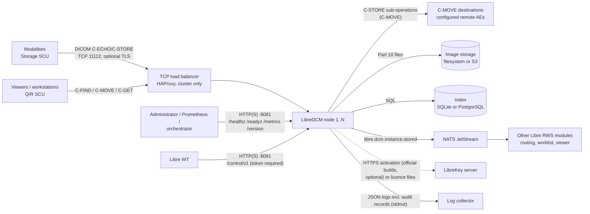
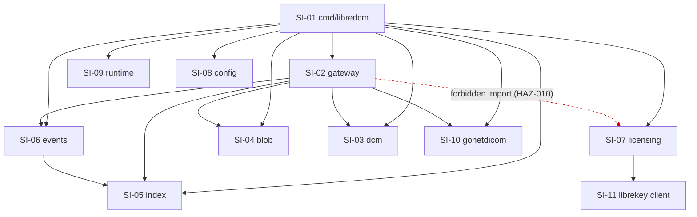
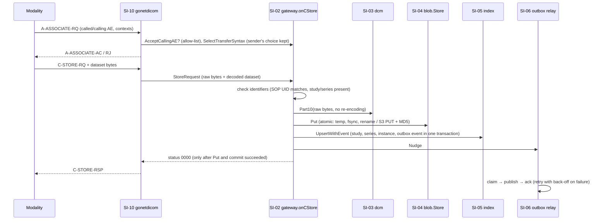

# LibreDCM software architecture

| | |
|---|---|
| Document | DHF-DCM-ARCH |
| Status | **DRAFT for approval** (written 2026-11-10 by Hermes/Claude, retrospectively, from the code at branch `qms/retro-dcm` and `docs/DEVELOPMENT.md`; checked against the import graph, see §10) |
| Software item | LibreDCM (software system), safety class B with class-C depth for the units named in §3.2 |
| Standards | IEC 62304 §5.3 (architectural design), FDA *Content of Premarket Submissions for Device Software Functions* (architecture diagram), FDA cybersecurity guidance (architecture views, see `cybersecurity.md`) |
| Related | `SRS.md` (requirements), `intended-use.md`, `risk-management.md`, `soup.md`, `design/` (detailed design), `docs/DEVELOPMENT.md` (developer guide) |

## 1. Scope

This document describes the software architecture of LibreDCM 0.2.x: its
software items, their interfaces, the data flows between them and with
external systems, the SOUP it relies on, and the deployment topologies. It
identifies which items implement risk controls and how they are segregated
(IEC 62304 §5.3.5). Detailed design of the class-C-depth units is in
`design/`.

## 2. System context

### 2.1 External interfaces

| ID | Interface | Peer | Protocol / format | Direction | Requirements |
|---|---|---|---|---|---|
| IF-01 | DICOM listener | Modalities, viewers, other PACS | DICOM UL/DIMSE (PS3.7, PS3.8), TCP, optional TLS ≥ 1.2 (PS3.15 B.1) | In | DCM-SRS-001…017, -043 |
| IF-02 | C-MOVE sender | Configured remote AEs | DICOM C-STORE SCU | Out | DCM-SRS-010, -011, -013 |
| IF-03 | Image storage | Filesystem path or S3 bucket | POSIX files (temp + fsync + rename) / S3 PUT with Content-MD5 | Out | DCM-SRS-005 |
| IF-04 | Index database | SQLite file or PostgreSQL server | SQL (`database/sql`) | Out | DCM-SRS-020, -021 |
| IF-05 | Event bus | NATS JetStream | JSON events, subjects `libre.dcm.>` (+ legacy `rws.dicom.>`) | Out | DCM-SRS-030, -031, -032 |
| IF-06 | Admin endpoint | Administrators, Prometheus, Docker/Kubernetes | HTTP or HTTPS, JSON and Prometheus text; bearer token | In | DCM-SRS-041, -042, -054, -057 |
| IF-07 | Logs and audit records | Log collector | Structured JSON (or text) on stdout; audit records carry `audit=true` and a PS3.15 A.5 event name | Out | DCM-SRS-040 |
| IF-08 | Configuration | Administrator | YAML file, environment variables, command-line flags, SIGHUP | In | DCM-SRS-016, -050, -051 |
| IF-09 | Licensing (official builds) | LibreKey server, licence files | HTTPS (online activation) or signed files (offline) | In/Out | DCM-SRS-058…061 |
| IF-10 | Workstation installer | Administrator | `LibreDCM.sh` / `LibreDCM.ps1`, `.env`, Docker Compose | In | DCM-SRS-056 |

## 3. Software items

### 3.1 Decomposition

LibreDCM is one Go binary (`LibreDCM`) built from the packages below. A
software item here is a Go package (or a forked module); software units are
the functions and types documented in `design/` for the class-C-depth items.

| ID | Item (package) | Responsibility | Own / SOUP | Main SOUP used |
|---|---|---|---|---|
| SI-01 | `modules/dicom/cmd/libredcm` | Entry point: flags, configuration loading, wiring of all items, administrative commands (`-echo`, `-gen-cert`, `-backup`, `-license-*`), SIGHUP reloader | Own | — |
| SI-02 | `modules/dicom/internal/gateway` | DIMSE services: association acceptance (called-AE check, calling-AE allow-list), transfer-syntax selection, C-STORE, C-FIND, C-MOVE, C-GET handlers, audit records, DIMSE metrics | Own | godicom |
| SI-03 | `modules/dicom/internal/dcm` | Part 10 wrapping without re-encoding, reading the dataset back, attribute extraction, transfer-syntax policy | Own | godicom |
| SI-04 | `modules/dicom/internal/blob` | Image storage contract (`blob.Store`) with filesystem and S3 implementations | Own | minio-go |
| SI-05 | `modules/dicom/internal/index` | Index contract (`index.Index`): schema and migrations, transactional upsert of patient/study/series/instance rows with the outbox event, queries, outbox claim/ack, SQLite backup | Own | modernc sqlite, pgx |
| SI-06 | `modules/dicom/internal/events` | Event publishers (none, log, NATS JetStream) and the outbox relay | Own | nats.go |
| SI-07 | `modules/dicom/internal/licensing` | Licence state, reminders, acknowledgement, licence metrics (official builds only; nil in source builds) | Own | LibreKey client (SI-11) |
| SI-08 | `platform/config` | YAML + environment-variable configuration loader with legacy names | Own | go.yaml.in/yaml/v3 |
| SI-09 | `platform/runtime` | Shared chassis: logging, admin endpoints, control-API registration (token required), readiness checks, component lifecycle and shutdown | Own | prometheus client, x/sync |
| SI-12 | `modules/dicom/internal/control` | REST control API for Libre WT: list, detail, plan and resolve patient-association conflicts (DCM-SRS-077) | Own | — |
| SI-10 | `third_party/gonetdicom` | DICOM upper layer, PDU and DIMSE codec, association state machine, SCP/SCU | **Own (fork of gonetdicom v0.17.0, MIT)**; verified as LibreDCM code, changes listed in `RWS_FORK.md` | godicom |
| SI-11 | `third_party/librekey` | LibreKey licence client (verification of signed licences, machine fingerprint, activation) | **Own (copy of the Libre Systems client, Apache-2.0)** | standard library |
| SI-12 | `deploy/` | Container image (`Dockerfile.dicom`), Compose files, HAProxy config, workstation installer scripts | Own | Docker, distroless base image, HAProxy, NATS, PostgreSQL images (SOUP at system level) |

### 3.2 Safety classification of items

The system is class B (`docs/qms/SDP.md` §2). The items that carry the main
risk controls get class-C depth of detailed design and unit verification
(decision D6, 2026-11-09):

| Risk-control area | Hazards | Items / units | Detailed design |
|---|---|---|---|
| Store path: no success status before the instance is durable and indexed | HAZ-001 | SI-02 `onCStore`, SI-03 `Part10`, SI-04 `FS.Put` / `S3.Put`, SI-05 `UpsertWithEvent`, SI-09 shutdown | `design/store-path.md` |
| Index and patient association | HAZ-002, HAZ-011 | SI-05 schema, upsert, `Find`; SI-02 `parseIdentifier`, `buildFilter`, `buildResponse` | `design/index-patient-association.md` |
| Pixel-data integrity | HAZ-003 | SI-03 `Part10`, `DatasetOffset`, `SelectStorageSyntax`; SI-02 `storeOne`, `selectSyntax`; SI-04 integrity checks | `design/pixel-data-integrity.md` |

All other items are class B: architecture, interfaces and verification at
item level.

## 4. Internal interfaces

Items talk through small Go interfaces, so storage, index and bus can be
swapped and tested with fakes.

| Interface | Defined in | Implemented by | Used by | Contract |
|---|---|---|---|---|
| `blob.Store` | SI-04 | `FS`, `S3` | SI-02, SI-01 (readiness) | `Put` is atomic (readers never see a partial object); `Get` returns `ErrNotFound` for missing keys; `Check` for readiness. Verified by a shared contract test on both backends (DCM-SRS-005) |
| `index.Index` | SI-05 | `SQL` (SQLite, PostgreSQL) | SI-02, SI-06, SI-01 | `UpsertWithEvent` stores instance rows and the outbox event atomically; `Find` returns identical results on both engines (shared conformance suite, DCM-SRS-020) |
| `events.Publisher` | SI-06 | none, log, NATS | SI-02 (direct mode), SI-06 relay | `Publish(subject, msgID, payload)`; message ID used for de-duplication |
| `events.Outbox` | SI-06 | `index.SQL` | SI-06 relay | claim with lease, ack, nack with retry time, pending count |
| `runtime.Component` | SI-09 | gateway, reloader, outbox relay, licensing | SI-09 | `Run(ctx)` blocks until `ctx` is cancelled |
| `ae.ServerConfig` callbacks | SI-10 | SI-02 | SI-10 | `AcceptCallingAE`, `SelectTransferSyntax`, `OnCStore`, `OnCFind`, `OnCMove`, `OnCGet` |
| `reloadTarget` | SI-01 | SI-02 | SI-01 reloader | `SetRemoteAEs`, `SetAllowedAEs` (live settings) |

### 4.1 Dependency rules (enforced or checked)

| Rule | Why | How it is enforced |
|---|---|---|
| The gateway (SI-02) must not import licensing (SI-07) or the LibreKey client (SI-11) | No licence state may refuse, delay or interrupt DICOM services (HAZ-010, DCM-SRS-058) | Architecture test `TestGatewayHasNoLicenseDependency` parses the gateway's imports in CI |
| `internal/` packages are private to the module | Keeps the module boundary stable for other Libre RWS modules | Go `internal` visibility rule (compiler) |
| Modules exchange data only through the event bus and DICOM, not through each other's code | Modularity (DEVELOPMENT.md §1) | Package layout; no cross-module imports exist (checked §10) |

## 5. Data flows

### 5.1 C-STORE (store path, HAZ-001/HAZ-003)

A failure at any step returns a failure status (A700 out of resources,
A900 or C000 for invalid data) and the modality keeps its copy. Re-sent
instances overwrite the same storage key and index row (idempotent; see
ANOM-002 for demographic conflicts).

### 5.2 C-FIND

Identifier → `parseIdentifier` (level and information model check, supported
keys only, universal matching skipped) → filters with bound parameters →
`index.Find` (row cap `find_limit`) → `buildResponse` (exactly the requested
keys; ISO_IR 192 when non-ASCII text is returned) → Pending responses, then
Success. Column names come only from a fixed table; values are always bound
SQL parameters (no SQL built from peer input).

### 5.3 C-MOVE and C-GET

C-MOVE: destination looked up in the configured table (unknown → A801,
nothing sent) → identifier resolved to instances (a unique key is required;
"retrieve everything" is refused) → instances grouped by stored transfer
syntax → one association per group proposing exactly the stored syntax →
each instance read from storage and sent byte for byte (native data
re-encoded only between Explicit and Implicit VR LE) → one final response
with completed/failed/warning counts and the failed UID list; audit record.

C-GET: same resolution; only natively encoded instances, buffered up to
`get_max_bytes`, are sent on the requestor's association (gonetdicom v0.17
limitation, DEVELOPMENT.md §7).

### 5.4 Events (outbox)

With an events driver configured, the event row is committed with the
instance (§5.1). The relay publishes due events in batches, deletes each one
after the bus acknowledges it, and on failure reschedules it with back-off
(1 s doubling to 5 min). Claims are leased for 30 s so several nodes can
drain one PostgreSQL outbox. Delivery is at least once; JetStream
de-duplicates on the message ID within 10 minutes.

### 5.5 Administration

- **Startup:** load configuration → open storage, index (migrations under a
  PostgreSQL advisory lock), publisher → register readiness checks → start
  components (gateway, reloader, relay, licensing) and the admin server.
- **SIGHUP:** reload remote AEs and allow-list; a load error keeps the running
  settings; reload is refused while an unlicensed node is unacknowledged
  (official builds).
- **SIGTERM/SIGINT:** the listener and open associations close; components
  stop; the admin server shuts down within `shutdown_timeout`. In-flight
  stores are aborted without a success status (ANOM-005).
- **Backup:** `-backup PATH` snapshots the SQLite index with `VACUUM INTO`
  while the node runs.

## 6. SOUP items

The full list with evaluation is `soup.md` (generated from `go.mod` and the
SBOM). Architecture-relevant SOUP and what LibreDCM requires of it
(IEC 62304 §5.3.3, §5.3.4):

| SOUP | Used by | Functional / performance requirements LibreDCM relies on | System hardware/software needed |
|---|---|---|---|
| Go runtime and standard library 1.26.x (≥ 1.26.10) | all | Correct TCP/TLS (crypto/tls, TLS ≥ 1.2), file I/O incl. `fsync`, `database/sql`, `net/http`, concurrency | Linux, Windows or macOS; amd64/arm64 |
| godicom v0.30.0 | SI-02, SI-03, SI-10 | Decodes and encodes datasets in Implicit/Explicit VR LE without losing attributes; reads Part 10 files; does not alter pixel data it does not decode | — |
| modernc.org/sqlite v1.60.1 | SI-05 | Transactions are atomic; WAL mode; `VACUUM INTO` for backup; one writer | Local disk |
| pgx v5.11.0 | SI-05 | Transactions, advisory locks, connection pooling | PostgreSQL 16 (tested) |
| minio-go v7.4.1 | SI-04 | S3 PUT with Content-MD5, GET, DELETE, bucket check | S3-compatible store |
| nats.go v1.54.0 | SI-06 | JetStream publish with message-ID de-duplication, stream creation | NATS 2.11 with JetStream |
| prometheus client_golang v1.24.1 | SI-02, SI-06, SI-07, SI-09 | Counters, gauges, histograms, text exposition | — |
| golang.org/x/sync v0.23.0 | SI-09 | errgroup | — |
| go.yaml.in/yaml/v3 v3.0.5 | SI-08 | YAML decoding into structs | — (replaced the archived gopkg.in/yaml.v3 on 2026-11-10) |
| distroless base image (Debian 12, pinned by digest) | SI-12 | glibc loader for the dynamically linked binary (purego codecs), non-root user, CA certificates | Docker or OCI runtime |

## 7. Deployment topologies

| Topology | Index | Storage | Bus | Nodes | Notes |
|---|---|---|---|---|---|
| Workstation (`deploy/workstation`) | SQLite in a Docker volume | Docker volume, host folder or S3 | none (log) | 1 | Installer asks AE title, storage, TLS, patient-ID options; admin port bound to 127.0.0.1 |
| Single container (`deploy/compose/docker-compose.yml`) | SQLite | local volume | NATS | 1 | |
| HA cluster (`deploy/compose/docker-compose.cluster.yml`) | PostgreSQL | shared volume or S3 | NATS JetStream | N behind HAProxy (`leastconn`, health = `/readyz`) | Any node serves any instance (DCM-SRS-055) |
| Bare metal / VM | SQLite or PostgreSQL | filesystem or S3 | optional | 1..N | `bin/LibreDCM -config …` |

Upgrades are rolling in a cluster (stop one node, replace, repeat); the
workstation installer backs up the index before upgrading.

## 8. Segregation and risk controls in the architecture (IEC 62304 §5.3.5)

| Risk control | Architectural measure |
|---|---|
| Licensing can never affect DICOM (HAZ-010) | SI-07 is wired only to the reloader and `/version`; SI-02 has no import path to it (architecture test). In source builds SI-07 is nil |
| Durable before acknowledged (HAZ-001) | Ordering inside one handler: storage write → index commit → success status. No asynchronous acknowledgement path exists |
| Event loss (HAZ-006) | Outbox row in the same transaction as the instance; the relay is a separate component that can fail without affecting stores |
| Wrong destination (HAZ-005) | Destinations only from the configured table, held behind a mutex and replaced atomically on reload |
| Unauthorised peers (HAZ-007) | Calling-AE check happens in the association acceptor (SI-10 callback) before any DIMSE handler runs; fails closed on an invalid list |
| SQL injection via query keys | Column names from a fixed table in SI-02; values always bound parameters in SI-05 |

Segregation is logical (packages, interfaces, compile-time import rules)
inside one process. There is no process-level segregation; a crash of the
process stops all items, which the cluster topology and modality-side
retention cover (HAZ-004).

## 9. Concurrency and resources

- One goroutine per association; `max_associations` (default 64) limits
  concurrency; extra associations are rejected by the acceptor.
- PDU size `max_pdu_length` (default 128 KiB); handshake and idle timeouts.
- SQLite: one connection (single writer); PostgreSQL: pool of 20.
- C-MOVE streams one instance at a time; C-GET buffers up to
  `get_max_bytes` (default 1 GiB).
- Configuration that can change at run time (remote AEs, allow-list) is
  guarded by a read/write mutex.

## 10. Verification of this architecture (IEC 62304 §5.3.6)

Done 2026-11-10 on `qms/retro-dcm`:

1. **Import graph matches §3/§4.1.** `go list -f '{{.ImportPath}}: {{.Imports}}' ./...`
   was run and compared with the dependency diagram: every edge in the
   diagram exists, and the only edges not drawn are to the standard library
   and SOUP listed in §6. The gateway has no edge to licensing or LibreKey
   (also enforced by `TestGatewayHasNoLicenseDependency`).
2. **Interfaces exist as described.** `blob.Store`, `index.Index`,
   `events.Publisher`, `events.Outbox`, `runtime.Component` and the
   `ae.ServerConfig` callbacks were checked in the source.
3. **Requirements are allocated.** Every external interface in §2.1 names
   the SRS requirements it realises; risk-control requirements map to the
   items in §3.2 and §8.
4. **Supports the requirements.** The store ordering (§5.1) and the
   shutdown behaviour were exercised by `TestEndToEnd` and
   `TestGracefulShutdown`; the outbox by `TestRelaySurvivesBusOutage`.

Findings while writing: `soup.md` still describes the LibreKey client risk
as "C-STORE refused" (changed by issue #5) and points to `deploy/Dockerfile`
(now `deploy/docker/Dockerfile.dicom`); README says S3 is "planned" and
names `LIBRE_DCM_FORK.md` (the file is `RWS_FORK.md`). Recorded for the SRS
and documentation review.
