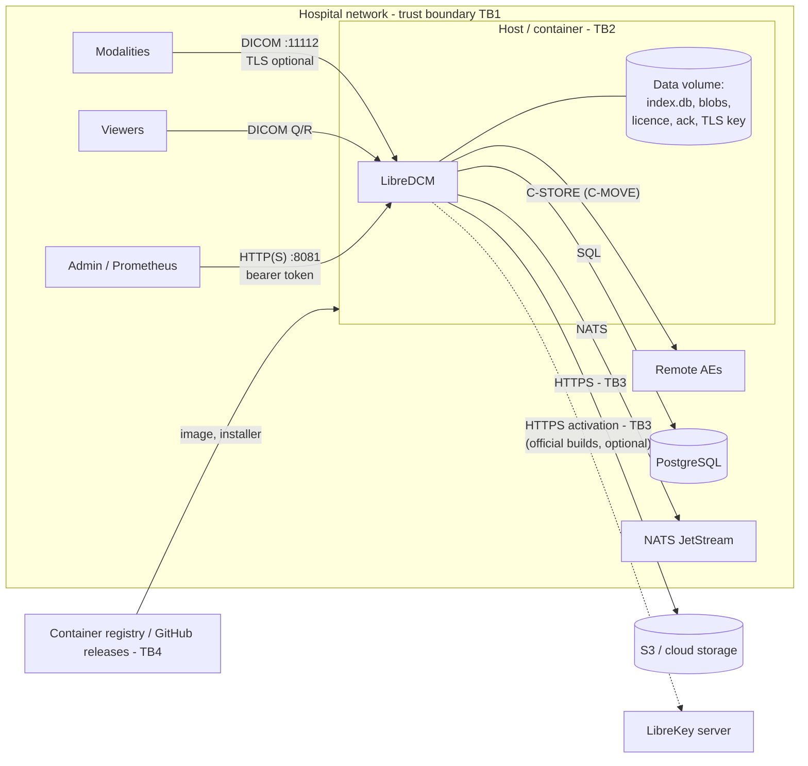

# LibreDCM cybersecurity file

| | |
|---|---|
| Document | DHF-DCM-SEC |
| Status | **DRAFT for approval** (threat model and architecture views completed 2026-11-10 by Hermes/Claude; seed of 2026-11-09 in Git history) |
| Basis | FD&C Act §524B (cyber device); FDA *Cybersecurity in Medical Devices: QMS Considerations and Content of Premarket Submissions* (Feb 2026); IEC 81001-5-1 (13-122); ANSI/AAMI SW96 (13-131); IHE ITI ATNA |
| Related | `architecture.md`, `risk-management.md` (security risks transferred as HAZ-007, -009, -012), QMS-SOP-003 §6.3 (exploitability scale), QMS-SOP-010 (vulnerability management, when approved) |

## 1. Why this applies

As part of the Libre RWS PACS, LibreDCM is software that connects to
networks, can reach the internet (S3, LibreKey activation, remote peers) and
could be vulnerable, so it meets the §524B "cyber device" definition. A 510(k)
must include a postmarket vulnerability plan with coordinated disclosure
(`SECURITY.md`), secure development and patching processes (`docs/qms/SDP.md`)
and an SBOM (`generated/sbom.cdx.json`).

## 2. Security architecture views

### 2.1 Global system view and trust boundaries

| Boundary | What crosses it | Main threats |
|---|---|---|
| TB1 hospital network ↔ LibreDCM | DICOM associations, admin HTTP | Spoofing peers, eavesdropping, malformed input, DoS |
| TB2 host ↔ container/data volume | Files: index, images, licence, acknowledgement, TLS key, admin token | Local tampering, theft of data at rest, ransomware |
| TB3 LibreDCM ↔ internet services | S3 objects, licence activation | Credential theft, MITM, provider outage |
| TB4 supply chain ↔ host | Container images, installer scripts, updates | Tampered images or scripts |

### 2.2 Multi-patient harm view

LibreDCM holds the images of **all** patients of a site, so a single
compromise can affect many patients at once:

| Path to multi-patient harm | Effect | Controls | Gaps |
|---|---|---|---|
| Archive unavailable (ransomware on the host, DoS, storage loss) | Delayed care for every patient whose priors or new studies are needed | Backup command, cluster topology, association limits/timeouts, fuzz-hardened parsers, modalities keep queues | No documented restore test; no immutable/offline backup guidance; no rate limiting |
| Bulk exfiltration of studies (spoofed viewer AE, open admin endpoint, stolen data volume) | Privacy harm to many patients | Allow-list (AE@IP/CIDR), TLS, admin token, audit records of every export | No mutual TLS; AE@IP spoofable on a flat network; no encryption at rest in LibreDCM itself (relies on the storage/OS) |
| Bulk integrity attack (injected or altered images, index tampering) | Wrong-patient or altered images for many patients | Allow-list, audit; compressed data byte-identical; S3 Content-MD5 on upload | No per-object checksum verified on retrieve; index not integrity-protected; ANOM-002 (silent reassignment) |
| Misconfiguration pushed to all nodes (cluster) | Wrong destinations, open access | Reload validation, fail-closed allow-list, empty-env rule | No signed/validated configuration distribution |

### 2.3 Updatability / patchability view

| Item | How it is updated | Who | Time to patch target |
|---|---|---|---|
| LibreDCM binary/image (incl. Go runtime and Go SOUP) | New release image; workstation `LibreDCM.sh/.ps1 upgrade` (backs up the index first, keeps data); cluster rolling restart | Customer admin, from Libre Systems release | Critical/high: 30 days (SECURITY.md draft) |
| Base image OS packages (distroless) | New release with updated pinned digest | Libre Systems | Same |
| Customer-run infrastructure (PostgreSQL, NATS, HAProxy, Docker, host OS) | Customer's own patching | Customer | Customer policy; documented in security notes |
| Configuration | YAML/env + SIGHUP or restart | Customer admin | — |

Releases are announced in GitHub releases with security notes; there is no
automatic update channel (by design: hospitals control change). Gap:
releases and images are not yet signed (TM-10).

### 2.4 Security use-case views

| Use case | Actors | Security-relevant flow |
|---|---|---|
| SUC-1 Modality stores a study | Modality, LibreDCM | (TLS handshake) → called-AE check → calling-AE allow-list → C-STORE → durable write → audit `DICOMInstancesTransferred.received` |
| SUC-2 Viewer queries and retrieves | Viewer, LibreDCM, destination | Allow-list → C-FIND (bound SQL parameters) → audit `Query` → C-MOVE only to a configured destination → audit `DICOMInstancesTransferred.exported` with destination and patient IDs |
| SUC-3 Administrator monitors and reloads | Admin | HTTPS + bearer token for `/metrics`, `/version`; SIGHUP reload with validation; licence acknowledgement audited |
| SUC-4 Install / upgrade | Admin, registry | Installer asks TLS and patient-ID options, generates the admin token, verifies health, admin port bound to 127.0.0.1; upgrade backs up the index |
| SUC-5 Licence activation (official builds) | Admin, LibreKey | Ed25519-signed licence verified offline; online activation over HTTPS; licence state never affects DICOM |

## 3. Threat model (STRIDE) with risk and traceability

Exploitability (E): H high, M medium, L low, VL very low (QMS-SOP-003 §6.3;
mapped to P4/P3/P2/P1). Severity per QMS-SOP-003 §6.1. Status: **C**
controlled, **P** partly controlled, **O** open.

| ID | STRIDE | Threat | Asset | E | S | Controls in place (requirement / mechanism) | Verification | Status | Planned / gap | Risk file |
|---|---|---|---|---|---|---|---|---|---|---|
| TM-01 | S | Spoofed modality AE injects wrong-patient images | Integrity of the archive | M | S4 | Called-AE check (DCM-SRS-014); allow-list AE@IP/CIDR, fails closed (-015); audit (-040) | `TestWrongCalledAERejected`, `TestAllowListEndToEnd`, `TestAuditRecords` | P | Mutual TLS (DCM-SRS-044); per-peer permissions | HAZ-007 |
| TM-02 | S/I | Spoofed viewer AE pulls studies | PHI | M | S4 | Allow-list; C-MOVE only to configured destinations (-011, -013); export audit | `TestEndToEnd` (A801), `TestParseRemoteAEs`, `TestAuditRecords` | P | Mutual TLS; per-peer retrieve permission | HAZ-007, HAZ-009 |
| TM-03 | I | Eavesdropping on DICOM traffic | PHI | M | S4 | DICOM TLS ≥ 1.2 when configured (-043); installer offers self-signed or own certificate | `TestDICOMListenerTLSOnly` | P | TLS on by default; TLS on C-MOVE outbound associations (not supported today) | HAZ-009 |
| TM-04 | T | Tampering with stored objects or the index on the data volume | Image integrity | L | S4 | Host/volume access control (customer); S3 Content-MD5 on upload (-005) | `TestStoreContract` | P | Store a checksum per object and verify on retrieve; immutable storage option | HAZ-003 |
| TM-05 | R | Accesses not traceable / audit records altered | Accountability | M | S2 | Structured audit records for store, query, export, rejection, licence acknowledgement (-040, -061) | `TestAuditRecords`, licensing tests | P | ATNA syslog over TLS (-045), NTP guidance, forwarding to a protected collector | HAZ-008 |
| TM-06 | I | Disclosure via admin API, readiness details or logs | PHI, configuration | M | S3 | Bearer token for `/metrics`, `/version`; `/readyz` hides details; token file fails closed (-041); HTTPS (-042); patient-ID omission (-032); admin bound to 127.0.0.1 by the workstation installer | `TestAdminToken*`, `TestOmitPatientID`, `TestGenCert` | P | User accounts/RBAC (Libre WT); log redaction review | HAZ-009 |
| TM-07 | D | Association floods, slow peers, huge objects | Availability | H | S3 | `max_associations`, handshake and idle timeouts, PDU limit, streaming C-MOVE, `get_max_bytes` | gonetdicom limit tests; `TestGracefulShutdown` | P | Per-peer rate limits; object size limit; free-disk alerting | HAZ-004 |
| TM-08 | D/T | Malformed DICOM or identifiers crash the parser, exhaust memory or corrupt output | Availability, integrity | H | S3 | Bounds-checked decoders (uint64 length checks); Part 10 guard (-018); fuzzing in CI (seed corpora) and before release | Fuzz targets (§7), `TestPart10RefusesUnencodableMeta` | C | Keep fuzzing; add more targets as code grows | HAZ-004, HAZ-003 |
| TM-09 | E/T | Known vulnerability in a dependency or the Go runtime exploited | All | M | S4 | govulncheck in CI; Trivy image scan of OS packages (blocking, justified exceptions expire); SBOM; pinned versions; gosec (blocking); quarterly review | CI `verify` and `image-scan` jobs; tool validation (positive controls) | C | Weekly scheduled scans | HAZ-012 |
| TM-10 | T | Tampered image, installer or release (supply chain) | All | L | S4 | Base images pinned by digest; release checksums (SHA256SUMS) on GitHub releases; protected tags | Release record | P | Signed tags and images (cosign/SSH), provenance (card) | HAZ-012 |
| TM-11 | D | Ransomware encrypts the host and archive | Availability | M | S3 | `-backup` (index snapshot while running); S3 option with versioning | `TestBackupWhileWriting` | P | Documented, tested restore; immutable/offline backup guidance | HAZ-001, HAZ-004 |
| TM-12 | E | Injection through query keys (SQL) | Index integrity, PHI | L | S4 | Column names from a fixed table; values always bound parameters | `TestConformance`, C-FIND fuzzers (no query error for any parsed identifier) | C | — | HAZ-002 |
| TM-13 | T | Path traversal through storage keys | Host files | L | S3 | Keys built from UIDs; `FS.path` rejects `..` and anchors under the root; S3 key check | `TestStoreContract` | C | — | HAZ-003 |
| TM-14 | S/T | Stolen or guessed admin token | Configuration, metrics | M | S2 | Token generated by the installer; constant-time compare; token file option | `TestAdminToken*` | P | Rotation guidance; per-user auth (Libre WT) | HAZ-009 |
| TM-15 | T | Forged licence acknowledgement or licence file | Licence enforcement only | M | S1 | Signed licences (Ed25519); acknowledgement audited; licensing cannot affect DICOM (-058) | Licensing tests, `TestGatewayHasNoLicenseDependency` | C | — (commercial, not safety) | HAZ-010 |
| TM-16 | I/T | Credentials for S3, PostgreSQL or NATS exposed in config or environment | Data at rest/in transit | M | S4 | Env/file configuration; admin token file option | — | O | Secrets-file support for all credentials; TLS guidance for PostgreSQL/NATS | HAZ-009 |
| TM-17 | T | Peer sends instances whose Patient ID conflicts with an existing study (deliberate or accidental) | Patient association | M | S4 | None (ANOM-002) | — | O | Conflict detection, audit, alert | HAZ-013 |

All threats with possible patient harm are carried into `risk-management.md`
(HAZ-003, -004, -007, -008, -009, -012, -013); the security risk is evaluated
there with the common matrix.

## 4. FDA security control categories (Appendix 1 of the 2026 guidance)

| Category | LibreDCM today | Gap |
|---|---|---|
| Authentication | Peer: called/calling AE titles and IP/CIDR; admin: bearer token | No cryptographic peer authentication (mTLS); no individual admin accounts |
| Authorization | Destination table for C-MOVE; allow-list | No per-peer permissions (store vs. query vs. retrieve) |
| Cryptography | TLS ≥ 1.2 for DICOM and admin (Go crypto/tls); Ed25519 licences; S3 over HTTPS | TLS optional; outbound C-MOVE without TLS; no encryption at rest in LibreDCM |
| Code, data and execution integrity | Memory-safe language; pinned digests; protected tags; byte-identical storage; Part 10 guard | Unsigned images/tags; no per-object checksum on retrieve |
| Confidentiality | TLS; patient-ID omission in events/audit; admin token; no PHI in the repository | Encryption at rest is delegated to the platform (must be documented for customers) |
| Event detection and logging | Structured audit records (PS3.15 A.5 names); metrics; rejected associations counted | No ATNA syslog/TLS; no alert rules shipped |
| Resiliency and recovery | Cluster topology; outbox; graceful shutdown never acknowledges unstored data; backup command | No tested restore procedure; durability gaps ANOM-003/004 |
| Firmware/software updates | Versioned releases with SBOM and checksums; upgrade command with index backup | No signed releases; no update notification channel beyond GitHub releases |

## 5. Baseline scan results (2026-11-09, branch `qms/foundation`)

`govulncheck` v1.9.0 against `./...` with Go 1.26.9:

| Finding | Component | Reachable from LibreDCM code? | Fix |
|---|---|---|---|
| GO-2026-6809 (crypto/x509: distrust compromised intermediate certificates) | Go standard library 1.26.9 | **Yes** (trace via blob storage I/O) | Build with Go **1.26.10** or later (done in 0.2.0-beta.1) |
| GO-2026-6866, GO-2026-6860 | golang.org/x/net v0.60.0 | No (module required, vulnerable code not called) | Upgrade to v0.62.0 |
| GO-2026-6865 | github.com/klauspost/compress v1.20.0 | No | Upgrade to v1.20.2 |
| GO-2026-5932 | golang.org/x/crypto v0.57.0 | No | Upgrade when a tagged release containing the fix exists |

SBOM: CycloneDX 1.x, 49 components, `generated/sbom.cdx.json` (cyclonedx-gomod v1.12.0). One component without a detected licence: `github.com/tinylib/msgp` v1.6.4 (check by hand).

## 5a. Container image scan (Trivy 0.76.2, added 2026-11-10)

CI job `image-scan` builds the release image and scans it. OS packages with a
fixed HIGH/CRITICAL vulnerability **block** the build unless justified in
`.trivyignore.yaml`, where every entry has a reason and an expiry date. Go
libraries in the binary are reported only: govulncheck (with reachability)
is the gate for them.

First scan, 2026-11-10 (`gcr.io/distroless/base-debian12:nonroot` digest
`7f0c72cd…`, also the newest published build that day):

| Finding | Verdict |
|---|---|
| CVE-2026-84782, libssl3 3.0.20 (HIGH, fixed in 3.0.22) | Not reachable: the binary does not load libssl (checked: it references only libc, libdl, libm, libpthread, libgcc_s, libstdc++ and the codec libraries), and the flaw is in DTLS. Accepted until 2026-12-15 or the next base-image update |
| 40 OS findings below HIGH | Report only (CI artifact) |
| Go binary: GO-2026-5932 (x/crypto openpgp), CVE-2026-78661 / -97045 (x/net/html) | Same as govulncheck §5: modules required but vulnerable code not called; upgrades planned |

Checks: without the ignore entry, and with an expired entry, the blocking
step fails (rc 1); with it, rc 0.

## 6. Static analysis (SAST), gosec v2.30.0 (added 2026-11-10)

CI runs gosec on every pull request. Libre RWS code (`modules/`, `platform/`)
is **blocking**: the build fails on any finding that is neither fixed nor
annotated `#nosec <rule> -- <reason>`. `third_party/` is scanned
report-only and the report is kept as a CI artifact.

Baseline run on branch `qms/retro-dcm` (2026-11-10), Libre RWS code, 24
files: 15 findings, all triaged below; result after triage 0 open, 13
annotated.

| Rule | Where | Verdict | Action |
|---|---|---|---|
| G115 int→uint16/uint32 | `dcm.Part10` / `writeMeta` | **Real defect (latent).** A File Meta value over 65,535 bytes would wrap the 16-bit length and produce an unreadable file. Not reachable through the filesystem store today (the file name would exceed the OS limit first, so the store fails), but reachable in principle with S3 keys or future callers | Fixed: Part10 refuses values that cannot be encoded (DCM-SRS-018, ANOM-001); remaining conversions annotated as bounded |
| G115 int→uint16 | `retrieve.go` `clamp16` | False positive: value clamped to 65,535 the line before | Annotated |
| G402 InsecureSkipVerify | `-echo` (TLS) and `-healthcheck` | Accepted: reachability check of an often self-signed install, and the container probe of its own loopback port. Neither carries data or makes a trust decision | Annotated |
| G304 file path from variable | config loader, licence ack, licence install, `blob.FS.Get` | Accepted: paths come from the administrator (flags, configuration). Blob keys pass `FS.path`, which rejects `..` and anchors under the root | Annotated |
| G301/G306 0755/0644 | licence acknowledgement file, `-gen-cert` certificate | Accepted: the acknowledgement holds a name, time and state; the certificate is public (its key is written 0600) | Annotated |
| G104 unhandled error | `index.backfillFold` `rows.Close()` | Cosmetic | Fixed (`_ =`) |

`third_party/gonetdicom` (fork, a LibreDCM software item) 22 findings:

| Rule | Count | Verdict |
|---|---|---|
| G115 decode side (`pdu/pdata.go`, `dimse/command.go`, uint64→int) | 4 | False positive: lengths are compared in uint64 against the buffer length before conversion (comments in the code explain why); fuzz targets cover these paths (§7) |
| G115 encode side (PDU/command/associate lengths, int→uint16/uint32) | 14 | Bounded: values are built locally and limited by the negotiated PDU size or by configuration (UIDs, AE titles, user identity). Track: add explicit length checks when the fork is next changed |
| G115 message ID (`ae/assoc.go`, uint32→uint16) | 1 | Intended wrap-around of the DIMSE message ID counter (zero skipped) |
| G118 goroutine with context.Background | 1 | N-EVENT-REPORT on a new association (`scp.go`); not used by LibreDCM |
| G705 XSS taint (`dicomweb/server.go`) | 3 | Not compiled into LibreDCM (the DICOMweb package is not imported) |

`third_party/librekey` (client copy) 7 findings: G204 subprocess with
variable arguments in `fingerprint` (fixed command names, arguments are not
user input), G304/G301/G306 for the licence and activation files (paths
from configuration; licence files are signed and not secret). Accepted; to
be annotated in the LibreKey repository and re-synced.

## 7. Fuzzing (Go native fuzzing, added 2026-11-10)

**Targets** (each is also a normal test: `go test` replays its seed corpus
and every saved failing input on every CI run):

| Target | Package | Untrusted input | Oracle (what must always hold) |
|---|---|---|---|
| `FuzzPart10RoundTrip` | `dcm` | Identifiers and dataset bytes from a C-STORE | `Part10` refuses or writes a file whose dataset bytes read back unchanged, whose File Meta parses, and which carries the identifier as given |
| `FuzzDatasetOffset` | `dcm` | Stored object bytes (C-MOVE/C-GET read path) | No panic; any returned offset lies inside the file |
| `FuzzDecodeAndExtract` | `dcm` | Dataset bytes in either native transfer syntax | Decoding (godicom, SOUP) and identifier extraction never panic or hang |
| `FuzzCFindKeys` | `gateway` | Structured C-FIND key values | Final status Success; no SQL failure; every response encodable |
| `FuzzCFindIdentifierBytes` | `gateway` | Raw C-FIND identifier bytes (Implicit VR LE) | As above, in the request's transfer syntax |
| `FuzzRead`, `FuzzDecodePDataTF` | gonetdicom `pdu` | Raw PDUs and P-DATA-TF items from the network | No panic or hang; no decoded PDU whose fields contradict its bytes |
| `FuzzDecodeElements`, `FuzzCommandDecoders` | gonetdicom `dimse` | DIMSE command sets (any Command Field with any body) | No panic; every decoder reachable by a peer handles any input |

**How it runs:** `scripts/qms/fuzz.sh <time>` runs every target;
`.github/workflows/fuzz.yml` runs it weekly (5 min per target), on demand and
before a release, and keeps the log and any failing inputs as artifacts.

**Record run, 2026-11-10** (`golang:1.26-bookworm`, go1.26.10, 24 workers, 2 min
per target, branch `qms/retro-dcm`):

| Target | Executions | Result |
|---|---|---|
| FuzzPart10RoundTrip | 82,542,217 | Pass (after oracle fix, see below) |
| FuzzDatasetOffset | 126,516,998 | Pass |
| FuzzDecodeAndExtract | 91,528,098 | Pass |
| FuzzCFindKeys | 2,603,160 | Pass |
| FuzzCFindIdentifierBytes | 14,258,510 | Pass |
| FuzzRead | 177,399,885 | Pass |
| FuzzDecodePDataTF | 208,226,686 | Pass |
| FuzzDecodeElements | 180,127,761 | Pass |
| FuzzCommandDecoders | 101,604,475 | Pass |

Earlier runs the same day (3 min and 2 min per target) found:

| Finding | Kind | Resolution |
|---|---|---|
| A C-FIND identifier with a group 0000/0002 element made the response unencodable and dropped the association | **Product defect** (ANOM-008) | Fixed in `gateway/query.go`; crasher kept as a regression seed; removing the fix makes it fail again |
| A C-FIND identifier with a retired (7F30,0010) "OB or OW" element failed to encode in Explicit VR | Test-harness error: the harness encoded the response in Explicit VR although the request arrived in Implicit VR; LibreDCM answers in the request's presentation context (`gonetdicom/ae/find.go`) | Harness fixed to use the request's syntax; input kept as a seed |
| Identifiers with leading spaces, NUL or CR compared unequal after read-back | Test-oracle error: the parser trims padding and whitespace when it returns strings | Oracle now compares raw bytes; mutation check: writing a changed identifier makes the target fail |

`FuzzPart10RoundTrip` and the two C-FIND targets are tagged `Verifies:
DCM-SRS-004, -006, -018` in the trace matrix. They support the risk controls for HAZ-003 and HAZ-004 (TM-08).

## 8. Still required before a 510(k)

Independent penetration test; mutual TLS and per-peer permissions; ATNA
audit transport; signed releases and images; customer security documentation and MDS2 form; documented restore
and immutable-backup guidance; secrets handling for S3/PostgreSQL/NATS
credentials; patch and end-of-support policy; postmarket metrics (time to
patch).
