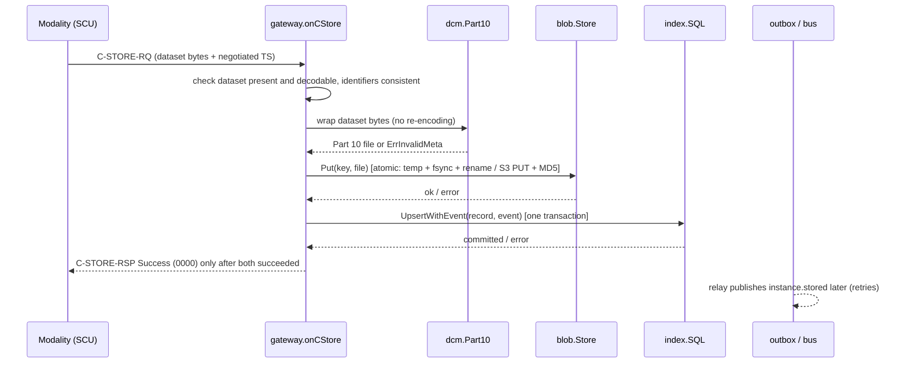

# LibreDCM detailed design (class-C depth units)

| | |
|---|---|
| Document | DHF-DCM-DD |
| Status | **DRAFT for approval** (retrospective, written 2026-11-10 by Hermes/Claude from the code on branch `qms/retro-dcm`) |
| Basis | IEC 62304 §5.4.2–§5.4.4 (detailed design), §5.5.3–§5.5.5 (unit acceptance criteria and verification); decision D6 in the compliance plan: LibreDCM is class B, with **class-C depth** for the units whose failure can directly cause the highest-severity hazards |
| Related | `architecture.md` (software items, interfaces), `SRS.md`, `risk-management.md` (HAZ-001, -002, -003, -013), `anomalies.md`, `cybersecurity.md` |

## 1. Scope: which units get class-C depth and why

| Unit (package · function) | Why class-C depth | Hazards |
|---|---|---|
| Store path: `gateway.onCStore`, `dcm.Part10`, `blob.FS.Put` / `blob.S3.Put` | A wrong success status, or a changed dataset, means a lost or altered image with the modality already having deleted its copy | HAZ-001, HAZ-003 |
| Index and patient association: `index.SQL.UpsertWithEvent`, `index.SQL.Find` (patient/study levels) | Wrong patient association or missing studies leads to wrong or missed comparison | HAZ-002, HAZ-013 |
| Pixel-data path on retrieve: `gateway.readDataset`, `dcm.DatasetOffset`, `gateway.sendChunk` / `storeOne`, `gateway.onCGet` | Altered pixel data shown in the viewer | HAZ-003 |

All other units are documented at architecture level (class B), per D6.

## 2. Store path

### 2.1 Sequence and ordering invariant

**Invariant (DCM-SRS-003):** the image is durable in storage before it is
visible to queries, and visible to queries before any event is published.
A success status is sent only when the storage write **and** the index
transaction have both succeeded.

### 2.2 Inputs, checks and outcomes

| Condition | Response status | Side effects |
|---|---|---|
| No dataset bytes or no transfer syntax | 0xC000-range *Cannot understand* (`CannotUnderstand`) | None |
| Dataset cannot be decoded by godicom | *Cannot understand* | None |
| SOP Instance UID in the dataset differs from the command's Affected SOP Instance UID, or Study/Series UID missing | 0xA900 *Data set does not match SOP class* | None |
| `dcm.Part10` refuses identifiers that cannot be encoded (empty, > 65,534 bytes) | 0xA700 *Out of resources* | None (ANOM-001) |
| Storage write fails (disk full, permission, S3 error, context cancelled) | 0xA700 | Temp file removed; nothing indexed |
| Index transaction fails | 0xA700 | **Orphan file** in storage (not visible to queries; storage use only). Sender retries |
| Event JSON cannot be built (outbox mode) | 0xA700 | Orphan file as above |
| All succeeded | 0x0000 *Success* | Audit record `DICOMInstancesTransferred.received`; metrics |

Missing SOP Class/Instance UIDs in the dataset are taken from the command
(they are mandatory in the command). The dataset is never modified.

### 2.3 Storage key and duplicates

- Key `StudyUID/SeriesUID/SOPInstanceUID.dcm`. `blob.FS.path` rejects keys
  containing `..` and anchors them under the root (TM-13).
- **Resend of the same SOP Instance UID** (common after a timeout at the
  modality): the file is replaced atomically and the index row updated
  (last write wins). The instance is never duplicated.
- If the same SOP Instance UID arrives with a different Study/Series UID, the
  key differs: the index points to the new file and the old file becomes an
  orphan. See ANOM-009 for the related series case.

### 2.4 Durability

| Backend | Mechanism | Known gap |
|---|---|---|
| Filesystem | Write to `.incoming-*` temp file in the target directory → `fsync` file → close → `rename` onto the key (atomic on POSIX; readers never see a partial file) | Directory not fsynced after rename (ANOM-003) |
| S3 | Single `PutObject` with `Content-MD5`; the store rejects a body that does not match | Depends on the provider's durability (documented for customers) |
| Index (SQLite) | One transaction; WAL, `synchronous=NORMAL`, busy timeout 10 s, one connection (single writer) | Committed transaction can roll back on power loss (ANOM-004) |
| Index (PostgreSQL) | One transaction; server durability settings | None known |

### 2.5 Concurrency

Each association is served on its own goroutine; C-STOREs on different
associations run in parallel. SQLite writes are serialised by
`SetMaxOpenConns(1)`; PostgreSQL uses up to 20 connections and row-level
upserts. Two concurrent stores of the **same** SOP Instance UID end with one
file and one index row (rename and upsert are both atomic; the later one
wins). This follows from the design; no dedicated test exists (the suite
runs under the race detector, which checks memory races, not this case).

### 2.6 Unit acceptance criteria (IEC 62304 §5.5.3) and verification

| Criterion | Verified by |
|---|---|
| Success only after durable storage and index commit; any failure gives a failure status | `TestStoreFailureNeverAcknowledged` (fake storage and index that fail), mutation check (returning Success on storage failure makes it fail) |
| Dataset bytes stored unchanged for any input; File Meta always readable | `TestPart10RoundTrip`, `FuzzPart10RoundTrip` (fuzzing record in `cybersecurity.md` §7) |
| Unencodable identifiers refused, nothing written | `TestPart10RefusesUnencodableMeta` |
| Mismatched or missing identifiers refused | `TestEndToEnd`, gateway store tests |
| Atomic write, no partial files, backends behave the same | `TestStoreContract` (filesystem and S3) |
| Index and event committed together | `TestOutboxLifecycle`, `TestOutboxConcurrentClaims` |
| Graceful shutdown never acknowledges unstored data | `TestGracefulShutdown` |

## 3. Index and patient association

### 3.1 Data model

Three tables, keyed by DICOM UIDs: `studies` (study UID → patient ID, name,
birth date, sex, study attributes), `series` (series UID → study UID and
series attributes), `instances` (SOP Instance UID → series, study, class,
transfer syntax, storage key, size, source AE, received time). There is no
patients table: **the patient level is derived** from `studies` grouped by
Patient ID (`NumberOfPatientRelatedStudies` = count of studies;
name/birth date/sex = `MAX` over that patient's studies).

### 3.2 Upsert semantics (current behaviour)

| Table | On conflict | Effect |
|---|---|---|
| studies | `ON CONFLICT (study_uid) DO UPDATE` with all patient and study attributes of the newest instance | Last instance received defines the study's patient. **ANOM-002 / HAZ-013**: instances of one study arriving with a different Patient ID move the whole study to the new patient without any record |
| series | `ON CONFLICT (series_uid) DO UPDATE` incl. `study_uid` | A series UID arriving under another study moves to that study (ANOM-009) |
| instances | `ON CONFLICT (sop_instance_uid) DO UPDATE` | Resend replaces the row (see §2.3) |

All three upserts and the outbox insert run in one transaction: either all
are stored or none.

### 3.3 Query behaviour relevant to patient safety

- Filters are built from a fixed column table; values are always bound
  parameters (TM-12). Patient Name matching is case-insensitive by default,
  including non-ASCII letters, through the folded column (DCM-SRS-007).
- Results are limited by `find_limit` (default 1000). When the limit is hit,
  the response is truncated with only a log warning (HAZ-002 residual risk,
  noted in the risk file).
- At the patient level, if studies of one Patient ID carry different names,
  one of them (`MAX`) is returned. Demographic conflicts are not reported
  (part of the ANOM-002 decision).
- Instances with an empty Patient ID are grouped under an empty patient at
  the patient level; they remain findable at the study level.

### 3.4 Unit acceptance criteria and verification

| Criterion | Verified by |
|---|---|
| Same results on SQLite and PostgreSQL for the matching rules | shared conformance suite `TestConformance` (SQLite in CI on every change; PostgreSQL 16 in `release-verify.sh` for every release) |
| Wildcards, ranges, lists, case folding, character sets behave as specified | `TestBuildFilterKinds`, `TestTimeBounds`, `TestResponseCharset`, `TestFindRefinementsEndToEnd` |
| No identifier (any bytes) makes the SQL fail or the association drop | `FuzzCFindKeys`, `FuzzCFindIdentifierBytes` (found ANOM-008, fixed) |
| Atomic multi-table write | `TestOutboxLifecycle`; schema upgrade `TestUpgradeFromV1` |
| **Patient-ID conflict detected and recorded** | **Not met today** (ANOM-002, decision pending) |

## 4. Pixel-data integrity

### 4.1 Rules

1. **Store:** `dcm.SelectStorageSyntax` accepts the sender's first proposed
   syntax that LibreDCM can store as-is (`dcm.StorageSyntaxes`: Explicit and
   Implicit VR Little Endian, JPEG baseline/extended/lossless, JPEG-LS, JPEG
   2000, HTJ2K, RLE), so compressed data is archived compressed. Syntaxes
   outside this list (e.g. retired Explicit VR Big Endian, deflate) are not
   accepted, so they are never stored. The dataset bytes are wrapped by `dcm.Part10`, never decoded
   and re-encoded.
2. **Read back:** `dcm.DatasetOffset` finds the end of the File Meta group
   from its group length and returns the dataset bytes exactly as stored.
3. **C-MOVE send** (`sendChunk`, `storeOne`), per instance:

   | Stored syntax | Negotiated syntax | Action |
   |---|---|---|
   | X | X (same) | Dataset sent **byte for byte** |
   | Implicit VR LE or Explicit VR LE | the other of the two | Decoded and re-encoded by godicom (VR resolution, no change to values) |
   | Compressed (JPEG, JPEG-LS, JPEG 2000, HTJ2K, RLE) | anything else | **Never transcoded.** Two independent layers: (a) only the stored syntax is proposed for compressed instances, so a destination that does not support it rejects the context; (b) `storeOne` refuses any other combination. Result: failed sub-operation, reported in the final status and the Failed SOP Instance UID List |

4. **C-GET** (`onCGet`): only natively encoded instances are served
   (decoded and handed to gonetdicom, which encodes in the requestor's
   accepted syntax); compressed instances are failed sub-operations until the
   fork can tell the handler the chosen syntax. Buffered bytes are capped by
   `get_max_bytes`.

### 4.2 Unit acceptance criteria and verification

| Criterion | Verified by |
|---|---|
| Same-syntax transfer is byte-identical (native and compressed) | `TestPixelDataIntegrity` (raw dataset bytes compared for a JPEG Lossless instance and pixel bytes for native ones) |
| Native re-encoding keeps every pixel value; 16-bit Pixel Data written as OW in explicit VR | `TestPixelDataIntegrity` (Implicit→Explicit and Explicit→Implicit with a non-symmetric 16-bit pattern) |
| Compressed data is never decompressed or relabelled; destination without support gets a failed sub-operation | `TestPixelDataIntegrity` (B000 with 2 completed, 1 failed) |
| Dataset bytes unchanged through Part 10 wrapping and read-back, for any input | `FuzzPart10RoundTrip`, `FuzzDatasetOffset` |
| Real DICOM peers receive compressed data unchanged | DCMTK conformance in `release-verify.sh` / `scripts/conformance.sh`: pydicom sample files (RLE, JPEG 2000, JPEG-LS, JPEG) stored with storescu, moved back with movescu, pixel data compared ("compressed instances retrieved byte-identical") |

Mutation checks run on 2026-11-10 for `TestPixelDataIntegrity`:

| Mutation | Result |
|---|---|
| Stored dataset truncated by 2 % in `Part10` | Test fails ✓ |
| Compressed instances also proposed with native syntaxes (layer a removed) | Test passes: layer (b) still refuses (expected, shows the layers are independent) |
| Layer (a) and (b) both removed (compressed bytes sent with a native label) | Test fails: destination got 3 "completed" instead of 2 + 1 failed ✓ |
| Native instances always re-encoded, never sent byte for byte | Test passes (expected: values preserved either way) |

## 5. Known weaknesses in these units

ANOM-002 (patient reassignment), ANOM-003 (directory fsync), ANOM-004
(SQLite durability), ANOM-005 (shutdown aborts), ANOM-009 (series
reassignment), ANOM-010 (C-GET completed count) — see `anomalies.md`.
