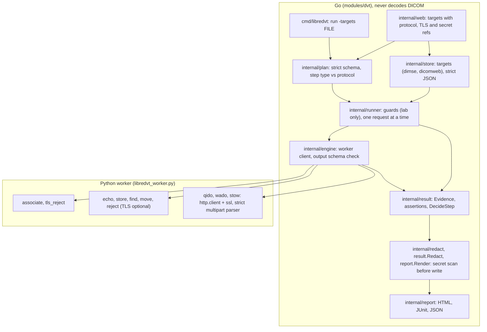

# LibreDVT architecture

| | |
|---|---|
| Document | DHF-DVT-ARCH |
| Status | **DRAFT for approval** (written 2026-11-10 by Hermes/Claude) |
| Related | `SRS.md`, `risk-management.md`, `cybersecurity.md`, `plan-schema.md`, `evidence-model.md`; research: vault note *LibreDCMTK Research* |

## 1. Purpose

LibreDVT (DICOM Validation & Test) validates DICOM objects and tests DICOM
services through a web interface and a command line. It learns from DVTk
(emulators, message-level checks, scripted tests, results manager), dicom3tools
(IOD and cross-object validation) and Gazelle EVS (several engines behind one
web upload). It runs as its own container, separate from LibreDCM and Libre WT
(Patrick Mulcahy, 2026-11-10), and treats the system under test as a black box
reached only over DICOM.

## 2. Independence from the system under test

LibreDCM uses godicom and a fork of gonetdicom. LibreDVT must not (DVT-SRS-080):
a bug in a shared library could hide in both the product and its test. All
DICOM parsing and networking in LibreDVT is done by other implementations:

| Job | Engine | Language | Licence |
|---|---|---|---|
| IOD, encoding, VR/VM validation | dicom3tools `dciodvfy` | C++ | BSD (wheel: Apache-2.0 packaging) |
| Cross-file consistency | dicom3tools `dcentvfy` | C++ | BSD |
| IOD validation from the standard's DocBook source | pydicom `dicom-validator` | Python | MIT |
| File reading, pixel comparison | pydicom | Python | MIT |
| DIMSE (SCU and built-in Storage SCP) | pynetdicom | Python | MIT |

The Go code never decodes DICOM; it orchestrates, stores results and serves
the UI. An architecture test enforces that no `modules/dvt` package imports
godicom or gonetdicom.

## 3. Components

```
 browser ──HTTPS/HTTP──► libredvt serve (Go)  ◄── libredvt run plan.yaml (Go CLI, CI)
                            │  web UI, auth, targets, plans, runs, reports
                            │  internal/engine ── exec ──► dciodvfy, dcentvfy
                            │                  └─ exec ──► libredvt_worker.py (Python, JSON on stdout)
                            ▼                                  ├─ dicom-validator
                     /var/lib/libredvt                         ├─ pydicom (probe, compare)
                     (targets, uploads, results)               └─ pynetdicom (echo/store/find/move/reject, Storage SCP)
                                                                        │ DICOM
                                                                        ▼
                                                               system under test (e.g. LibreDCM)
```

Go packages under `modules/dvt/`:

| Package | Responsibility |
|---|---|
| `cmd/libredvt` | `serve`, `run`, `validate`, `version` subcommands |
| `internal/result` | Result model (findings, step and run verdicts, versions); verdict rules (DVT-SRS-009, -042) |
| `internal/engine` | Runs external engines with timeouts; parsers for `dciodvfy`/`dcentvfy` output; client for the Python worker; "engine error" on any failure (DVT-SRS-007) |
| `internal/plan` | Strict YAML test-plan parsing (DVT-SRS-040) |
| `internal/runner` | Executes plans and validations; production guard (DVT-SRS-028) |
| `internal/report` | JUnit XML and self-contained HTML (DVT-SRS-043, -044) |
| `internal/store` | Targets, uploads and results in the data directory (DVT-SRS-020, -045) |
| `internal/web` | HTTP handlers, sessions, CSRF, login rate limit, embedded templates and CSS (DVT-SRS-060…-062, -066) |
| `internal/redact` | Secret scan and redaction of artefacts before writing (v0.2, DVT-SRS-152) |
| `internal/fakepeer` | Test only: synthetic PKI and scripted DICOM upper-layer/TLS peer for the association and TLS controls (v0.2) |

Python worker `modules/dvt/worker/libredvt_worker.py`: one process per
request, arguments on the command line, one JSON document on stdout, non-zero
exit only for worker failures (a failed DICOM check is a normal JSON result).
Commands: `versions`, `probe`, `iod`, `echo`, `store`, `find`, `move`,
`reject`. The worker never decides a verdict; Go applies the rules, so the
pass/fail logic lives in one tested place. Network commands also get
`--impl-uid`/`--impl-version`: LibreDVT's own Implementation Class UID and
Version Name, computed in Go from the build version (`engine.Implementation`,
DVT-SRS-082, `docs/qms/uid-registry.md`); the worker sends them instead of
pynetdicom's and writes them in received files.

## 4. Test plans

```yaml
name: LibreDCM conformance
target: libredcm-lab          # name in the target registry
steps:
  - id: echo
    type: echo
    verifies: [DCM-SRS-001]
  - id: store
    type: store
    files: [fixtures/*.dcm]
    verifies: [DCM-SRS-002, DCM-SRS-003]
  - id: move
    type: move
    studies: from-store       # the studies sent by earlier store steps
    compare_pixels: true
    verifies: [DCM-SRS-010]
```

Unknown keys are errors (YAML decoder with known-fields checking). The plan's
SHA-256 goes into every report.

## 5. Deployment

- Image `libre/dvt`, built by `deploy/docker/Dockerfile.dvt`: Go build stage
  (pinned `golang` image), runtime on a pinned `python:3.12-slim-bookworm`
  with every Python package pinned, indirect ones included, installed with
  `pip install --no-deps` and checked with `pip check`
  (`modules/dvt/worker/requirements.txt`). The
  DICOM standard edition for `dicom-validator` is downloaded at build time
  and stored in the image (DVT-SRS-064). Runs as uid 10001 (DVT-SRS-065).
- A `test` build target runs the engine integration tests
  (`go test -tags engines ./modules/dvt/...`) inside an image with the real
  engines, so CI exercises the actual binaries.
- Compose file `deploy/compose/docker-compose.dvt.yml`: web port 8095 and
  Storage SCP port 11115 published on 127.0.0.1 (DVT-SRS-063), data volume
  `libredvt-data`, admin password from a Docker secret or env.

## 6. SOUP (tool configuration items)

LibreDVT is a QMS tool, so these are recorded as tool configuration items
(QMS-SOP-011, IEC 62304 §8.1.2), not as product SOUP.

| Item | Version | Purpose | Licence |
|---|---|---|---|
| python:3.12-slim-bookworm | pinned by digest in `Dockerfile.dvt` | runtime base | PSF / Debian |
| golang | as LibreDCM | build | BSD-3 |
| dicom3tools (PyPI wheel) | 20260927 (dicom3tools 1.00.snapshot.20260927113651) | `dciodvfy`, `dcentvfy` | BSD-style; wheel Apache-2.0 |
| dicom-validator | 0.9.0 | IOD validation | MIT |
| DICOM standard (DocBook, parts 3, 4, 6) | 2026d | rule source for dicom-validator | NEMA, free use |
| pydicom | 3.0.2 | read/compare DICOM | MIT |
| pynetdicom | 3.0.4 | DIMSE SCU/SCP | MIT |
| lxml | 6.1.3 | indirect, dicom-validator (DocBook parsing at build time) | BSD-3 |
| pyparsing | 3.3.3 | indirect, dicom-validator | MIT |
| go.yaml.in/yaml/v3 | already a libre-rws dependency | plan parsing | MIT/Apache-2.0 |

All are compatible with LibreDVT's Apache-2.0 licence. DVTk (LGPL) and
Wireshark (GPL) are not used in v0.1.

## 7. v0.2 design (DRAFT for approval)

Written 2026-11-19 by Hermes/Claude for issue #34 (decisions D1–D5 in
`v0.2-plan.md`). Details: `plan-schema.md` (targets, plans, settings) and
`evidence-model.md` (results). Requirements: `SRS.md` §6–§12.



Design decisions (settled here so later cards do not decide them again):

1. **The worker does all network I/O, Go decides.** New worker commands:
   `associate`, `tls-probe`, `qido`, `wado`, `stow`. Each prints facts as
   JSON (`evidence-model.md` §3); Go checks the output's shape, builds the
   assertions and decides (DVT-SRS-143, -144). This keeps the v0.1 split and
   keeps DICOM decoding out of Go.
2. **DICOMweb client from the Python standard library.** `http.client` and
   `ssl`, with LibreDVT's own strict multipart parser (DVT-SRS-120). No new
   Python package is planned; DICOM JSON is read with pydicom (already
   pinned). If a card needs a new package, that is a SOUP change with its
   own evaluation.
3. **TLS from Python `ssl`.** One context factory used by every command:
   `minimum_version` TLS 1.2 (or 1.3), `check_hostname = True`,
   `verify_mode = CERT_REQUIRED`, CA file or system store. pynetdicom gets
   that context for DIMSE TLS. Refusal probes build their own narrow context
   and never carry credentials (DVT-SRS-105, -106).
4. **Secrets.** Go passes file paths only; the worker reads the files
   (DVT-SRS-153). Go also reads the configured secrets, only to scan
   artefacts before writing them (DVT-SRS-152).
5. **Independent test peers.** A tester must not share the libraries of
   what it tests, so LibreDVT's own controls avoid the worker's libraries
   (pynetdicom, Python `ssl`/OpenSSL, `http.client`) on the peer side:
   DICOMweb and TLS positive controls use test servers written in Go
   (`net/http`, `crypto/tls`) for the tests only; association controls use
   DCMTK peers (`storescp` with association profiles, `+tls`) and a Go
   raw-socket peer that sends scripted PDUs for abort, close, garbage and
   silence. Cross-check: Orthanc with its DICOMweb plugin, digest-pinned,
   test container only, never shipped. LibreDCM's libraries stay excluded
   (DVT-SRS-080, architecture test).
6. **Compatibility.** Target records without `protocol` are DIMSE; v0.1
   plans, results and reports are unchanged (DVT-SRS-110, -142, -145).

Implementation notes, card DVT-0.2/3 (2026-11-19, Hermes/Claude, DRAFT for
approval). They settle details the decisions above left open:

1. **`associate` uses a raw PS3.8 client in the worker, not pynetdicom.**
   pynetdicom hides what the target answered (for example a context missing
   from the A-ASSOCIATE-AC, an unparseable PDU, or role and asynchronous
   operations replies). The worker writes and reads the association PDUs
   itself with the standard library and reports every field; Go checks the
   shape (`engine.checkAssociate`) and decides (`runner/assoc.go`). v0.1
   steps keep pynetdicom.
2. **One TLS client context factory** (`tls_client_context` in the worker) for
   `associate`, the v0.1 DIMSE steps and later DICOMweb: TLS 1.2 or the
   target's 1.3 minimum, `CERT_REQUIRED`, `check_hostname`,
   `hostname_checks_common_name = False`, CA file or the image's trust
   store, optional client certificate. A policy check refuses any context
   that does not hold these values, so a code change that weakens one fails
   the step as an engine error before any connection. The cipher list is
   OpenSSL's default for the pinned image; a server that offers only legacy
   suites (for example RSA key exchange with CBC) fails the handshake. That
   is a fail-closed outcome, recorded in the evidence.
3. **Refusal probes** (`tls-probe`) build their own narrow context: no
   client certificate, no token, the old version offered at OpenSSL security
   level 0 so the image can really offer TLS 1.0 and 1.1. They report an
   observation (`handshake_completed`, `handshake_alert`, `dicom_reply`, …);
   `runner.probeVerdict` maps it, and only a clear refusal passes.
4. **Built-in Storage SCP with TLS** during a `move` to a TLS target uses
   `scp_tls_cert`/`scp_tls_key`, verifies the target's client certificate
   against the target's CA and requires it unless the target sets
   `move_client_cert: optional`. Without the SCP certificate the step fails;
   there is no clear-text fallback.
5. **Go test peer `internal/fakepeer`** (test only; an architecture test
   allows only `_test.go` files to import it): a synthetic PKI built with
   `crypto/x509` (root, intermediate, unrelated CA; good, wrong-host,
   CN-only, expired, not-yet-valid, self-signed and client leaves) and a
   scripted upper-layer peer on `crypto/tls`/`net` that can accept, reject,
   abort, close, send garbage, stay silent, drop or add a context, answer
   roles and asynchronous operations, misbehave on release, connect back
   for a move, and record what it received. It shares no code
   with the worker (Python `ssl`/OpenSSL), so a defect in one cannot hide a
   defect in the other.
6. **No verification bypass anywhere in non-test code**
   (`TestNoTLSVerificationBypass` scans the Go and Python sources outside
   `internal/fakepeer` and test files for `InsecureSkipVerify`, `CERT_NONE`,
   `_create_unverified_context`, a Common Name fallback and a disabled
   host-name check).

Test-only configuration items added by v0.2 (recorded in the tool
validation when first used): Orthanc and its DICOMweb plugin (GPL-3.0 /
AGPL-3.0, used only as an unmodified test container, not distributed with
LibreDVT), DCMTK 3.6.7 (BSD, already used for LibreDCM conformance).
