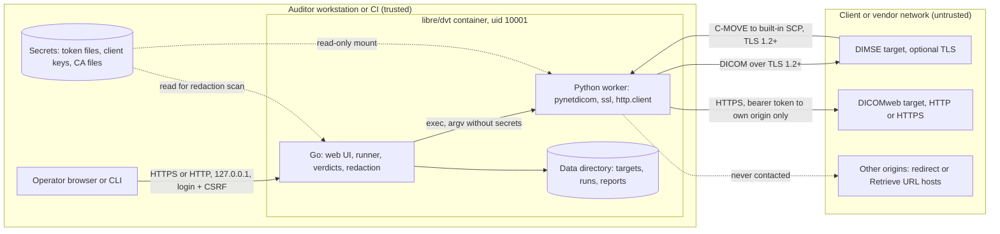

# LibreDVT cybersecurity notes

| | |
|---|---|
| Document | DHF-DVT-CYBER |
| Status | **DRAFT for approval** (written 2026-11-10 by Hermes/Claude) |
| Related | `risk-management.md` (DVT-HAZ-002, DVT-HAZ-003), `architecture.md` |

LibreDVT is an internal test tool, not a cyber device under FD&C §524B. It
still handles possibly sensitive files and talks DICOM to other systems, so
the controls below apply.

| Asset / interface | Threat | Control |
|---|---|---|
| Web UI (port 8095) | Unauthorised access; credential guessing; CSRF | Login required for everything except `/login` and `/healthz` (DVT-SRS-061); no default password, start refused without one; password compared in constant time with the configured secret; session cookie `HttpOnly`, `SameSite=Strict`, `Secure` when served over TLS; inactivity timeout; CSRF token on every POST (DVT-SRS-062); login rate limit (DVT-SRS-062); published on 127.0.0.1 by default (DVT-SRS-063) |
| Uploaded files and reports | PHI disclosure; path traversal through zip entries or file names | Synthetic-data warning (DVT-SRS-066); delete function (DVT-SRS-045); uploads stored under random IDs; zip entries with absolute paths or `..` rejected; size limits on uploads and zip expansion |
| Engine execution | Command injection through file names or plan values | Engines run with `exec` argument vectors, never a shell; arguments come from stored file paths under the data directory and validated plan fields (AE titles ≤ 16 chars, ports 1–65535, hosts without spaces) |
| Built-in Storage SCP (port 11115) | Unsolicited stores filling the disk | Runs only during a move step (DVT-SRS-026); accepts only the AE titles of the step's target; published on 127.0.0.1 by default |
| Test targets | Tests run against a clinical PACS | Production guard (DVT-SRS-028) |
| Data at rest | Other local users reading results | Data directory files written 0600 and directories 0750, owned by the container user (uid 10001) |
| Supply chain | Vulnerable engine or base image | Every Python package pinned (indirect ones too) and base images by digest (DVT-SRS-065); image scanned with Trivy in CI (blocking for fixed HIGH/CRITICAL OS packages, CI job `libredvt`) |

DICOM TLS to targets is not in v0.1 (planned for v0.2 with the association
and security tests).

## v0.2 threat model: outbound connections (DRAFT for approval)

Written 2026-11-19 by Hermes/Claude for issue #34. v0.2 adds outbound DICOM
TLS, outbound HTTP(S) to DICOMweb servers, deliberate refusal probes, and
new secrets (bearer tokens, client private keys). Targets may belong to
clients and other vendors (intended use, user T4), so LibreDVT must protect
the client's credentials and systems as well as its own results.

### Data flow and trust boundaries

The boundary that matters for v0.2 is between the container and the
client's network: everything a target sends is untrusted input, and
nothing secret may cross it except the bearer token to the target's own
origin over TLS (or loopback HTTP).

### Threats and controls

| Interface / asset | Threat | Control |
|---|---|---|
| DICOM TLS to targets | Man in the middle; a target with a wrong or expired certificate reported as secure | TLS 1.2+ only; chain verified against the target's CA or the trust store; host name checked against subjectAltName; no bypass setting exists (DVT-SRS-100…-103); TLS details recorded (DVT-SRS-107) |
| Refusal probes (`tls_reject`) | The probe itself leaks credentials or data over a weak or plaintext connection | Probes send no token, no client certificate and no DICOM data beyond the association request or HTTP request line (DVT-SRS-106) |
| DICOMweb requests | Token sent in clear; token sent to a redirect or Retrieve URL host; token sent to the wrong target | Bearer only over HTTPS or loopback HTTP (DVT-SRS-112); token only to the target's own origin (DVT-SRS-111); redirects never followed (DVT-SRS-151); Retrieve URLs to other origins never requested (DVT-SRS-132) |
| Built-in Storage SCP with TLS | Unsolicited stores; a peer impersonating the target | Runs only during a move step (DVT-SRS-026); TLS 1.2+ with LibreDVT's own certificate; peer certificate verified against the target's CA, required by default (DVT-SRS-108); 127.0.0.1 by default |
| Bearer tokens, client keys, SCP key | Disclosure in reports, logs, stored runs, process list, error messages | File references only, no inline fields (DVT-SRS-141); never in worker argv or environment (DVT-SRS-153); `Authorization` redacted; every artefact scanned for configured secrets before writing, a hit fails the run (DVT-SRS-152); web-managed references limited to `secrets_dir`; Compose mounts secrets read-only as Docker secrets |
| Responses from untrusted targets | Memory or disk exhaustion; parser bugs triggered by hostile multipart, JSON or DICOM | Size and count limits on bodies, parts, JSON and pages, fail on reaching them (DVT-SRS-154, -117); strict multipart parser (DVT-SRS-120); worker runs per request as non-root, its crash is an engine error (DVT-SRS-150); received data stays under the run's directory |
| Target configuration (web UI) | Authenticated user aims LibreDVT at arbitrary hosts (server-side request forgery) or reads arbitrary files through a CA/key path | Targets editable only after login with CSRF (DVT-SRS-061, -062); certificate and secret paths limited to `secrets_dir`; outbound requests only to configured targets, one at a time (DVT-SRS-155) |
| Client systems | Overload or data written into a production system during an audit | Data steps only against `lab` targets (DVT-SRS-028, -134); one request at a time (DVT-SRS-155); page maximum; audits need the client's written authorisation (user docs) |
| Audit reports | Report shared with a client exposes another client's data or secrets | Synthetic test data only; secret scan; one target per run; report records target identity and certificate fingerprint for the right client |

### Residual risks and open points

- Python's `ssl` module (OpenSSL in the pinned base image) may refuse to
  offer TLS 1.0/1.1 at its default security level. Then `tls_reject` with
  `tls_version` is an engine error (fail), which is safe but blocks that
  check. Card DVT-0.2/3 showed the pinned image does offer both when the
  probe lowers the security level (TLS 1.0 and 1.1 handshakes completed
  against the Go test peer and DCMTK's AES profile).
- The redaction scan finds configured secret values only. A secret the
  operator never configured (e.g. typed into a plan name) cannot be known;
  the user guide says not to.
- Certificate revocation (CRL/OCSP) is not checked in v0.2. Recorded as a
  known limitation in the user documentation.

### Implemented controls (card DVT-0.2/2, 2026-11-19, DRAFT for approval)

- Strict target schema in the registry and in target files: unknown
  fields, inline secret fields (`token`, `password`, `private_key`) and
  switches such as `insecure_skip_verify`, `verify` or `check_hostname`
  are rejected (DVT-SRS-140, -141, -103). A registry with one bad record
  is not loaded at all.
- Bearer tokens over `http://` only to `localhost`, 127.0.0.0/8 or ::1
  (DVT-SRS-112), checked when the target is loaded.
- Referenced files are checked at the start of each network step:
  absolute path, regular, non-empty, at most 1 MiB, and under
  `secrets_dir` for web UI runs. Errors name the field, never the content
  (DVT-SRS-141).
- Tokens must be one line of at least 16 RFC 6750 token characters, so
  they cannot inject a header and the scan finds them in every artefact.
- Every process LibreDVT starts (worker and dicom3tools) is refused when a
  configured secret, or its base64 or URL-encoded form, appears in its
  argument vector or environment (DVT-SRS-153).
- Step results, the finished run and the JSON/HTML/JUnit bytes are each
  scanned for the configured secrets; a hit is replaced by `[REDACTED]`
  and fails the run (DVT-SRS-152, `evidence-model.md` §7).
- Until the TLS engine exists, a DIMSE target with a `tls` block refuses
  every step instead of connecting in clear text. (Superseded by card
  DVT-0.2/3 below.)

### Implemented controls (card DVT-0.2/3, 2026-11-19, DRAFT for approval)

- DIMSE TLS is built. Every connection to a TLS target (the `associate`
  step and the v0.1 `echo`, `store`, `find`, `move`, `reject` steps) uses
  one client context: TLS 1.2 or the target's 1.3 minimum, certificate
  chain to the target's CA file or the image trust store, host name checked
  against subjectAltName only (no Common Name fallback), optional client
  certificate. A policy check refuses a context without these values
  (DVT-SRS-100…-104).
- A v0.1 step against a TLS target fails unless the worker reports a
  verified TLS connection with a version, so a clear-text or unverified
  fallback can never pass (DVT-SRS-100, -107).
- TLS facts (version, cipher, peer subject, issuer, SANs, validity,
  SHA-256 fingerprint, whether a client certificate was offered) are in the
  evidence and the step messages of every TLS step (DVT-SRS-107).
- `tls_reject` probes carry no client certificate, no key and no token, and
  send at most the A-ASSOCIATE-RQ. Go refuses a probe result that says a
  client certificate was sent, and passes the probe only the CA path, never
  the key pair (DVT-SRS-105, -106). Only a clear refusal passes; a timeout,
  connection error or local error is a problem, not a pass.
- The CA file and the client certificate/key pair are checked in Go before
  any connection; messages name the field, never the content.
- The built-in Storage SCP listens with TLS for a move to a TLS target,
  verifies the target's client certificate against the target's CA and
  requires it by default (`move_client_cert: required`). Without
  `scp_tls_cert`/`scp_tls_key` the move fails; there is no clear-text
  fallback (DVT-SRS-108).
- No verification bypass exists in non-test code; an architecture test
  scans the Go and Python sources for one (DVT-SRS-103).
- Cipher suites: the client uses OpenSSL's default list for the pinned
  image (forward-secret suites). A server offering only legacy suites, for
  example DCMTK's retired AES profile (AES128-SHA), fails the handshake.
  That is a fail-closed result; the report shows the TLS alert. The
  refusal probes, by contrast, offer TLS 1.0/1.1 at OpenSSL security level
  0 so they can see whether a server still accepts them; the pinned image
  can offer both (shown against the Go test peer and DCMTK).

### Implemented controls (card DVT-0.2/4, 2026-11-19, DRAFT for approval)

- DICOMweb client in the worker on the standard library (`http.client`
  over the same TLS context factory). One request per connection, the next
  only after the previous one closed: a target never sees parallel traffic
  (DVT-SRS-155; the Go test server measured at most 1 request in progress,
  counted before any response byte is written; its own test shows parallel
  requests are counted as parallel).
- Redirects are never followed. A 3xx fails the step with its `Location`
  recorded; a 307 on a STOW is not re-sent; the other origin receives
  nothing (DVT-SRS-151).
- The bearer token is read by the worker from its file, checked (one line,
  RFC 6750 characters, at least 16), and sent only to the base URL's own
  origin. Over `http://` it is sent only to a loopback host; the worker
  checks this a third time after the target schema and the runner
  (DVT-SRS-111, -112). Retrieve URLs from STOW responses are recorded and
  never requested; one pointing to another origin gives a warning.
- Every exchange records the `Authorization` value as `[REDACTED]` (and
  `Set-Cookie` response headers likewise). Go refuses worker output with an
  unredacted `Authorization` value as an engine error (DVT-SRS-118).
- Refusal probes against DICOMweb targets send one bare `GET …/studies`
  with no headers beyond Host, Accept and Connection: no token, no client
  certificate (DVT-SRS-106). An HTTP 400 answer counts as a refusal (TLS
  servers answer a clear-text request on their port with 400 and do not
  serve it); any other HTTP status shows the request was served.
- Size limits on the response body, DICOM JSON documents, multipart part
  size and part count, and the page count; reaching one fails the step and
  never truncates (DVT-SRS-154). A body shorter than its Content-Length is
  a protocol error.
- DICOMweb steps run only against `lab` targets; production and
  unclassified targets receive no connection (DVT-SRS-134, shown with the
  Go test server's connection count).
- Shown end to end: the real worker against the Go test server echoing the
  `Authorization` header into its error page: the token is caught,
  redacted and the run fails; a clean run against Orthanc with a token
  over loopback leaves no token form in any of 30 artefacts.
- Known limitation: some HTTPS front ends (for example nginx with
  `ssl_verify_client on`) answer a request without a client certificate
  with HTTP 400 after the handshake; LibreDVT counts that as a refusal. A
  plain-HTTP server that answers LibreDVT's bare search with 400 would also
  count as refusing clear text; such a server is not known, and any other
  status fails the probe.

## Static analysis (2026-11-10)

gosec v2.30.0 on `modules/dvt`: 26 findings, triaged to 0 open. Fixed: file
modes tightened to 0600 (G306/G302), unchecked `Close` errors (G104).
Annotated with reasons (22 `#nosec` in total, including engine `exec`
calls): path findings on paths built from validated IDs, fixed names or the
operator's own command-line arguments (G703/G304), multipart parsing whose
body is capped by `http.MaxBytesReader` (G120), downloads of LibreDVT's own
escaped reports (G705), the embedded stylesheet (G203), and the session
cookie's `Secure` flag, which is set whenever the UI is served over TLS
(G124).
