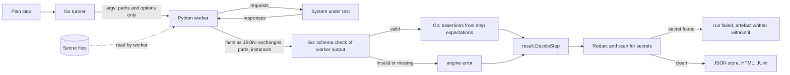

# LibreDVT evidence and result model (v0.2)

| | |
|---|---|
| Document | DHF-DVT-EVIDENCE |
| Status | **DRAFT for approval** (written 2026-11-19 by Hermes/Claude for issue #34) |
| Related | `SRS.md` (DVT-SRS-143, -144, -145, -152), `plan-schema.md`, `architecture.md`, `risk-management.md` (DVT-HAZ-001, -004, -007, -009) |

## 1. Purpose

v0.1 steps keep their result as free-form worker output (`Step.Details`)
plus messages. v0.2 adds one protocol-neutral model for every new step type
(`associate`, `tls_reject`, `qido`, `wado`, `stow`, and TLS details on DIMSE
steps). It serves three goals:

1. The record says exactly what was sent, what came back and what was
   checked, so an auditor can see why a step passed or failed (DVT-HAZ-004).
2. The verdict comes from one rule in one package (`internal/result`), the
   same for every protocol (DVT-SRS-144, DVT-HAZ-001).
3. Secrets never enter the record (DVT-SRS-152, DVT-HAZ-007).

v0.1 result fields stay as they are; stored v0.1 runs load and render
unchanged (DVT-SRS-145). The new data lives in a new optional field
`Step.Evidence`.

## 2. Flow

The worker reports facts only. It never says "pass". Go builds the
assertions from the plan's expectations and the worker's facts, then
decides.

## 3. Model

JSON field names are fixed here; Go types in `internal/result` follow them.

### 3.1 `Evidence` (one per step)

| Field | Type | Meaning |
|---|---|---|
| `schema` | string | `libredvt.evidence/1`; a reader rejects unknown major versions |
| `target` | object | `name`, `class`, `protocol`, `endpoint` (`host:port` or base URL) |
| `exchanges` | list of `Exchange` | every network interaction, in order |
| `instances` | list of `Instance` | per-object facts (stow, wado, compare) |
| `assertions` | list of `Assertion` | every expectation checked |
| `errors` | list of `Problem` | protocol, engine or limit errors; any entry fails the step |
| `redactions` | integer | number of values replaced by `[REDACTED]` |

### 3.2 `Exchange`

| Field | Type | Meaning |
|---|---|---|
| `seq` | integer | 1, 2, 3 … within the step |
| `protocol` | `tls`, `dimse` or `http` | layer of this exchange |
| `operation` | string | e.g. `TLS-HANDSHAKE`, `A-ASSOCIATE`, `A-RELEASE`, `C-ECHO`, `GET`, `POST` |
| `endpoint` | string | `host:port` or URL (with query, never credentials) |
| `started` | RFC 3339 time (UTC) | |
| `duration_ms` | integer | |
| `outcome` | `completed`, `refused` or `error` | |
| `error` | `Problem` | when `outcome` is `error` |
| `tls` | `TLSInfo` | when TLS was attempted |
| `association` | `AssociationInfo` | for `A-ASSOCIATE` |
| `http` | `HTTPInfo` | for HTTP requests |
| `dimse_status` | string | final status, `0x0000` style, for DIMSE operations |

`TLSInfo`: `version`, `cipher`, `verified` (bool), `verify_error`,
`peer` = {`subject`, `issuer`, `san_dns` (list), `san_ip` (list),
`not_before`, `not_after`, `sha256`}, `client_cert_sent` (bool). No key
material, ever (DVT-SRS-107).

`AssociationInfo`: `result` (`accepted`, `rejected`, `aborted`,
`no_response`), `reject` = {`result`, `source`, `reason`}, `abort` =
{`source`, `reason`}, `max_pdu`, `impl_class_uid`, `impl_version`,
`async_ops` = {`invoked`, `performed`}, `contexts` = list of {`id`,
`abstract_syntax`, `proposed_transfer_syntaxes`, `result` (`accepted`,
`rejected`, `missing`), `accepted_transfer_syntax`, `reason`, `roles` =
{`scu`, `scp`}}, `released` (bool) (DVT-SRS-090…-096).

`HTTPInfo`: `method`, `url`, `request_headers` (map of lists; the value of
`Authorization` is `[REDACTED]`), `status`, `response_headers`, `body` =
{`content_type`, `size`, `sha256`, `excerpt`, `excerpt_truncated`},
`parts` = list of {`index`, `content_type`, `transfer_syntax`,
`sop_instance_uid`, `size`, `sha256`} (DVT-SRS-118, -126).

### 3.3 `Instance`

`sop_instance_uid`, `sop_class_uid`, `transfer_syntax`, `file` (sent file,
relative to the plan), `size`, `sha256`, `remote_result` (`success`,
`warning`, `failure`, `missing`, `extra`, `duplicate`), `reason` (Failure
or Warning Reason, hex), `retrieve_url`, `pixel_sha256_sent`,
`pixel_sha256_received` (DVT-SRS-121, -131, -136).

### 3.4 `Assertion`

| Field | Type | Meaning |
|---|---|---|
| `id` | string | stable check name, e.g. `tls.hostname`, `assoc.context.accepted`, `qido.uid.present`, `wado.multipart.closed`, `stow.instance.referenced` |
| `subject` | string | what it is about: a context ID, a UID, a URL |
| `expected` | string | value the plan or the standard requires |
| `actual` | string | value observed |
| `outcome` | `pass`, `warn` or `fail` | |
| `message` | string | short plain-English explanation |

### 3.5 `Problem`

`kind` (`engine`, `protocol`, `timeout`, `connection_closed`, `tls`,
`limit`, `config`, `guard`), `message`. Every problem fails the step
(DVT-SRS-150).

## 4. Verdict rule (DVT-SRS-144)

`result.DecideStep(evidence)`:

1. Any `errors` entry → **fail**.
2. No assertions → **fail** with problem `engine: nothing was checked`.
3. Any assertion `fail` → **fail**.
4. Any assertion `warn` → **pass with warnings**.
5. Otherwise → **pass**.

The step's v0.1 `status` is `passed` for pass and pass with warnings, else
`failed`. The run verdict keeps DVT-SRS-042 and becomes "pass with warnings"
when any step passed with warnings. A step refused by a guard has one
`Problem` of kind `guard` and no exchanges.

## 5. Redaction (DVT-SRS-152, -153)

1. The worker never receives a secret on its command line or environment;
   it gets the file path and reads the file itself.
2. The worker writes `[REDACTED]` for the `Authorization` header value and
   never logs the contents of a secret file.
3. Before any artefact is written (stored run JSON, HTML, JUnit, log line),
   Go scans the serialised bytes for every configured secret value of the
   run's target (the token, and the PEM body of the client key). On a hit
   it replaces the value with `[REDACTED]`, adds a `Problem` of kind
   `engine` ("secret found in output") which fails the run, and only then
   writes the artefact.
4. The scan also covers the base64 and URL-encoded forms of each token.

## 6. Size of evidence

Raw bodies are kept up to `limits.max_body_excerpt_bytes`; beyond that the
evidence keeps the size and SHA-256 of the full body. Multipart parts are
never stored in the evidence; only their facts (§3.2). Received DICOM files
are kept in the run's directory only while the step needs them for
comparison or validation, as in v0.1 moves.

## 7. Implementation notes (card DVT-0.2/2, 2026-11-19)

**DRAFT for approval.** Written by Hermes/Claude with the code.

- Go types: `internal/result/evidence.go`. `Step.Evidence` (JSON
  `evidence`) and `Step.Verdict` (JSON `verdict`, the `DecideStep` result)
  are new optional fields; a v0.1 step serialises exactly as before.
- `Step.ApplyEvidence` is the only way a v0.2 step gets its status. It
  checks the evidence against the closed value sets of §3 (`Evidence.Check`),
  adds the problem "nothing was checked" when there is no assertion, sets
  the verdict from `DecideStep` and copies problems and failed assertions
  into the v0.1 `messages`, so every existing report shows the reason.
- A step refused before connecting (guard, configuration, feature not in
  this build) has evidence with one `Problem` and no exchange.
- Redaction has three layers, each failing the run on a hit:
  1. every step result is scanned before it is added to the run, so
     progress snapshots the web UI stores mid-run are clean;
  2. the finished run is scanned (run-level fields such as the plan name);
  3. `report.Render` scans the JSON, HTML and JUnit bytes before the CLI
     or the web UI writes them.
  The configured secrets are read from the target's files at the start of
  the run, so every step is covered, including `validate` steps.
