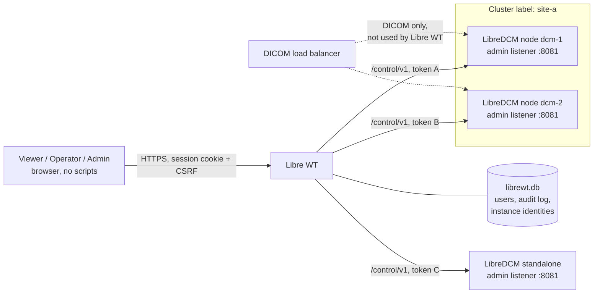
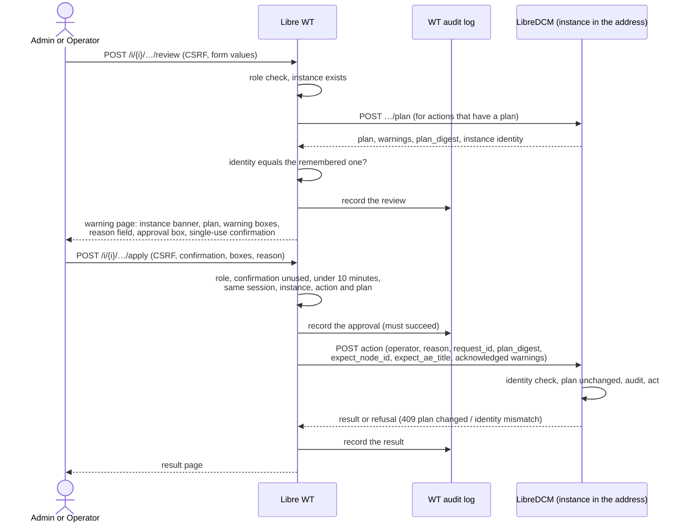
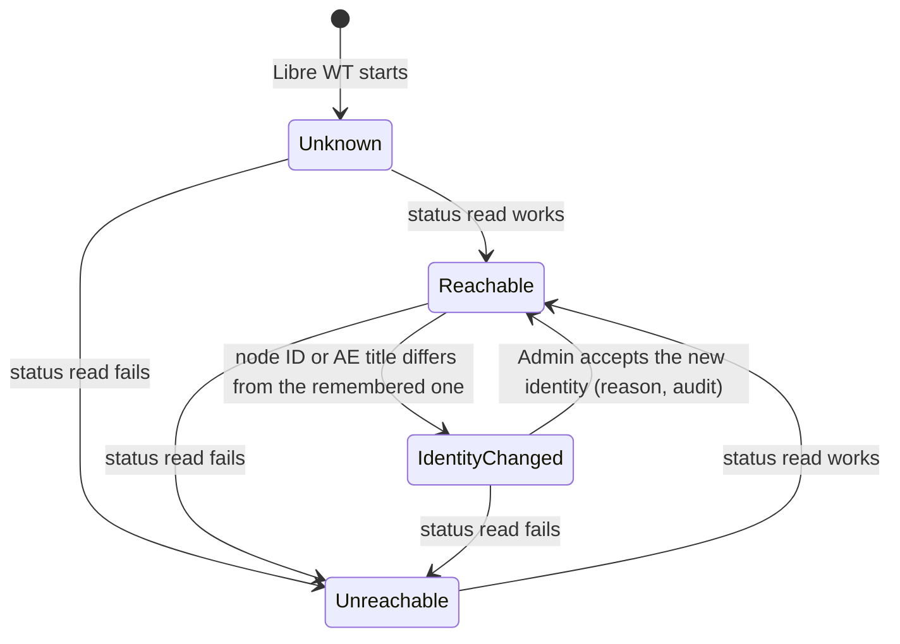
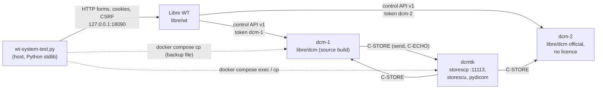

# Libre WT architecture (v0.1)

| | |
|---|---|
| Document | DHF-WT-ARCH |
| Status | **DRAFT** (2026-11-10); v0.2 part added 2026-11-14, **DRAFT for approval**; §2…§6 updated 2026-11-16 with what card WT-0.2/5 built; §3, §5 and §8 updated 2026-11-16 with what card WT-0.2/6 built |

| Item | Path | Responsibility |
|---|---|---|
| WT-SI-01 | `modules/wt/cmd/librewt` | Entry point: configuration (YAML + `LIBRE_WT_*`), wiring, HTTP(S) server, graceful shutdown |
| WT-SI-02 | `modules/wt/internal/accounts` | Users, roles, argon2id hashes, epochs, audit log (SQLite in the data directory) |
| WT-SI-03 | `modules/wt/internal/dcmclient` | LibreDCM control-API client (JSON contract only, no LibreDCM imports; architecture test `TestWTDoesNotImportDCM`) |
| WT-SI-04 | `modules/wt/internal/web` | Pages, sessions, CSRF, rate limiting, edit confirmations, security headers; templates and CSS embedded in the binary |

Resolve sequence: detail page → `GET /exceptions/{id}/review?action=` (Libre
WT asks LibreDCM for the plan, audits the review, issues a single-use
confirmation bound to session, exception, action and a digest of the plan) →
`POST /exceptions/{id}/resolve` (CSRF, role, confirmation, approve box,
reason; plan fetched again and compared; approval audited; LibreDCM
`POST /control/v1/conflicts/{id}/resolve` with operator, reason and
`confirm: true`; result audited).

Deployment: one container (`deploy/docker/Dockerfile.wt`, image `libre/wt`)
or the binary, next to LibreDCM. Libre WT keeps its own data directory and
can be upgraded separately from LibreDCM.

# Libre WT 0.2 architecture (DRAFT for approval, 2026-11-14)

Written by Hermes (Claude) for human review, before coding (issue #20).
Requirements: WT-SRS-013…036 (Draft). LibreDCM side:
`../libredcm/control-api-v1.md`, DCM-SRS-080…097 (Draft). The v0.1 text
above stays valid; this part adds to it.

## 1. Context



Libre WT talks to each node's admin listener directly, never through the
DICOM load balancer. Each LibreDCM stays the source of truth for its own
state. Libre WT stores no LibreDCM configuration and no patient data.

## 2. Software items (changes)

| Item | Path | Change in 0.2 |
|---|---|---|
| WT-SI-01 | `modules/wt/cmd/librewt` | Configuration gains `instances:`; the `dcm:` block of 0.1 is read as one instance named `default` |
| WT-SI-02 | `modules/wt/internal/accounts` | Audit entries gain an instance column (schema upgrade in place); new table for the remembered identity of each instance |
| WT-SI-03 | `modules/wt/internal/dcmclient` | One client per instance. New calls for every control endpoint. Still the JSON contract only, no LibreDCM imports (`TestWTDoesNotImportDCM`) |
| WT-SI-04 | `modules/wt/internal/web` | New pages (§3). One shared action flow for all state changes (§5). Role table in one place |
| WT-SI-05 (new) | `modules/wt/internal/fleet` | Registry of instances: name, cluster label, client, short status cache, remembered identity, supported features. **Implemented** (card WT-0.2/5) |
| Test support (not part of the program) | `modules/wt/internal/fakedcm` | Stand-in for LibreDCM's control API over HTTP, for tests. No program file imports it (`TestFakeIsTestOnly`) |

No new dependency is planned.

## 3. Screens

All pages are server-rendered HTML without scripts, under the same security
headers as 0.1 (WT-SRS-001). `{i}` is the instance name. Every `/i/{i}/…`
page shows the instance banner (WT-SRS-014).

| Screen | Address | Roles | Shows / does | Requirement |
|---|---|---|---|---|
| Fleet | `GET /` | All | All instances by cluster label; health, version, licence, counters; divergence flags | WT-SRS-016, -023 |
| Dashboard | `GET /i/{i}/` | All | Key values of one instance; links to its pages | WT-SRS-017 |
| Status | `GET /i/{i}/status` | All | Readiness checks, counters per DICOM service, backends, restart procedure note | WT-SRS-017 |
| Configuration | `GET /i/{i}/config` | Operator, Admin | Running settings, source, restart needed or not; secrets as set / not set | WT-SRS-019 |
| Destinations | `GET /i/{i}/remote-aes` | Operator, Admin | C-MOVE destinations in force; links to edit and to C-ECHO | WT-SRS-020 |
| Allow-list | `GET /i/{i}/allow-list` | Operator, Admin | Rules in force; "empty = everyone may connect" notice | WT-SRS-020 |
| Edit destinations / allow-list | `GET /i/{i}/config/edit`, `POST /i/{i}/config/review`, `POST /i/{i}/config/apply` | Admin | Form, then warning page with LibreDCM's plan, then apply | WT-SRS-021, -031 |
| Reload, rollback | `POST /i/{i}/reload/review`, `POST /i/{i}/reload/apply`, `POST /i/{i}/rollback/review`, `POST /i/{i}/rollback/apply` | Admin | Plan page with the difference, then apply | WT-SRS-022, -031 |
| C-ECHO test | `GET /i/{i}/echo`, `POST /i/{i}/echo/review`, `POST /i/{i}/echo/apply` | Operator, Admin (free address: Admin, checked in the handler) | Pick a destination (Admin: or free address); warning page with reason; result page | WT-SRS-024 |
| Studies | `GET /i/{i}/studies`, `POST /i/{i}/studies/search`, `GET /i/{i}/studies/{uid}`, `GET /i/{i}/studies/{uid}/series/{suid}` | Operator, Admin | Search form and results; study detail with series; series with its instances (identifiers only); "not a diagnostic viewer" statement | WT-SRS-025 |
| Send | `POST /i/{i}/studies/{uid}/send/review`, `POST /i/{i}/studies/{uid}/send/apply` | Admin (D52) | Warning page with patient, study, destination; result per instance | WT-SRS-026, -031 |
| Licence | `GET /i/{i}/license`, `POST /i/{i}/license/{action}/review`, `POST /i/{i}/license/{action}/apply` (`{action}`: `ack`, `request`, `install`, `activate`) | View: all. Every action, including the acknowledgement: Admin (D47) | State; acknowledge, request file, install file (upload), activate online | WT-SRS-027, -031 |
| Backup | `GET /i/{i}/backups`, `POST /i/{i}/backup/review`, `POST /i/{i}/backup/apply` | Operator, Admin | Files on the node and the history from the WT audit log; start a backup; result with file, size, SHA-256 | WT-SRS-028, -031 |
| LibreDCM audit records | `GET /i/{i}/audit`, export `GET /i/{i}/audit.csv` | Admin | Recent records with filters; CSV export | WT-SRS-029, -037 |
| LibreDCM logs | `GET /i/{i}/logs`, export `GET /i/{i}/logs.csv` | View: Operator, Admin. Export: Admin (D53) | Recent lines, level and period filter; CSV export | WT-SRS-030, -037 |
| Study Exceptions | `GET /i/{i}/exceptions…` (0.1 pages moved under the instance; `/exceptions` redirects when there is one instance) | As in 0.1 | As in 0.1 | WT-SRS-007…010 |
| Instance identity | `POST /i/{i}/identity/review`, `POST /i/{i}/identity/apply` | Admin | Accept a changed node ID or AE title. Nothing is sent to LibreDCM | WT-SRS-015 |
| About | `GET /about` | All | Versions | WT-SRS-035 |
| Users, account, console audit | `/users`, `/account`, `/audit` | As in 0.1 | Audit gains an instance filter | WT-SRS-012, -033 |

Search values, reasons and licence keys are sent by `POST`, so they never
appear in an address (WT-SRS-032).

## 4. Libre WT and LibreDCM control API v1

| Libre WT function | Control API call (see `../libredcm/control-api-v1.md`) |
|---|---|
| Fleet, dashboard, status, about | `GET /control/v1`, `GET /control/v1/status` |
| Configuration, destinations, allow-list | `GET /control/v1/config`, `/remote-aes`, `/allow-list` |
| Edit | `POST /control/v1/config/plan`, `POST /control/v1/config` |
| Reload, rollback | `POST /control/v1/reload/plan`, `/reload`, `/config/rollback/plan`, `/config/rollback`, `GET /config/history` |
| C-ECHO test | `POST /control/v1/echo` |
| Studies | `GET /control/v1/studies` |
| Send | `POST /control/v1/send/plan`, `POST /control/v1/send` |
| Licence | `GET /control/v1/license`, `POST /control/v1/license/ack`, `/request`, `/install`, `/activate` |
| Backup | `GET /control/v1/backups`, `POST /control/v1/backup` |
| Audit records, logs | `GET /control/v1/audit`, `GET /control/v1/logs` |
| Study Exceptions | `/control/v1/conflicts…` (0.1) |

Status reads: Libre WT reads an instance's status when a page needs it and
keeps the answer for a few seconds (default 5, setting `status_cache`) for
all users, so many open consoles do not load a node (WT-HAZ-16). The page
shows the time of the reading. There is no background change of state:
Libre WT never acts on a LibreDCM without a user request.

As built (card WT-0.2/5): one reading is two requests, `GET /control/v1`
(functions and identity) and `GET /control/v1/status`. Page loads that
arrive during a reading wait for it and share its result. A failed reading
is kept for the same few seconds, so a node that is down is not asked on
every page load. A failed reading keeps nothing the node said before: only
the time of the last good reading. The fleet page reads all instances at
the same time. Data pages (Study Exceptions) are not cached.

A LibreDCM without `GET /control/v1` (versions before the control API
extension) is read through `/version`: node ID and version only. Libre WT
then offers Study Exceptions for it and shows status as not available. It
sends such a node no expected identity, because that node refuses request
fields it does not know.

Timeouts: 5 seconds for reads, 30 seconds for actions. A send or a backup
may take longer: Libre WT then shows "still running, check the audit
records", and the request ID makes a repeat safe. As built (card
WT-0.2/5): status reads use 5 seconds; the Study Exceptions resolve keeps
its 2 minutes of 0.1 (a correction rewrites every file of a study). The
fleet page therefore takes up to 5 seconds when a node does not answer.
As built (card WT-0.2/7): online activation waits 45 seconds (LibreDCM
gives the licence server 30); a backup waits 110 seconds, below the
2-minute HTTP client timeout and the 3-minute write timeout of the Libre
WT web server. A longer backup still finishes on the node (LibreDCM lets it
run up to 10 minutes); Libre WT then records the outcome as `unknown` and
the file appears in the list of backups.

As built (card WT-0.2/7), licence and backup:

- **Licence page.** Reads `GET /control/v1/license`. The key is shown as
  its last four characters; the client cuts a longer value LibreDCM might
  send to four characters. Every licence page says that DICOM services keep
  running whatever the licence state.
- **Acknowledgement.** Admin only (D47). The warning page asks the person
  to type their own user name as a signature; the apply step refuses
  anything else. LibreDCM gets the logged-in user as operator, never the
  typed text.
- **Install.** The only upload in Libre WT: `multipart/form-data` is read
  only on `POST /i/{i}/license/install/review`, with the whole body capped
  at 192 KiB in memory (`http.MaxBytesReader`, nothing written to disk) and
  the file at 128 KiB of UTF-8 text without NUL bytes. A multipart body
  sent to any other address is refused by the CSRF check, because its
  fields are not read. The file text stays on the server with the
  confirmation; the warning page shows its name, size and SHA-256, and the
  approval is bound to that checksum.
- **Activation and request file.** The key is typed into a password field,
  kept in memory with the confirmation only, shown masked, sent once, and
  removed from LibreDCM's error text (all cases) before it is shown or
  audited. The request text comes back as a `text/plain` download
  (`Content-Disposition: attachment`) and is never rendered.
- **Backup.** The review step reads `GET /control/v1/backups` and issues no
  confirmation when the node has no backup directory or a PostgreSQL index.
  The apply step sends the envelope only. The result (file, size, SHA-256,
  duration) is written to the WT audit log; the backup page shows those
  records as the history (`accounts.AuditActionLog`), next to the files
  LibreDCM lists.

As built (card WT-0.2/8), studies, send, audit records and logs:

- **Study search.** The form is sent by `POST` (values never in an
  address). Libre WT turns it into DICOM matching keys: `PatientID`,
  `PatientName` (wildcards `*` and `?` pass through), `StudyDate` as a range
  `YYYYMMDD-YYYYMMDD` from two date fields, `ModalitiesInStudy` (one code,
  upper case), `AccessionNumber`, `StudyInstanceUID`. A value of `*` alone
  counts as no value; a search without a value is refused before anything
  is sent. Values are at most 64 characters, without control characters or
  the DICOM list separator `\`. The search is written to the Libre WT audit
  log (with its keys and values, D55) before `GET /control/v1/studies` is
  called with the user's name in `X-Libre-Operator`; LibreDCM writes its
  own `Query` record. 50 studies per page; when LibreDCM says there are
  more, the page says so and offers the next page with LibreDCM's cursor.
  The answer is shown only when it comes from the expected node.
- **Study and series pages.** `GET /i/{i}/studies/{uid}` asks for the study
  row and its series (level `series`, 200 per page);
  `GET …/series/{suid}` asks for the instances (level `image`). The UIDs in
  the address are checked to be DICOM UIDs. Each opening is audited first
  (no record, no page). No pixel data is read or shown; every page says
  that Libre WT is not a diagnostic viewer.
- **Send.** Admin only (D52). The study page offers a send form only when
  the study has exactly one row without `ConflictID` (not held, not under
  two patients) and the node offers `send`. The form carries the
  destination (a list of the configured destinations), the Patient ID the
  page showed and optionally series. The review step calls
  `POST /control/v1/send/plan` and issues no approval when the plan names
  another Patient ID, study or destination than the request, has no
  digest, holds no instance or comes from another node. The warning page
  shows the patient name, ID and birth date in the warning box, in the
  table and in the approval box. The request and the plan digest stay on
  the server with the approval; the apply step checks that the study in
  the address is the reviewed one and sends exactly that request with
  `confirm`, `plan_digest` and the envelope. LibreDCM builds the plan
  again and refuses with `409 plan_changed` when anything changed.
- **Send result.** `complete` and `partial` (HTTP 200) and `failed` (HTTP
  502 `send_failed`, which carries the counts) are shown with the accepted
  count and every failed and warning SOP Instance UID; the audit record
  holds the outcome (`success`, `partial`, `failure`), counts and failed
  UIDs. Libre WT waits 110 seconds (D54); then the outcome is `unknown` and
  the page gives the request ID to look up on the LibreDCM audit page
  (event `DICOMInstancesTransferred.sent`).
- **Audit records and logs.** `GET /control/v1/audit` and `/logs` with
  filters from fixed lists only (outcome, level, period of 15 minutes to 7
  days or all, limit) and an event-type prefix of letters, digits, `.`,
  `_` and `-` (D57). Each JSON line is shown newest first as time,
  event or message, outcome, who (operator, or the calling AE) and the
  other fields as `key=value` text. Each opening is audited (no record, no
  page).
- **CSV export.** Admin only (D53). Same filter, same rows; written to the
  audit log before the file is sent (no record, no file);
  `text/csv; charset=utf-8`, `Content-Disposition: attachment`, a file name
  from the configured instance name and the time. A cell that starts with
  `=`, `+`, `-`, `@`, tab or carriage return gets a leading `'`.
- **Study Exceptions views** are now audited too (D56), so every page that
  shows patient data leaves a record (WT-SRS-033).

## 5. Action flow (all state changes)



One implementation of this flow serves every action (configuration change,
reload, rollback, send, licence actions, backup, C-ECHO, identity
acceptance, and the 0.1 resolve). Actions without a LibreDCM plan (backup,
C-ECHO, licence acknowledgement) still get a warning page that says what
will happen and on which instance.

As built (card WT-0.2/6, `modules/wt/internal/web/actions.go`): the review
step stores what the apply step will send (the edited table or rules, the
C-ECHO target, LibreDCM's plan digest, the warnings that need a box)
together with the single-use confirmation, on the server. The apply request
carries only the confirmation, the reason and the ticked boxes; form fields
it adds are ignored. The confirmation is bound to the session, the
instance, the action and a fingerprint of the expected node, target and
plan digest. The apply step checks, in this order: confirmation (used up at
the first try, whatever the outcome), approval box, reason (1 to 500
characters), every warning box, instance reachable and still the
remembered node, a check of the action (C-ECHO: the destination still has
the address shown), then writes the approval to the audit log and only
then sends the action with operator, reason, a new random request ID, the
expected node ID and AE title, the plan digest and the acknowledged warning
codes. The 0.1 resolve and the identity acceptance keep their own handlers;
they follow the same rule.

Action answers: success is recorded with LibreDCM's digests before and
after and the request ID. A refusal before the action started (400, 404,
409, 422, 423, 429) is shown with LibreDCM's text and "Nothing was
changed". Another error is shown without that sentence. When LibreDCM does
not answer in time (30 seconds), the outcome is recorded as `unknown` and
the page gives the request ID to look for; Libre WT does not repeat the
request on its own.

## 6. Multi-instance connections

```yaml
instances:
  - name: dcm-1                 # letters, digits, - and _; unique
    cluster: site-a             # optional label; same label = one group on the fleet page
    url: https://dcm-1.example:8081
    token_file: ./tokens/dcm-1.token
    ca_file: ./tls/dcm-1.crt
  - name: dcm-2
    cluster: site-a
    url: https://dcm-2.example:8081
    token_file: ./tokens/dcm-2.token
```

- Instances come from the configuration file only. They are not added or
  changed in the browser: adding a connection means handling a token, which
  stays on the host. There is no environment variable for the list.
- At most 64 instances. Names: 1 to 64 letters, digits, `-` or `_`; two
  names that differ only in upper and lower case are refused.
- Without an `instances:` list, the `dcm:` block (or `LIBRE_WT_DCM_*`) of
  0.1 is one instance named `default`. Giving both is refused at start.
- The addresses of 0.1 (`/exceptions…`) lead to the same page of the only
  instance. With several instances they lead to the fleet page.
- Each instance has its own token. A token never appears in pages, logs or
  the audit log.
- The cluster label groups instances on the fleet page and drives the
  divergence flags. It gives no cluster actions: every action is for one
  instance.
- Instances of one cluster usually share one index (PostgreSQL). Study
  Exceptions and study search then show the same data from each node. The
  pages say which instance answered.

State of an instance, as shown on the fleet page:



In the states `IdentityChanged` and `Unreachable`, Libre WT sends no action
to that instance (accepting the new identity is the one exception; it
changes only what Libre WT expects and sends nothing to LibreDCM).

The remembered identity is kept in `librewt.db` (table `instance_identity`,
keyed by instance name): node ID, AE title, first seen, and for an accepted
identity who accepted it, when and why. The first answer of a newly
configured instance is remembered as it is. A later answer never replaces
it; only the acceptance does. One exception: a node first seen as an older
LibreDCM (node ID only) that later reports an AE title under the same node
ID has the AE title added.

`librewt.db` schema version 2 (SQLite `user_version`): the audit table has
an `instance` column, added in place when a 0.1 database is opened. A
database with a higher version is refused.

## 7. What Libre WT 0.2 does not do

No start, stop or restart of LibreDCM. No change of settings that need a
restart. No certificate generation. No image display, upload, download or
deletion. No cluster-wide action. No instance management in the browser. No
scripts in pages.

### 7a. System-level verification (card WT-0.2/9, 2026-11-17)

The system test runs Libre WT against real LibreDCM containers, the way a
site installs them. It is a test configuration, not a product
configuration.



| Item | Path | Role |
|---|---|---|
| Stack | `deploy/compose/docker-compose.wt-system.yml` | Two LibreDCM nodes, Libre WT, DCMTK on a private network; only Libre WT is published, on 127.0.0.1 |
| Runner | `scripts/e2e/wt-system-test.sh` | Writes random tokens and the Libre WT configuration outside the repository, starts the stack, runs the test, saves the logs, scans the record for the tokens |
| Test | `scripts/e2e/wt-system-test.py` | 87 checks (`SYS-xx`, `DATA-x`, `CTL-1`) through the web pages, as Viewer, Operator and Admin |
| Test data | `scripts/e2e/wt_make_data.py` | Synthetic study (2 series × 2 instances) and one conflicting instance, from pydicom's public sample with every identifier and UID replaced |
| Comparison | `scripts/e2e/wt_compare.py` | Received instances against sent instances: SHA-256 of the data set after the File Meta Information; `--tamper` is its positive control |
| Screenshots | `scripts/e2e/wt-screenshots.mjs` | Headless Chromium over the DevTools protocol (Node, no packages): every page in light and dark, and a check that no page is wider than its window. Documentation only |

The test tools share no code with Libre WT or LibreDCM (Python and
Node against Go), so a defect in the product's libraries can't hide in the
test. Their validation is in `../../qms/tool-validation/README.md`
("Libre WT system test").

## 8. Open decisions for Patrick

Hermes chose these defaults where the instruction of 2026-11-14 left room.
Each can be changed before the code that depends on it is merged.

| # | Question | Default chosen | Why | Alternative |
|---|---|---|---|---|
| D1 | How does Libre WT know several LibreDCM? | Named connections in the Libre WT configuration file, each with its own token file; the instance is part of every page address; no "selected instance" in the session | A selected instance kept in the session is the classic way to act on the wrong node (WT-HAZ-05) | Manage connections in the browser (needs token entry and storage in Libre WT) |
| D2 | Clusters | A label per connection. Grouped display and divergence flags only. Every action is for one node | Rolling cluster actions need a control plane; too large and too risky for 0.2 | Cluster-wide apply, one node at a time, later |
| D3 | Which settings can be edited? | Only what LibreDCM can reload live today: C-MOVE destinations and the allow-list, through an overlay file owned and validated by LibreDCM. Everything else is read-only | A wrong restart-required value can stop a node from starting with nobody at the host (HAZ-004) | Edit more settings and mark them "applies at next restart" |
| D4 | Remote start, stop, restart | Not built. The status page names the host procedure | Brief of 2026-11-14; a remote stop makes images unavailable | Later, through the installer or an agent on the host |
| D5 | Roles | Viewer: fleet, status, licence state, exceptions (as 0.1). Operator: also configuration view, logs, study search, C-ECHO to configured destinations, backup, licence acknowledgement (moved to Admin by D47). Admin: all changes, send, licence installation, LibreDCM audit records | Follows the 2026-10-16 console spec (Operator runs, Admin changes) and least privilege for patient data | Viewer also sees configuration; Operator may reload |
| D6 | Send and C-ECHO targets | Send only to configured destinations. C-ECHO to configured destinations for Operators; a free address only for Admin | Images must never go to an address nobody configured (HAZ-005); the free C-ECHO is needed when connecting a new device | No free C-ECHO address at all |
| D7 | Licence actions | Acknowledge: Operator and Admin. Request, install, activate: Admin. Keys masked. **Acknowledgement changed to Admin only by D47 (card WT-0.2/7)** | Mirrors the command-line functions; installation changes what the site paid for | Admin only for everything |
| D8 | Backup | Written to a directory set in LibreDCM's own configuration; file name made by LibreDCM; never overwrites; no download and no delete in the console; SQLite index only | No path from the browser removes traversal and overwrite risks; the index holds patient data | Download for Admin over HTTPS only; retention rule |
| D9 | Audit records and logs | Recent records from fixed-size buffers in LibreDCM's memory (lost at restart). The site's log collector stays the record | No new store for patient data; no streaming needed | Persist audit records in the index database; live tail |
| D10 | Who is the operator for LibreDCM? | Libre WT sends the logged-in user's name with the shared admin token of that instance | Same model as 0.1; per-user tokens need an identity design | Per-user or per-console credentials, mutual TLS |
| D11 | Plain HTTP to LibreDCM | Allowed, with a warning on the instance's pages and in the log when the address is not loopback | Docker networks on one host use plain HTTP today; refusing would break existing installs | Refuse actions (or all use) over plain HTTP to non-loopback addresses |
| D12 | How is "what I approved is what happens" kept? | LibreDCM returns a digest of the plan; the action must carry it; LibreDCM refuses when the state changed. A request ID makes repeats harmless | No state kept on LibreDCM between plan and apply; safe against double clicks and stale pages | Server-side plan store with expiry |
| D13 | REST or gRPC | REST (`/control/v1`), growing by addition only | Decision of 2026-11-10 kept; no streaming needed with D9 | gRPC when live log streaming is wanted |
| D14 | Metrics | Libre WT shows the counters from the status endpoint. It does not proxy `/metrics` and draws no history graphs | Prometheus and Grafana already do history; pages stay script-free | Simple history kept in Libre WT |
| D15 | `-gen-cert` | Not in the console. TLS on or off is shown | It writes a private key on the host and needs a restart | Offer it together with a restart function, later |
| D16 | Image upload (C-STORE from the console), C-GET to the browser | Not built. C-STORE and C-GET activity is shown as counters and audit records | Importing images is a new clinical data path with its own hazards; Libre WT does not handle images | Separate import tool, later |
| D17 | Reload from the console: is a plan needed? | Yes. `POST /control/v1/reload` needs `confirm` and the digest of the plan the administrator saw; changes that empty the allow-list or remove or retarget a destination must be acknowledged by code. SIGHUP on the host stays as it is (card WT-0.2/3) | A reload applies whatever is in the file at that moment; the console user may not be the person who edited it (HAZ-015) | Reload without a plan, as SIGHUP |
| D18 | Audit records per action | Two: one before the action (no record, no action) and one with the outcome. Written at every log level and also with `audit_log_off` (card WT-0.2/3) | "Audit before acting" and "audit the outcome" can not both be one record | One record after the action; administrative actions silenced by `audit_log_off` |
| D19 | Do plan endpoints need operator, reason and request ID? | No. They change nothing and are not audited by LibreDCM; they do check the expected node (card WT-0.2/3) | Less noise in the audit trail; Libre WT audits who opened the page | Require and audit them |
| D20 | Backup directory | Off until `control.backup_dir` (`LIBRE_DCM_CONTROL_BACKUP_DIR`) is set; the installer does not set it. Suggested value in the workstation install: `/var/lib/libredcm/backups` (card WT-0.2/3) | A new place that holds patient data should be a decision of the site | Installer sets it by default |
| D21 | C-ECHO over TLS to a free address | The peer certificate is not checked; the response says `tls_verified: false`. Configured remote AEs are tested without TLS, as C-MOVE sends today (card WT-0.2/3) | Same as the command-line `-echo-tls`: a reachability test, often of a self-signed peer; no patient data is sent | Check against the system trust store, with a switch |
| D22 | Licence acknowledgement through the API | Allowed for any holder of the admin token, under the operator name it sends; it lifts the reload block for 24 hours as the command line does (card WT-0.2/3) | Same effect and same audit as `-license-ack NAME`; licensing must only inconvenience administrators | Keep the acknowledgement on the host only |
| D23 | Overlay file: on or off by default? | On. `control.overlay_file` defaults to `./data/config-overlay.yaml` (container image: `/var/lib/libredcm/config-overlay.yaml`); `""` in `config.yaml` turns configuration edit off (card WT-0.2/4) | The scope is "all LibreDCM functions from the console"; the file is only written when an administrator applies a change | Off until the site sets the path, like the backup directory (D20) |
| D24 | Overlay and `config.yaml` both hold a setting | The overlay replaces the value of `config.yaml` as a whole; environment variables still win. `GET /control/v1/config` names the source. To drop the console's changes: delete the overlay file and reload (card WT-0.2/4) | A removal made in the console must stay removed; a merge would bring the entry back from the file | Merge per entry; or write changes back into `config.yaml` |
| D25 | Overlay file broken or holding another setting | The node does not start and a reload is refused, with a message that names the file. It never runs on `config.yaml` alone (card WT-0.2/4) | `config.yaml` alone may have the wider allow-list; a node that starts with it would be open without anyone noticing (HAZ-007). The file is written atomically and re-read before use, so this needs a manual edit or a damaged disk | Start with `config.yaml` and log an error (availability over the allow-list) |
| D26 | Conflict instances in a send from the console | Never sent: neither held ones nor ones accepted as a separate study. A study that exists only as an accepted separate entry cannot be sent from the console; a DICOM peer can still retrieve it with C-MOVE (card WT-0.2/4) | The send names one patient and one study; an accepted separate entry shares the Study UID with another patient (HAZ-013, HAZ-016) | Send accepted separate entries when the request names their Patient ID, as C-MOVE does |
| D27 | Limits of a send | One at a time per node; at most 5000 instances; 30 minutes; chosen series or instances possible. `200` with `outcome: complete` or `partial`; `502` when nothing arrived (card WT-0.2/4) | Bounded load on the node (HAZ-004); a total failure must not look like a success | Other limits; a queue of sends |
| D28 | Study query rules | Operator name in the header `X-Libre-Operator`, required. One audit record per query, written before rows are returned, also with `audit_log_off`. A key the node does not match on is refused (C-FIND ignores it). 200 rows per page, 10 000 rows deep, four queries at once (card WT-0.2/4) | A search by a person in a console is an access to patient data that must be traceable (HAZ-009); an ignored key would give more rows than the person asked for (HAZ-002) | Ignore unknown keys like C-FIND; do not audit reads |
| D29 | "Recently active peer" | Calling AEs with a store, query or retrieve record in the in-memory audit ring in the last 24 hours. Empty after a restart. With `audit_log_off` every narrower allow-list carries the warning. The warning also covers a list that starts to be enforced, and reload plans (card WT-0.2/4) | No new store is needed; the conservative answer is used when the node cannot tell | Keep last-seen times per peer in the index |
| D30 | Audit event name of a send | `DICOMInstancesTransferred.sent` with `op: control-send`, the name C-MOVE and C-GET exports already use. (The card text said `.exported`.) (card WT-0.2/4) | One event name for every export keeps log rules simple; the name follows the existing records | A new event name |
| D31 | Method of the plan endpoints of the configuration edit | `POST` (they carry the new value in the body) and they change nothing, as the reload and send plans. (The card text said "GET plan".) (card WT-0.2/4) | A `GET` with a body is not reliable through proxies; one rule for every plan endpoint | `GET` with the value in the query string |
| D32 | How many overlay versions are kept | One previous version, with time, operator and reason. A rollback swaps current and previous. The audit records hold every change (card WT-0.2/4) | Smallest thing that undoes the last change | A longer history with a pick list |
| D33 | Which identity does Libre WT trust first? | The first answer of a newly configured instance is remembered (trust on first use) and kept in `librewt.db`. Later changes need an Admin (card WT-0.2/5) | No extra step when adding an instance; the address and token were typed by the person who installs | Node ID and AE title written in the configuration file and checked from the first contact |
| D34 | "Health polled" (card text) | Read when a page is opened, kept 5 seconds for all users. No background polling and no automatic page refresh (card WT-0.2/5) | Design of 2026-11-14 (WT-HAZ-16): Libre WT does nothing without a user; an auto-refresh would also keep idle sessions alive | A background poller with a "last seen" history; a refresh button or timed refresh |
| D35 | LibreDCM before the control API extension | Supported for Study Exceptions only; status shown as not available; no expected identity sent to it (card WT-0.2/5) | A site may upgrade Libre WT first. The old node refuses unknown request fields, so the identity check cannot be sent | Refuse to manage such a node |
| D36 | Both `dcm:` and `instances:` configured | Refuse to start (card WT-0.2/5) | It would not be clear which LibreDCM the console manages | Add the `dcm:` block as one more instance |
| D37 | Divergence rule | Within a cluster label: flag the instances whose value is not the most common one; when no value is the most common, flag all. Unreachable instances are not compared (card WT-0.2/5) | Shows the odd node out without calling a majority "right" when there is none | Flag every instance as soon as two values exist |
| D38 | "Instance selector" (card text) | Links: the fleet page lists the instances; every instance page has "Other instances". No drop-down and nothing remembered (card WT-0.2/5) | D1: a selection kept in the session is how the wrong node gets changed | A drop-down that only navigates |
| D39 | Fleet counts | "Stored" is the C-STORE result `success`; "Not stored" is every other C-STORE result; "Rejected associations" is LibreDCM's own counter (card WT-0.2/5) | Card text: "store/rejection counts"; the status page shows every result on its own | Other grouping |
| D40 | Test against a real LibreDCM | The test builds LibreDCM from the repository and runs it as a separate process (not in the test process) (card WT-0.2/5) | Libre WT must not import LibreDCM code (`TestWTDoesNotImportDCM`); a separate process is also how an installation runs | Allow the import in one test file |
| D41 | Where does the apply step get what it sends? | From the server: the review step keeps the edited value, the C-ECHO target and LibreDCM's plan digest with the single-use confirmation. The apply form carries only the confirmation, the reason and the ticked boxes (card WT-0.2/6) | The browser can't change what was reviewed between the warning page and the approval; LibreDCM's digest check stays a second line | Send the value again from the browser and rely on LibreDCM's digest check alone |
| D42 | How many open approvals per session? | At most 20; a new review drops the oldest. Each lives 10 minutes (card WT-0.2/6) | Bounded memory; a person rarely has more than a few warning pages open | No limit; or one per action |
| D43 | Audit of configuration views | Every opening of the configuration, destinations, allow-list, edit and C-ECHO pages is recorded. When the record can't be written the page is not shown (card WT-0.2/6; card text: "audit on WT side for every view of config") | Same rule as for actions: no record, no access. The pages show network layout and the allow-list | Record and show anyway, logging the failure |
| D44 | LibreDCM does not answer an action in time | Libre WT waits 30 seconds, then records the outcome as `unknown` and shows the request ID. It does not repeat the request on its own; a new attempt needs a new review (card WT-0.2/6) | A repeat could do the action twice (C-ECHO is harmless; a change is refused by LibreDCM because the plan digest no longer fits). The person checks first | Retry automatically with the same request ID (LibreDCM returns the first result) |
| D45 | Destinations form | The whole table is sent; rename is remove and add; destinations fixed by an environment variable are shown read-only and left out (LibreDCM keeps them). Up to 3 empty rows for new entries; allow-list as one rule per line (card WT-0.2/6) | Matches the API (whole value of a setting); no scripts needed in the page | One form per destination |
| D46 | Licence block link | When LibreDCM refuses a change until the licence notice is acknowledged, the page says so and that DICOM keeps running. The link to the instance's licence page appears once Libre WT has that page, which comes in card WT-0.2/7 (card WT-0.2/6) | The licence page is built in the next card; the link is generated from the list of instance pages | Build a minimal licence page now |
| D47 | Who acknowledges the unlicensed notice in Libre WT? | An Admin, who types their own user name as a signature; LibreDCM records the logged-in user. This replaces the Operator part of D7 (card WT-0.2/7; card text: "acknowledge (Admin, enters own name = logged-in user)") | The card asks for Admin; the acknowledgement lifts the block on configuration reloads, which are Admin actions; the stricter rule is the safer default. It never affects DICOM services | Operator and Admin, as D7 said |
| D48 | Size and form of a licence file upload | Text (UTF-8, no NUL bytes), at most 128 KiB; the whole upload at most 192 KiB, held in memory; the only address that reads `multipart/form-data` (card WT-0.2/7) | Licence files are a few KiB; LibreDCM accepts 256 KiB of request body; one upload address keeps the attack surface small | Paste the licence text into a text field |
| D49 | How long does Libre WT wait for a backup? | 110 seconds, then the outcome is `unknown` and the person checks the list of backups. Online activation: 45 seconds (card WT-0.2/7) | Stays below the HTTP client timeout (2 minutes) and the web server's write timeout (3 minutes) without changing either; LibreDCM finishes the backup anyway | Raise both timeouts to more than LibreDCM's 10 minutes |
| D50 | Backup history | From the Libre WT audit log (the result record holds file, size, SHA-256, request ID and reason), next to the file list of LibreDCM, which has no checksum (card WT-0.2/7; card text: "backup history from the audit records") | No new store; the checksum is known only from the answer to the backup | Read LibreDCM's own audit records (Admin only, card WT-0.2/8) |
| D51 | Views of the licence and backup pages | Not written to the audit log; every licence and backup action is (card WT-0.2/7) | Neither page shows patient data, audit records or logs (WT-SRS-033); the licence state is a Viewer page like the status page | Record every view, as for the configuration pages (D43) |
| D52 | Who may send a study? | Admin only, as designed (WT-SRS-026, -034; D5). The card text said "Operator+" (card WT-0.2/8) | "Admin only" is a listed risk control of WT-HAZ-07 (wrong study or wrong destination). The brief forbids weakening a risk control without a written assessment and Patrick's decision; the stricter rule is the safe default | Operators and Admins send (change one line of the role table, WT-SRS-026, -034 and the risk file) |
| D53 | Roles of the log page and of the CSV export | Log page: Operator and Admin, as designed (WT-SRS-030). CSV export of audit records and of logs: Admin only (card text: "audit record viewer and log tail with filters and CSV export (Admin; export itself audited)") (card WT-0.2/8) | An export takes patient data and network details off the screen into a file; Admin is the role that already reads audit records | Logs page Admin only too; or export for Operators |
| D54 | How long does Libre WT wait for a send? | 110 seconds, as for a backup; then the outcome is `unknown` and the page points to LibreDCM's audit records (card WT-0.2/8) | LibreDCM finishes the send (up to 30 minutes); waiting longer would need longer HTTP and web-server timeouts. The request ID ties the result to the approval | Raise the timeouts; or poll a send status endpoint (not in the API) |
| D55 | What does the Libre WT audit log keep of a search? | The keys with their values (for example `PatientID=PAT-*`), cut to 300 characters (card WT-0.2/8) | "Who looked up which patient" is the point of auditing a search (HAZ-009); LibreDCM keeps the same values in its `Query` record. `librewt.db` therefore holds patient identifiers: protect the file like the index | Keep only the key names |
| D56 | Opening Study Exceptions pages | Audited now, like every other page with patient data; when the record can't be written the page is not shown (card WT-0.2/8) | WT-SRS-033 asks for every page that shows patient data; 0.1 did not record views | Leave the 0.1 pages unaudited |
| D57 | Filters of the audit and log pages | Fixed choices for outcome, level, period (15 minutes to 7 days, or all) and number; event type as a prefix of at most 64 letters, digits, `.`, `_`, `-`. Other values fall back to the default and are not sent (card WT-0.2/8) | No free text reaches LibreDCM or the export file name; a period is what people ask for ("the last hour") | Free date and time fields |
| D58 | "Per-instance result" of a send | The counts, plus every failed and every warning SOP Instance UID LibreDCM reports; every other instance of the plan was accepted (card WT-0.2/8) | It is exactly what LibreDCM returns; listing every accepted UID would need another query, which LibreDCM audits as an access | List all instances with their result |
| D59 | Where the system test runs | Locally, before a Libre WT release, with `scripts/e2e/wt-system-test.sh` (about 1 minute after the images are built); its log is the verification record. Not in GitHub CI (card WT-0.2/9) | It needs the DCMTK image `rws-e2e-dcmtk`, which is built locally today, and an official LibreDCM build | Add a CI job that builds the DCMTK image and runs it on every pull request |
| D60 | Version of this release | Release candidate label `0.2.0-rc.1` for Libre WT in the verification record; no tag. Proposal for the tag: the next repository pre-release `v0.3.0-beta.1`, which carries LibreDCM control API v1 and Libre WT 0.2.0 (card WT-0.2/9) | One repository, one version line (CHANGELOG); LibreDCM's control API is a new feature, so the minor version goes up | Tag Libre WT separately (`wt-v0.2.0-beta.1`) |
| D61 | Screenshots in the repository | 70 WebP files (35 pages, light and dark), 5.3 MB, in `docs/librewt/images/`, made by `scripts/e2e/wt-screenshots.mjs` from the system-test stack (card WT-0.2/9) | The user guide is versioned with the code it describes | Keep them in Drive and link them |
| D62 | Long values in tables | They wrap inside their cell (`overflow-wrap: anywhere`), so no page is wider than the window (card WT-0.2/9, found by the screenshot check) | A cut-off column hid "restart" or "live" on the configuration page | Horizontal scrolling per table |
