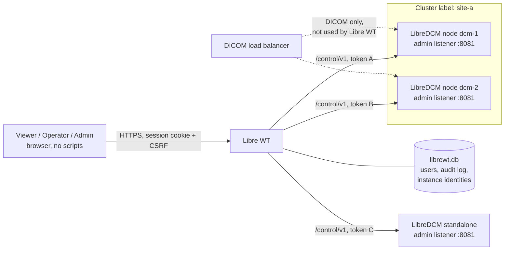
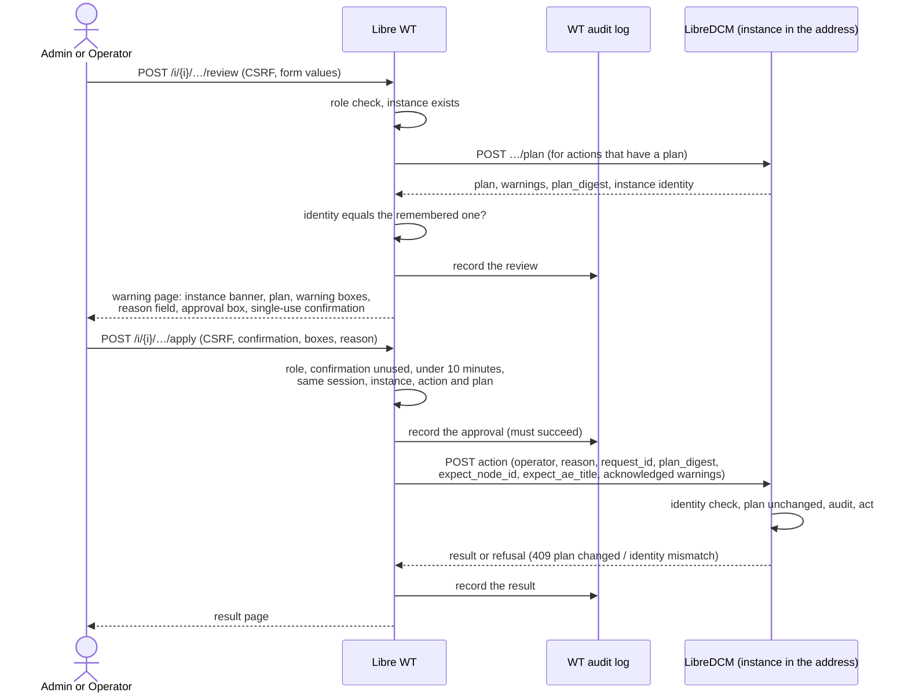
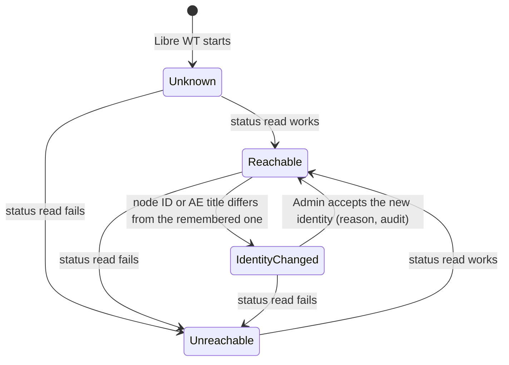

# Libre WT architecture (v0.1)

| | |
|---|---|
| Document | DHF-WT-ARCH |
| Status | **DRAFT** (2026-11-10); v0.2 part added 2026-11-14, **DRAFT for approval** |

| Item | Path | Responsibility |
|---|---|---|
| WT-SI-01 | `modules/wt/cmd/librewt` | Entry point: configuration (YAML + `LIBRE_WT_*`), wiring, HTTP(S) server, graceful shutdown |
| WT-SI-02 | `modules/wt/internal/accounts` | Users, roles, argon2id hashes, epochs, audit log (SQLite in the data directory) |
| WT-SI-03 | `modules/wt/internal/dcmclient` | LibreDCM control-API client (JSON contract only, no LibreDCM imports; architecture test `TestWTDoesNotImportDCM`) |
| WT-SI-04 | `modules/wt/internal/web` | Pages, sessions, CSRF, rate limiting, edit confirmations, security headers; templates and CSS embedded in the binary |

Resolve sequence: detail page → `GET /exceptions/{id}/review?action=` (Libre
WT asks LibreDCM for the plan, audits the review, issues a single-use
confirmation bound to session, exception, action and a digest of the plan) →
`POST /exceptions/{id}/resolve` (CSRF, role, confirmation, approve box,
reason; plan fetched again and compared; approval audited; LibreDCM
`POST /control/v1/conflicts/{id}/resolve` with operator, reason and
`confirm: true`; result audited).

Deployment: one container (`deploy/docker/Dockerfile.wt`, image `libre/wt`)
or the binary, next to LibreDCM. Libre WT keeps its own data directory and
can be upgraded separately from LibreDCM.

# Libre WT 0.2 architecture (DRAFT for approval, 2026-11-14)

Written by Hermes (Claude) for human review, before coding (issue #20).
Requirements: WT-SRS-013…036 (Draft). LibreDCM side:
`../libredcm/control-api-v1.md`, DCM-SRS-080…097 (Draft). The v0.1 text
above stays valid; this part adds to it.

## 1. Context



Libre WT talks to each node's admin listener directly, never through the
DICOM load balancer. Each LibreDCM stays the source of truth for its own
state. Libre WT stores no LibreDCM configuration and no patient data.

## 2. Software items (changes)

| Item | Path | Change in 0.2 |
|---|---|---|
| WT-SI-01 | `modules/wt/cmd/librewt` | Configuration gains `instances:`; the `dcm:` block of 0.1 is read as one instance named `default` |
| WT-SI-02 | `modules/wt/internal/accounts` | Audit entries gain an instance column (schema upgrade in place); new table for the remembered identity of each instance |
| WT-SI-03 | `modules/wt/internal/dcmclient` | One client per instance. New calls for every control endpoint. Still the JSON contract only, no LibreDCM imports (`TestWTDoesNotImportDCM`) |
| WT-SI-04 | `modules/wt/internal/web` | New pages (§3). One shared action flow for all state changes (§5). Role table in one place |
| WT-SI-05 (new) | `modules/wt/internal/fleet` | Registry of instances: name, cluster label, client, short status cache, remembered identity, supported features |

No new dependency is planned.

## 3. Screens

All pages are server-rendered HTML without scripts, under the same security
headers as 0.1 (WT-SRS-001). `{i}` is the instance name. Every `/i/{i}/…`
page shows the instance banner (WT-SRS-014).

| Screen | Address | Roles | Shows / does | Requirement |
|---|---|---|---|---|
| Fleet | `GET /` | All | All instances by cluster label; health, version, licence, counters; divergence flags | WT-SRS-016, -023 |
| Dashboard | `GET /i/{i}/` | All | Key values of one instance; links to its pages | WT-SRS-017 |
| Status | `GET /i/{i}/status` | All | Readiness checks, counters per DICOM service, backends, restart procedure note | WT-SRS-017 |
| Configuration | `GET /i/{i}/config` | Operator, Admin | Running settings, source, restart needed or not; secrets as set / not set | WT-SRS-019 |
| Destinations | `GET /i/{i}/remote-aes` | Operator, Admin | C-MOVE destinations in force; links to edit and to C-ECHO | WT-SRS-020 |
| Allow-list | `GET /i/{i}/allow-list` | Operator, Admin | Rules in force; "empty = everyone may connect" notice | WT-SRS-020 |
| Edit destinations / allow-list | `GET /i/{i}/config/edit`, `POST /i/{i}/config/review`, `POST /i/{i}/config/apply` | Admin | Form, then warning page with LibreDCM's plan, then apply | WT-SRS-021, -031 |
| Reload, rollback | `POST /i/{i}/reload/review`, `POST /i/{i}/reload/apply`, `POST /i/{i}/rollback/review`, `POST /i/{i}/rollback/apply` | Admin | Plan page with the difference, then apply | WT-SRS-022, -031 |
| C-ECHO test | `GET /i/{i}/echo`, `POST /i/{i}/echo` | Operator, Admin | Pick a destination (Admin: or free address), reason; result page | WT-SRS-024 |
| Studies | `GET /i/{i}/studies`, `POST /i/{i}/studies/search`, `GET /i/{i}/studies/{uid}` | Operator, Admin | Search form and results; study detail with series | WT-SRS-025 |
| Send | `POST /i/{i}/studies/{uid}/send/review`, `POST /i/{i}/studies/{uid}/send/apply` | Admin | Warning page with patient, study, destination; result | WT-SRS-026, -031 |
| Licence | `GET /i/{i}/license`, `POST /i/{i}/license/{action}/review`, `POST /i/{i}/license/{action}/apply` | View: all. Acknowledge: Operator, Admin. Other actions: Admin | State; acknowledge, request, install, activate | WT-SRS-027, -031 |
| Backup | `GET /i/{i}/backups`, `POST /i/{i}/backup/review`, `POST /i/{i}/backup/apply` | Operator, Admin | List; start a backup | WT-SRS-028, -031 |
| LibreDCM audit records | `GET /i/{i}/audit` | Admin | Recent records with filters | WT-SRS-029 |
| LibreDCM logs | `GET /i/{i}/logs` | Operator, Admin | Recent lines, level filter | WT-SRS-030 |
| Study Exceptions | `GET /i/{i}/exceptions…` (0.1 pages moved under the instance; `/exceptions` redirects when there is one instance) | As in 0.1 | As in 0.1 | WT-SRS-007…010 |
| Instance identity | `POST /i/{i}/identity/review`, `POST /i/{i}/identity/apply` | Admin | Accept a changed node ID or AE title | WT-SRS-015 |
| About | `GET /about` | All | Versions | WT-SRS-035 |
| Users, account, console audit | `/users`, `/account`, `/audit` | As in 0.1 | Audit gains an instance filter | WT-SRS-012, -033 |

Search values, reasons and licence keys are sent by `POST`, so they never
appear in an address (WT-SRS-032).

## 4. Libre WT and LibreDCM control API v1

| Libre WT function | Control API call (see `../libredcm/control-api-v1.md`) |
|---|---|
| Fleet, dashboard, status, about | `GET /control/v1`, `GET /control/v1/status` |
| Configuration, destinations, allow-list | `GET /control/v1/config`, `/remote-aes`, `/allow-list` |
| Edit | `POST /control/v1/config/plan`, `POST /control/v1/config` |
| Reload, rollback | `POST /control/v1/reload/plan`, `/reload`, `/config/rollback/plan`, `/config/rollback`, `GET /config/history` |
| C-ECHO test | `POST /control/v1/echo` |
| Studies | `GET /control/v1/studies` |
| Send | `POST /control/v1/send/plan`, `POST /control/v1/send` |
| Licence | `GET /control/v1/license`, `POST /control/v1/license/ack`, `/request`, `/install`, `/activate` |
| Backup | `GET /control/v1/backups`, `POST /control/v1/backup` |
| Audit records, logs | `GET /control/v1/audit`, `GET /control/v1/logs` |
| Study Exceptions | `/control/v1/conflicts…` (0.1) |

Status reads: Libre WT reads an instance's status when a page needs it and
keeps the answer for a few seconds (default 5) for all users, so many open
consoles do not load a node (WT-HAZ-16). The page shows the time of the
reading. There is no background change of state: Libre WT never acts on a
LibreDCM without a user request.

Timeouts: 5 seconds for reads, 30 seconds for actions. A send or a backup
may take longer: Libre WT then shows "still running, check the audit
records", and the request ID makes a repeat safe.

## 5. Action flow (all state changes)



One implementation of this flow serves every action (configuration change,
reload, rollback, send, licence actions, backup, C-ECHO, identity
acceptance, and the 0.1 resolve). Actions without a LibreDCM plan (backup,
C-ECHO, licence acknowledgement) still get a warning page that says what
will happen and on which instance.

## 6. Multi-instance connections

```yaml
instances:
  - name: dcm-1                 # letters, digits, - and _; unique
    cluster: site-a             # optional label; same label = one group on the fleet page
    url: https://dcm-1.example:8081
    token_file: ./tokens/dcm-1.token
    ca_file: ./tls/dcm-1.crt
  - name: dcm-2
    cluster: site-a
    url: https://dcm-2.example:8081
    token_file: ./tokens/dcm-2.token
```

- Instances come from the configuration file only. They are not added or
  changed in the browser: adding a connection means handling a token, which
  stays on the host.
- Each instance has its own token. A token never appears in pages, logs or
  the audit log.
- The cluster label groups instances on the fleet page and drives the
  divergence flags. It gives no cluster actions: every action is for one
  instance.
- Instances of one cluster usually share one index (PostgreSQL). Study
  Exceptions and study search then show the same data from each node. The
  pages say which instance answered.

State of an instance, as shown on the fleet page:



In the states `IdentityChanged` and `Unreachable`, Libre WT sends no action
to that instance (accepting the new identity is the one exception).

## 7. What Libre WT 0.2 does not do

No start, stop or restart of LibreDCM. No change of settings that need a
restart. No certificate generation. No image display, upload, download or
deletion. No cluster-wide action. No instance management in the browser. No
scripts in pages.

## 8. Open decisions for Patrick

Hermes chose these defaults where the instruction of 2026-11-14 left room.
Each can be changed before the code that depends on it is merged.

| # | Question | Default chosen | Why | Alternative |
|---|---|---|---|---|
| D1 | How does Libre WT know several LibreDCM? | Named connections in the Libre WT configuration file, each with its own token file; the instance is part of every page address; no "selected instance" in the session | A selected instance kept in the session is the classic way to act on the wrong node (WT-HAZ-05) | Manage connections in the browser (needs token entry and storage in Libre WT) |
| D2 | Clusters | A label per connection. Grouped display and divergence flags only. Every action is for one node | Rolling cluster actions need a control plane; too large and too risky for 0.2 | Cluster-wide apply, one node at a time, later |
| D3 | Which settings can be edited? | Only what LibreDCM can reload live today: C-MOVE destinations and the allow-list, through an overlay file owned and validated by LibreDCM. Everything else is read-only | A wrong restart-required value can stop a node from starting with nobody at the host (HAZ-004) | Edit more settings and mark them "applies at next restart" |
| D4 | Remote start, stop, restart | Not built. The status page names the host procedure | Brief of 2026-11-14; a remote stop makes images unavailable | Later, through the installer or an agent on the host |
| D5 | Roles | Viewer: fleet, status, licence state, exceptions (as 0.1). Operator: also configuration view, logs, study search, C-ECHO to configured destinations, backup, licence acknowledgement. Admin: all changes, send, licence installation, LibreDCM audit records | Follows the 2026-10-16 console spec (Operator runs, Admin changes) and least privilege for patient data | Viewer also sees configuration; Operator may reload |
| D6 | Send and C-ECHO targets | Send only to configured destinations. C-ECHO to configured destinations for Operators; a free address only for Admin | Images must never go to an address nobody configured (HAZ-005); the free C-ECHO is needed when connecting a new device | No free C-ECHO address at all |
| D7 | Licence actions | Acknowledge: Operator and Admin. Request, install, activate: Admin. Keys masked | Mirrors the command-line functions; installation changes what the site paid for | Admin only for everything |
| D8 | Backup | Written to a directory set in LibreDCM's own configuration; file name made by LibreDCM; never overwrites; no download and no delete in the console; SQLite index only | No path from the browser removes traversal and overwrite risks; the index holds patient data | Download for Admin over HTTPS only; retention rule |
| D9 | Audit records and logs | Recent records from fixed-size buffers in LibreDCM's memory (lost at restart). The site's log collector stays the record | No new store for patient data; no streaming needed | Persist audit records in the index database; live tail |
| D10 | Who is the operator for LibreDCM? | Libre WT sends the logged-in user's name with the shared admin token of that instance | Same model as 0.1; per-user tokens need an identity design | Per-user or per-console credentials, mutual TLS |
| D11 | Plain HTTP to LibreDCM | Allowed, with a warning on the instance's pages and in the log when the address is not loopback | Docker networks on one host use plain HTTP today; refusing would break existing installs | Refuse actions (or all use) over plain HTTP to non-loopback addresses |
| D12 | How is "what I approved is what happens" kept? | LibreDCM returns a digest of the plan; the action must carry it; LibreDCM refuses when the state changed. A request ID makes repeats harmless | No state kept on LibreDCM between plan and apply; safe against double clicks and stale pages | Server-side plan store with expiry |
| D13 | REST or gRPC | REST (`/control/v1`), growing by addition only | Decision of 2026-11-10 kept; no streaming needed with D9 | gRPC when live log streaming is wanted |
| D14 | Metrics | Libre WT shows the counters from the status endpoint. It does not proxy `/metrics` and draws no history graphs | Prometheus and Grafana already do history; pages stay script-free | Simple history kept in Libre WT |
| D15 | `-gen-cert` | Not in the console. TLS on or off is shown | It writes a private key on the host and needs a restart | Offer it together with a restart function, later |
| D16 | Image upload (C-STORE from the console), C-GET to the browser | Not built. C-STORE and C-GET activity is shown as counters and audit records | Importing images is a new clinical data path with its own hazards; Libre WT does not handle images | Separate import tool, later |
| D17 | Reload from the console: is a plan needed? | Yes. `POST /control/v1/reload` needs `confirm` and the digest of the plan the administrator saw; changes that empty the allow-list or remove or retarget a destination must be acknowledged by code. SIGHUP on the host stays as it is (card WT-0.2/3) | A reload applies whatever is in the file at that moment; the console user may not be the person who edited it (HAZ-015) | Reload without a plan, as SIGHUP |
| D18 | Audit records per action | Two: one before the action (no record, no action) and one with the outcome. Written at every log level and also with `audit_log_off` (card WT-0.2/3) | "Audit before acting" and "audit the outcome" can not both be one record | One record after the action; administrative actions silenced by `audit_log_off` |
| D19 | Do plan endpoints need operator, reason and request ID? | No. They change nothing and are not audited by LibreDCM; they do check the expected node (card WT-0.2/3) | Less noise in the audit trail; Libre WT audits who opened the page | Require and audit them |
| D20 | Backup directory | Off until `control.backup_dir` (`LIBRE_DCM_CONTROL_BACKUP_DIR`) is set; the installer does not set it. Suggested value in the workstation install: `/var/lib/libredcm/backups` (card WT-0.2/3) | A new place that holds patient data should be a decision of the site | Installer sets it by default |
| D21 | C-ECHO over TLS to a free address | The peer certificate is not checked; the response says `tls_verified: false`. Configured remote AEs are tested without TLS, as C-MOVE sends today (card WT-0.2/3) | Same as the command-line `-echo-tls`: a reachability test, often of a self-signed peer; no patient data is sent | Check against the system trust store, with a switch |
| D22 | Licence acknowledgement through the API | Allowed for any holder of the admin token, under the operator name it sends; it lifts the reload block for 24 hours as the command line does (card WT-0.2/3) | Same effect and same audit as `-license-ack NAME`; licensing must only inconvenience administrators | Keep the acknowledgement on the host only |
