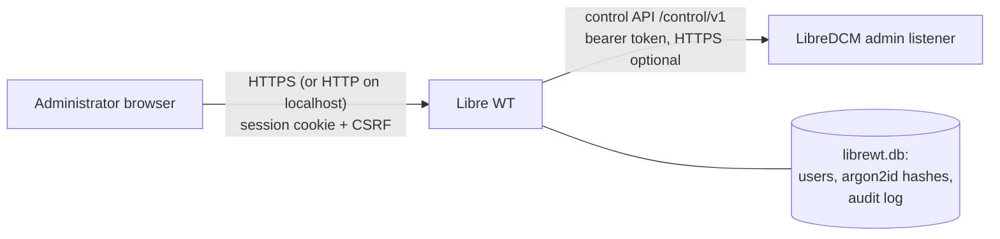
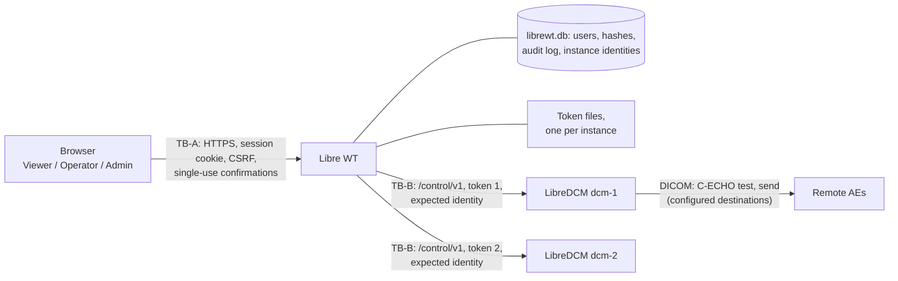

# Libre WT cybersecurity

| | |
|---|---|
| Document | DHF-WT-SEC |
| Status | **DRAFT** (2026-11-10); v0.2 part added 2026-11-14, **DRAFT for approval**; verification state updated 2026-11-16 (card WT-0.2/5) |

## Architecture and trust boundaries

| Boundary | Crosses | Threats | Controls |
|---|---|---|---|
| Browser ↔ Libre WT | Logins, pages, edit approvals | Credential theft, session hijack, CSRF, clickjacking, XSS | HTTPS (WT-SRS-001), argon2id + policy (-003), rate limits + CSRF (-004), HttpOnly/SameSite=Strict/Secure cookies, idle/absolute timeouts (-005), no scripts + strict CSP, `X-Frame-Options: DENY`, html/template escaping |
| Libre WT ↔ LibreDCM | Conflict data (PHI), resolve requests | Token theft, MITM, forged edits | Token from file, never displayed; TLS with pinned CA option (-006); LibreDCM refuses control requests without a configured token and without `confirm` (DCM-SRS-077) |
| Host ↔ data directory | Account DB, audit log | Tampering, theft of hashes | Directory created 0700; hashes only; audit log is append-only by API (no edit or delete function) |

## Threats (STRIDE)

| ID | STRIDE | Threat | Controls | Verification | Status | Gap |
|---|---|---|---|---|---|---|
| WT-TM-01 | S | Password guessing / default credentials | -002, -003, -004 rate limit | `TestFirstAdminOnce`, `TestPasswordsArgon2id`, `TestLoginRateLimit` | C | TOTP planned |
| WT-TM-02 | T | CSRF makes an admin resolve an exception | CSRF token on every POST, SameSite=Strict, single-use edit confirmation | `TestSessionCookieHeadersAndCSRF`, `TestReviewAndApproveEdit` | C | — |
| WT-TM-03 | E | Viewer escalates to resolve | Server-side role check on every request | `TestViewerRole` | C | — |
| WT-TM-04 | I | XSS / clickjacking expose PHI | No scripts, CSP `default-src 'none'`, frame-ancestors none, template escaping | `TestSessionCookieHeadersAndCSRF` (headers) | C | — |
| WT-TM-05 | S | Session survives a disabled account or role change | Epoch check on every request | `TestSessionEndsOnAccountChangeAndIdle` | C | — |
| WT-TM-06 | I | LibreDCM token leaked | Never rendered; token file; startup refuses missing token | `TestUsersAuditAndDCMDown`, `TestClientContract` | C | Rotation guidance |
| WT-TM-07 | R | Edits can't be attributed | WT audit before sending; operator in LibreDCM audit | `TestReviewAndApproveEdit`, LibreDCM `TestResolveCorrectIncoming` | P | Audit export/ATNA later |
| WT-TM-08 | I | Plain HTTP on a network | Warning at startup; installer guidance to bind 127.0.0.1 or configure TLS | Manual | P | HTTPS by default when packaged |

## Dependencies

New direct dependency `golang.org/x/crypto` (argon2), BSD-3-Clause, already in
the module graph; SQLite via `modernc.org/sqlite` (shared with LibreDCM). See
`soup.md`.

## Static analysis (gosec v2.30.0, 2026-11-10)

Findings fixed: G202 (SQL string concatenation in account updates: each
update now uses a constant statement). Suppressed with reason: G124 on the
two `http.SetCookie` calls, because `Secure` follows the HTTPS setting
(plain HTTP is meant for 127.0.0.1 only and logs a warning at startup);
HttpOnly and SameSite=Strict are always set. govulncheck: no called
vulnerabilities.

## Libre WT 0.2: threats for the new functions (DRAFT for approval, 2026-11-14)

Written by Hermes (Claude) for human review, before coding (issue #20).
Nothing below is implemented yet: status **O** (open) until the implementing
pull request adds the verification. LibreDCM's side: `../libredcm/cybersecurity.md`
§3a (TM-19…30).

### Trust boundaries with several instances

| Boundary | New in 0.2 | New threats | Planned controls |
|---|---|---|---|
| TB-A browser ↔ Libre WT | Many more state-changing forms; patient data on study, audit and log pages; licence keys typed into forms | CSRF or a hijacked session changes the archive's configuration or sends studies; patient data or keys left in addresses, caches, logs | One action flow with CSRF, role check and single-use confirmation for every change (WT-SRS-031); values sent by `POST`; no-store; keys never logged (WT-SRS-032); roles (WT-SRS-034) |
| TB-B Libre WT ↔ each LibreDCM | Several tokens; actions that change configuration and move images | Token of one instance used against another; action reaches the wrong node; secrets or patient data in transit | One token per instance, from files; expected identity on every action (WT-SRS-015); HTTPS with CA file, warning on plain HTTP (WT-SRS-036); LibreDCM never returns secrets (DCM-SRS-082) |
| Host ↔ Libre WT files | More token files | Theft of tokens | Files readable by the service user only (install guidance); tokens never copied into the database |

### Threats (STRIDE)

| ID | STRIDE | Threat | Planned controls | Planned verification | Status | Gap that stays |
|---|---|---|---|---|---|---|
| WT-TM-09 | T | CSRF or a forged form makes an Admin change the allow-list, reload, send a study, install a licence or start backups | CSRF token on every POST; SameSite=Strict; single-use confirmation bound to session, instance, action and plan; approval box and reason (WT-SRS-031) | Test per action: no CSRF token, reused confirmation, confirmation of another instance or action, all refused; mutation check of the guard | O | — |
| WT-TM-10 | E | Viewer or Operator reaches an Admin function by typing its address | Role table checked on the server for every route (WT-SRS-034); controls hidden when not allowed | Table-driven test over every route and role | O | — |
| WT-TM-11 | T | Action lands on another instance than shown (tampered form field, stale tab, changed DNS) | Instance only from the page address; confirmation bound to it; expected node ID and AE title sent; LibreDCM refuses a mismatch (WT-SRS-014, -015; DCM-SRS-097) | Test with two fake LibreDCM: confirmation from one refused for the other; identity change blocks actions | O | — |
| WT-TM-12 | I | Secrets shown or stored: admin tokens, redacted settings, licence keys | Never rendered, logged or audited; licence key fields are password fields sent by POST; LibreDCM redacts at the source (WT-SRS-032, -019, -027) | Test that searches every page, the log and the audit log for the configured tokens and a typed licence key | O | — |
| WT-TM-13 | I | Patient data on study, audit and log pages reaches people without need, or stays in browser caches and history | Roles (WT-SRS-034); no-store on every page; search values sent by POST and not placed in addresses; every opening audited (WT-SRS-033) | Header test; role test; audit test | O | Screens can be photographed; no second factor yet |
| WT-TM-14 | T/I | Text from LibreDCM (error messages, log lines, AE titles, patient names) carries markup that changes the page | html/template escaping everywhere; no scripts allowed by the CSP; log lines shown as plain text (WT-SRS-032, -001) | Test with markup in every field returned by a fake LibreDCM | O | — |
| WT-TM-15 | S | A malicious or wrong server answers at an instance's address and feeds false status or collects the token | HTTPS with the instance's CA file; identity remembered and checked; plain-HTTP warning (WT-SRS-015, -036) | Identity-change test; TLS test with a wrong certificate | O | Plain HTTP stays possible (decision D11) |
| WT-TM-16 | D | Many page loads or large searches make Libre WT load the LibreDCM nodes | Short shared status cache; timeouts; bounded searches; LibreDCM limits (DCM-SRS-096) | Test: several page loads cause one status read within the cache time | O | — |
| WT-TM-17 | E | Free C-ECHO address used to probe the network | Admin only; reason; audit on both sides (WT-SRS-024) | Role test; audit test | O | An Admin can still probe; it is recorded |
| WT-TM-18 | R | An action can't be tied to a person or to an instance | Audit before sending, with instance, action, reason, outcome; operator forwarded to LibreDCM (WT-SRS-033, -031) | Audit tests; test that a failing audit write stops the action | O | Shared accounts are a site matter; audit export later |
| WT-TM-19 | T | Wrong or hostile entry in the instances configuration (duplicate name, missing token, odd characters in a name used in addresses) | Strict name pattern; unique names; refuse to start (WT-SRS-013) | Configuration tests | O | — |

### State after card WT-0.2/5 (2026-11-16)

Card WT-0.2/5 built the connections to several instances, the fleet,
dashboard, status and about pages and the identity check. Status of the
threats above that it touches (C = control verified, P = partly, O = open):

| ID | Status | What is verified now | Tests |
|---|---|---|---|
| WT-TM-09 | P | For the resolve of a Study Exception and for accepting an instance identity: CSRF token, single-use confirmation bound to session, instance, action and plan, approval box, reason. Other actions come with their cards | `TestReviewAndApproveEdit`, `TestInstanceFromAddressOnly`, `TestIdentityChangeBlocksActionsUntilAccepted`, `TestIdentityAcceptedThenActionsResume` |
| WT-TM-10 | P | One role table for every address behind the login; walked for every role and without a session. New addresses must be added to the reviewed table in the test | `TestRoleTable` |
| WT-TM-11 | C (for the actions that exist) | Instance only from the address; a form field or query value can't select one; confirmation of one instance refused on another; identity change blocks actions; expected node ID and AE title sent; the real LibreDCM refuses a wrong one | `TestInstanceFromAddressOnly`, `TestIdentityChangeBlocksActionsUntilAccepted`, `TestLibreDCMRefusesWrongNode`, `TestAgainstRealLibreDCM` |
| WT-TM-12 | P | Admin tokens of every instance appear on no page, in no log line and in no start-up error | `TestFleetPage`, `TestDashboardStatusAndAbout`, `TestUsersAuditAndDCMDown`, `TestInstancesConfiguration`, `TestConnectionsValidated` |
| WT-TM-14 | P | Markup in the AE title, node ID, version, digest, check names and errors, licence text, counter names, patient name, source AE and study description stays text on every page that exists | `TestTextFromLibreDCMIsNeverMarkup` |
| WT-TM-15 | P | Identity remembered and checked; plain-HTTP warning. The TLS test with a wrong certificate is not written yet | `TestIdentityRememberedAndChangeDetected`, `TestPlainHTTPWarningOnPages`, `TestPlainHTTPRemote` |
| WT-TM-16 | P | 21 page loads inside the cache time cause one status read; status reads time out | `TestStatusReadIsCachedAndShared`, `TestClientStatusDiscoveryAndExpectedIdentity` |
| WT-TM-19 | C | Duplicate names (also by case), other characters, long names, missing token, empty token file, both configuration forms: refused at start | `TestConnectionsValidated`, `TestInstancesConfiguration` |

New points:

- **Trust on first use.** The node ID and AE title of a newly configured
  instance are remembered from its first answer (open decision D33). An
  attacker who answers at the address before the real node is ever reached
  would be remembered. The address and the token come from the host's
  configuration file; with HTTPS and a CA file the first answer is
  authenticated.
- **The token goes to whoever answers.** Libre WT sends the admin token to
  the configured address before it can check the identity. Over plain HTTP
  to another machine this exposes the token on the network (warning,
  WT-SRS-036; decision D11).
- **Instance names in addresses.** Names are limited to letters, digits,
  `-` and `_`, checked at start; the name in a request is matched exactly
  against the configured list, never used to build a file path or a query.
- **Redirects stay on the server.** `/i/<name>` redirects only for a
  configured instance, and the target is built from the configured name. An
  unknown name, however it is written, gives "not found". The 0.1 addresses
  redirect to `/i/<configured name>/exceptions…`. No redirect target takes
  a host from the request (`TestInstanceFromAddressOnly`,
  `TestOldAddressesWithOneInstance`).
- **The instance filter of the audit page** takes its value from the
  address (`?instance=`). The value is an instance name, not a secret, and
  an unknown value is ignored.
- **Identity acceptance** is a new state-changing function of Libre WT
  itself (Admin only, CSRF, single-use confirmation, approval box, reason,
  audit record before the change). It sends nothing to LibreDCM.
- **Database upgrade.** `librewt.db` is upgraded in place (one new column,
  one new table). No secret is added to it: tokens are never stored.

### Dependencies and static analysis

No new dependency in card WT-0.2/5 (`go.mod` and `go.sum` unchanged). gosec
v2.30.0 and govulncheck v1.9.0 results are in the pull request.

### State after card WT-0.2/6 (2026-11-16)

Card WT-0.2/6 added the configuration, destinations and allow-list views,
the edit of the destinations and the allow-list, reload, rollback and the
C-ECHO test. These are the first Libre WT functions that change a LibreDCM's
network behaviour. Status of the threats they touch (C = control verified,
P = partly, O = open):

| ID | Status | What is verified now | Tests |
|---|---|---|---|
| WT-TM-09 | P | For edit, reload, rollback and C-ECHO: CSRF token (missing, wrong, another session's: refused, nothing reaches LibreDCM, not even a plan request); single-use confirmation bound to session, instance, action and plan; expiry; approval box; reason; one box per warning. What is sent is kept on the server from the review, so a forged apply form can't change it. Send, licence and backup come with their cards | `TestConfigEditFlow`, `TestConfigEditWarningsAndRefusals`, `TestReloadAndRollback`, `TestEcho`, `TestConfigRolesAndCSRF`, `TestOpenApprovalsAreBounded` |
| WT-TM-10 | P | 13 new addresses in the reviewed role table; each walked for every role with a valid form (refused below its role, nothing reaches LibreDCM) and without a session. The free C-ECHO address is refused for an Operator inside the handler, at review and at apply. Pages show no control the role can't use (dashboard, tabs, configuration pages) | `TestRoleTable`, `TestConfigRolesAndCSRF`, `TestEcho` |
| WT-TM-11 | C (for the actions that exist) | No plan request and no action while the node differs or can't be reached; confirmation of one instance refused on another; expected node sent; LibreDCM's "instance mismatch" reported; an answer of a read that names another node is not shown | `TestConfigActionsNeedTheRememberedNode`, `TestReadAnsweredByAnotherNode`, `TestConfigEditFlow` |
| WT-TM-12 | P | Redacted settings shown only as set, not set or hidden; the client drops a value LibreDCM sent by mistake for a redacted setting; admin token on no page and in no log line. Licence keys come with card WT-0.2/7 | `TestConfigPage`, `TestConfigDropsRedactedValues`, `TestConfigAgainstRealLibreDCM` |
| WT-TM-14 | P | Markup in setting values, LibreDCM's warning messages and refusal texts, destination names typed back into the form: shown as text | `TestConfigPage`, `TestConfigEditWarningsAndRefusals`, `TestActionRefusalsAreShown` |
| WT-TM-17 | C | Free C-ECHO address Admin only (role and handler); host, port and AE title checked before sending (no URL, path or user part; port 1 to 65535; AE title 1 to 16 characters); reason; audit on both sides; LibreDCM returns only fixed error texts | `TestEcho`, `TestConfigRolesAndCSRF`, `TestConfigAgainstRealLibreDCM` |
| WT-TM-18 | P | For the new pages and actions: page openings, reviews, approvals (written before sending; no record, nothing sent) and results with instance, target, reason, request ID and outcome (`unknown` without an answer); LibreDCM's own records carry the same request ID and the Libre WT user | `TestConfigPage`, `TestNoAuditNoConfigAction`, `TestNoAnswerMeansUnknownOutcome`, `TestConfigAgainstRealLibreDCM` |

New points:

- **Request IDs.** Every action carries a random 128-bit request ID
  (`crypto/rand`, 32 hexadecimal characters), made on the server at
  approval. It ties the Libre WT audit record to LibreDCM's two records. It
  is not a secret.
- **Approval store.** Pending approvals are kept in memory with the
  session: at most 20 per session, 10 minutes each, removed at logout.
  They hold the reviewed value (destination table, rules, C-ECHO target),
  never a secret. A restart of Libre WT drops them: the person reviews
  again.
- **Network reach of the node.** The C-ECHO test makes the LibreDCM host
  open a TCP connection to an address an Admin typed. Libre WT checks the
  form; LibreDCM checks it again and returns no peer bytes (DCM-SRS-087).
  Residual: an Admin can learn which hosts answer; it is recorded.
- **Action timeout.** Libre WT waits at most 30 seconds for an action and
  5 seconds for a read or a plan. The C-ECHO itself is bounded by LibreDCM
  (15 seconds).

### Dependencies and static analysis (card WT-0.2/6)

No new dependency (`go.mod` and `go.sum` unchanged). gosec v2.30.0 and
govulncheck v1.9.0 results are in the pull request.

### State after card WT-0.2/7 (2026-11-16)

Card WT-0.2/7 added the licence page (acknowledge, request file, install
file, activate online) and the index backup. Status of the threats they
touch (C = control verified, P = partly, O = open):

| ID | Status | What is verified now | Tests |
|---|---|---|---|
| WT-TM-09 | P | For the four licence actions and the backup: CSRF token (missing, wrong, another session's: refused, nothing reaches LibreDCM), single-use confirmation bound to session, instance, action and input (licence file checksum, key end, site), approval box, reason. The acknowledgement also needs the person's own user name. What is sent (key, site, licence file) is kept on the server from the review. Send comes with card WT-0.2/8 | `TestLicenceAckFlow`, `TestLicenceInstallFlow`, `TestLicenceActivateAndRequest`, `TestBackupFlow`, `TestLicenceBackupRolesAndCSRF` |
| WT-TM-10 | P | 12 new addresses in the reviewed role table (licence view: all; every licence action: Admin, D47; backup: Operator and Admin), each walked for every role with a valid form and without the CSRF token; the upload address too. Licence actions are shown to Admins only; the backup tab not to Viewers | `TestRoleTable`, `TestLicenceBackupRolesAndCSRF`, `TestLicencePage` |
| WT-TM-11 | C (for the actions that exist) | Licence and backup actions: nothing sent while the node differs; expected node sent; LibreDCM's "instance mismatch" reported; licence and backup lists answered by another node are not shown | `TestLicenceBackupGuards` |
| WT-TM-12 | P | Licence keys: password field, shown only as `••••` plus the last four characters, also when LibreDCM sends more; removed from LibreDCM's error text in any case; in no page, log line or audit record; the request text (holds the key, encoded) only as a download. Licence file content in no page, log line or audit record. Search values and LibreDCM audit records come with card WT-0.2/8 | `TestLicenceActivateAndRequest`, `TestLicenceInstallFlow`, `TestLicencePage`, `TestLicenceKeyIsMasked`, `TestLicenceAndBackupRequests` |
| WT-TM-14 | P | Markup in licence message, site, customer and backup texts: shown as text | `TestLicencePage`, `TestBackupFlow` |
| WT-TM-18 | P | Reviews, approvals (before sending; no record, nothing sent) and results of every licence and backup action; `unknown` without an answer; LibreDCM's own backup record carries the Libre WT user and reason | `TestLicenceAckFlow`, `TestLicenceBackupGuards`, `TestBackupWithoutAnswer`, `TestLicenceAndBackupAgainstRealLibreDCM` |

New points:

- **File upload (new attack surface).** One address only,
  `POST /i/{i}/license/install/review`, Admin only, reads
  `multipart/form-data`. The whole body is capped at 192 KiB by
  `http.MaxBytesReader` and parsed in memory (nothing is written to disk;
  any temporary parts are removed at the end of the request). The CSRF
  token is checked after parsing, before the handler runs. The file must be
  UTF-8 text without NUL bytes, 128 KiB at most. Only its base name is
  kept, cut to 100 characters and shown as text. The content goes to
  LibreDCM, which checks the signature; Libre WT never renders it. A
  multipart body sent to any other address is not parsed, so it fails the
  CSRF check (`TestLicenceInstallFlow`).
- **Download (new).** The activation request is the only response of Libre
  WT that is not a page: `text/plain`, `Content-Disposition: attachment`,
  with `nosniff`, `no-store` and the strict CSP of every response. The file
  name is built from the configured instance name and the time, never from
  request text.
- **Secrets in memory.** A typed licence key and an uploaded licence file
  are kept with the pending approval: at most 10 minutes, at most 20 per
  session, dropped at logout and at restart. They are never written to
  disk, the log or the audit log.
- **Action timeouts.** Online activation waits up to 45 seconds; a backup
  up to 110 seconds (below the HTTP client and web-server timeouts). After
  that the outcome is recorded as `unknown`; LibreDCM finishes a backup
  and lists the file.

### Dependencies and static analysis (card WT-0.2/7)

No new dependency (`go.mod` and `go.sum` unchanged; `mime/multipart` and
`unicode/utf8` are standard library). gosec v2.30.0 and govulncheck v1.9.0
results are in the pull request.

### State after card WT-0.2/8 (2026-11-16)

Card WT-0.2/8 added the study search with study and series pages, the send
of a study, the LibreDCM audit record page, the log page and the CSV export.
It is the last action card, so the threats of the action flow can now be
judged for every action. Status (C = control verified, P = partly, O =
open):

| ID | Status | What is verified now | Tests |
|---|---|---|---|
| WT-TM-09 | C | Send: CSRF token, single-use confirmation bound to session, instance, action, study and LibreDCM's plan; approval box naming the patient; reason. The request comes from the server-side approval; fields added to the approval form are ignored; an approval for one study can't send another (study in the address checked) nor be used on another instance. With cards WT-0.2/6 and /7 every action of WT-SRS-031 is covered | `TestSendFlow`, `TestSendWrongPatientGuard`, `TestRoleTable` |
| WT-TM-10 | C | 10 new addresses in the reviewed role table (studies: Operator; send: Admin, D52; audit records and both exports: Admin; logs: Operator, D53), each walked for every role. Controls and tabs shown only to roles that can use them | `TestRoleTable`, `TestStudyAndSeriesPages`, `TestLogsPage` |
| WT-TM-11 | C | Send: no review while the node differs; the expected node is sent with the plan and the send; a plan, a search answer or a study answer that names another node is not shown and gets no approval | `TestSendWrongPatientGuard`, `TestStudySearch` |
| WT-TM-12 | C | No token or key on the new pages or in their audit records; search values and filters never in a page address except the fixed filter choices of the audit and log pages (no patient data) | `TestStudySearch`, `TestLibreDCMAuditPage`, `TestConfigPage`, `TestLicenceKeyIsMasked` |
| WT-TM-13 | P | Study, audit and log pages: role limits, `no-store`, search values by `POST`, every opening audited (no record, no page), Study Exceptions views audited too (D56); exports Admin only and audited (no record, no file). Gap that stays: screens and exported files can be copied; no second factor yet | `TestStudySearch`, `TestStudyAndSeriesPages`, `TestLibreDCMAuditPage`, `TestLogsPage`, `TestCSVExport`, `TestExceptionViewsAudited` |
| WT-TM-14 | C | Markup in LibreDCM's error text, patient names, audit fields and log messages is shown as text; log and audit lines are parsed as JSON and printed as text, never as markup | `TestStudySearch`, `TestLibreDCMAuditPage`, `TestActionRefusalsAreShown` |
| WT-TM-16 | P | Searches are bounded (50 rows per page, 200 for series and instances; LibreDCM allows four queries at once and pages up to 10 000 rows); no search without a value; ring reads bounded by the fixed limits (at most 500 records or 1000 lines) | `TestStudySearch`, `TestStudySearchMore`, `TestRingFilterQuery` |
| WT-TM-18 | C | Every action, page opening with patient data, audit or log view and export is recorded with user, address, instance, target and outcome; approvals before sending; searches with their values (D55); LibreDCM's own `Query` record names the Libre WT user | `TestSendFlow`, `TestSendResults`, `TestStudySearch`, `TestCSVExport`, `TestStudiesAuditLogsAgainstRealLibreDCM` |

New points:

- **CSV export (new download).** `GET /i/{i}/audit.csv` and `/logs.csv`,
  Admin only: `text/csv; charset=utf-8`, `Content-Disposition:
  attachment`, `nosniff`, `no-store` and the strict CSP of every response.
  The file name is built from the configured instance name and the time.
  Cells that a spreadsheet would run as a formula (starting with `=`, `+`,
  `-`, `@`, tab, carriage return) get a leading apostrophe (CSV injection,
  WT-SRS-037). The export is audited before the file is sent.
- **Patient identifiers in `librewt.db`.** The audit log keeps the values
  of each search (D55). Protect the Libre WT data folder like the LibreDCM
  index; back it up as a record.
- **Study UIDs in addresses.** Study and series pages carry the Study and
  Series Instance UID in their address (`GET`), so they can be linked and
  reloaded. UIDs are not names or patient IDs; the search values that are
  (Patient ID, name, accession number) are sent by `POST` only.
- **Send timeout.** Libre WT waits 110 seconds for a send (D54), then
  records `unknown`; LibreDCM finishes the send.

### Dependencies and static analysis (card WT-0.2/8)

No new dependency (`go.mod` and `go.sum` unchanged; `encoding/csv` is
standard library). gosec v2.30.0 and govulncheck v1.9.0 results are in the
pull request.
