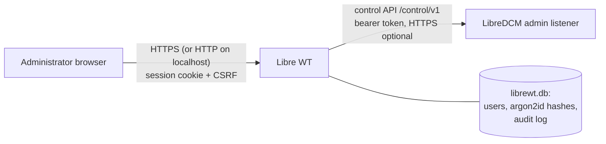

# Libre WT cybersecurity

| | |
|---|---|
| Document | DHF-WT-SEC |
| Status | **DRAFT** (2026-11-10) |

## Architecture and trust boundaries

| Boundary | Crosses | Threats | Controls |
|---|---|---|---|
| Browser ↔ Libre WT | Logins, pages, edit approvals | Credential theft, session hijack, CSRF, clickjacking, XSS | HTTPS (WT-SRS-001), argon2id + policy (-003), rate limits + CSRF (-004), HttpOnly/SameSite=Strict/Secure cookies, idle/absolute timeouts (-005), no scripts + strict CSP, `X-Frame-Options: DENY`, html/template escaping |
| Libre WT ↔ LibreDCM | Conflict data (PHI), resolve requests | Token theft, MITM, forged edits | Token from file, never displayed; TLS with pinned CA option (-006); LibreDCM refuses control requests without a configured token and without `confirm` (DCM-SRS-077) |
| Host ↔ data directory | Account DB, audit log | Tampering, theft of hashes | Directory created 0700; hashes only; audit log is append-only by API (no edit or delete function) |

## Threats (STRIDE)

| ID | STRIDE | Threat | Controls | Verification | Status | Gap |
|---|---|---|---|---|---|---|
| WT-TM-01 | S | Password guessing / default credentials | -002, -003, -004 rate limit | `TestFirstAdminOnce`, `TestPasswordsArgon2id`, `TestLoginRateLimit` | C | TOTP planned |
| WT-TM-02 | T | CSRF makes an admin resolve an exception | CSRF token on every POST, SameSite=Strict, single-use edit confirmation | `TestSessionCookieHeadersAndCSRF`, `TestReviewAndApproveEdit` | C | — |
| WT-TM-03 | E | Viewer escalates to resolve | Server-side role check on every request | `TestViewerRole` | C | — |
| WT-TM-04 | I | XSS / clickjacking expose PHI | No scripts, CSP `default-src 'none'`, frame-ancestors none, template escaping | `TestSessionCookieHeadersAndCSRF` (headers) | C | — |
| WT-TM-05 | S | Session survives a disabled account or role change | Epoch check on every request | `TestSessionEndsOnAccountChangeAndIdle` | C | — |
| WT-TM-06 | I | LibreDCM token leaked | Never rendered; token file; startup refuses missing token | `TestUsersAuditAndDCMDown`, `TestClientContract` | C | Rotation guidance |
| WT-TM-07 | R | Edits can't be attributed | WT audit before sending; operator in LibreDCM audit | `TestReviewAndApproveEdit`, LibreDCM `TestResolveCorrectIncoming` | P | Audit export/ATNA later |
| WT-TM-08 | I | Plain HTTP on a network | Warning at startup; installer guidance to bind 127.0.0.1 or configure TLS | Manual | P | HTTPS by default when packaged |

## Dependencies

New direct dependency `golang.org/x/crypto` (argon2), BSD-3-Clause, already in
the module graph; SQLite via `modernc.org/sqlite` (shared with LibreDCM). See
`soup.md`.

## Static analysis (gosec v2.30.0, 2026-11-10)

Findings fixed: G202 (SQL string concatenation in account updates: each
update now uses a constant statement). Suppressed with reason: G124 on the
two `http.SetCookie` calls, because `Secure` follows the HTTPS setting
(plain HTTP is meant for 127.0.0.1 only and logs a warning at startup);
HttpOnly and SameSite=Strict are always set. govulncheck: no called
vulnerabilities.
