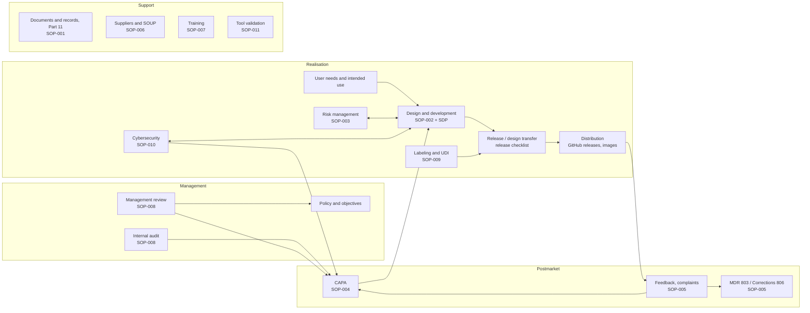

# Quality manual

| | |
|---|---|
| Document | QMS-QM-001 |
| Status | **DRAFT for approval** (written 2026-11-10 by Hermes/Claude). Becomes effective when approved by top management at the QMS baseline |
| Organisation | Libre Systems (to be formed; legal manufacturer). Until it exists: Patrick Mulcahy, Mulcahy.io, acting for Libre Systems |
| Standards | 21 CFR Part 820 (QMSR, effective 2026-02-02), which incorporates ISO 13485:2016 by reference (§820.7, §820.10); 21 CFR Part 11; ISO 14971:2019; IEC 62304 Ed 1.1; IEC 81001-5-1 |

## 1. Purpose

This manual describes the quality management system (QMS) of Libre Systems:
its scope, the quality policy and objectives, the organisation, the
processes and how they interact, and where each requirement of ISO 13485 and
the QMSR is met (ISO 13485 §4.2.2).

## 2. Scope of the QMS

**Activities covered:** design and development, release, distribution
(download from GitHub releases and container registries), maintenance and
postmarket surveillance of **standalone medical-device software** and the
software components that are planned to become part of a medical device:

- the Libre RWS PACS (future device; 21 CFR 892.2050, product code LLZ,
  Class II) and its modules: LibreDCM (archive, today a non-device function
  under FD&C Act §520(o)(1)(D)), Libre WT (management console), the LibreKey
  client, and future modules (LibreRIS, LibreHL7, LibreRPT, LibreBIL);
- supporting systems that affect the device's safety or availability but are
  not part of it (the LibreKey licence server) are covered through supplier
  control and the risk files.

**Sites:** no physical manufacturing site. Work is done remotely; records
are held in GitHub (`mulcahyio/libre-rws`, later a Libre Systems
organisation) and Google Drive (`LibreRWS/QMS`).

### 2.1 Exclusions and non-applicable requirements

| ISO 13485 clause | Status | Justification |
|---|---|---|
| 6.4.2 Contamination control | Not applicable | Software only; no physical product |
| 7.5.2 Cleanliness of product | Not applicable | Software only |
| 7.5.3 Installation activities | Applies in part | Customers install the software themselves with the supplied installer and instructions (`deploy/workstation/INSTALL.md`); the installer verifies the installation (DCM-SRS-056). No installation by Libre Systems staff today |
| 7.5.4 Servicing | Applies as software maintenance | Covered by the SDP (IEC 62304 §6) and the complaint and CAPA procedures |
| 7.5.5, 7.5.7 Sterile devices, sterilization validation | Not applicable | Software only |
| 7.5.9.2 Traceability for implantable devices | Not applicable | Not implantable |
| 7.6 Control of monitoring and measuring equipment | Not applicable | No physical measuring equipment. Software tools used to produce or check records are validated under §4.1.6 (QMS-SOP-011) |

## 3. Quality policy

> Libre Systems builds open, dependable software for medical imaging. We
> keep patients and their data safe by managing risk in every change, we
> meet the regulations and standards that apply to our products, we keep
> records that show what we did and why, and we improve the QMS and our
> products from what we learn in testing, review, use and complaints.
> Every person and tool that contributes, including AI coding tools under
> human review, follows this system.

*(Draft wording for approval by top management. ISO 13485 §5.3.)*

## 4. Quality objectives

Measured at each management review (QMS-SOP-008). Targets are proposals
for approval.

| # | Objective | Measure | Target |
|---|---|---|---|
| QO-1 | Every change is design-controlled | Share of merged PRs to `master` with a linked issue, a complete PR template and green CI | 100 % |
| QO-2 | Requirements are verified | Active requirements with verification (`trace.py`) at each release | 100 % |
| QO-3 | Known vulnerabilities are handled in time | Critical/high vulnerabilities fixed or mitigated within the SECURITY.md targets | 100 % |
| QO-4 | Anomalies are assessed | Open anomalies with a safety impact assessment at each release | 100 % |
| QO-5 | Complaints and CAPAs close on time | Complaints triaged within 5 business days; CAPAs closed by their due date | ≥ 90 % |
| QO-6 | People are trained before they work | Contributors with current training records for the procedures they use | 100 % |

## 5. Organisation and responsibilities

The organisation is very small (one developer plus AI tools). Roles are
defined so that independence can be shown once more people are involved.
**Role holders are not yet named** (Kanban card "Name QMS roles"); until
then Patrick Mulcahy holds all roles except the independent reviewer, which
is vacant (decision D5, 2026-11-09: no budget yet; documents are kept ready
for independent review).

| Role | Responsibilities | Holder |
|---|---|---|
| **Top management** | Quality policy and objectives, resources, management review, regulatory decisions (intended use, submissions) | Patrick Mulcahy |
| **Management representative** | Ensures the QMS is established, maintained and reported on; reports to top management; promotes regulatory awareness (ISO 13485 §5.5.2) | To be named (interim: Patrick Mulcahy) |
| **QA approver** | Approves controlled documents, release records, CAPA closure, supplier approvals | To be named (interim: Patrick Mulcahy) |
| **Developer** | Implements changes under the SDP; writes and runs tests; maintains design files | Patrick Mulcahy; AI coding tools (Claude via Hermes / Claude Code) as tools under human review |
| **Independent reviewer** | Takes part in design reviews and internal audits without responsibility for the work reviewed (ISO 13485 §7.3.5, §8.2.4) | Vacant: external consultant when budget allows |
| **Security officer** | Vulnerability intake, triage, coordinated disclosure, SBOM review (QMS-SOP-010) | To be named (interim: Patrick Mulcahy) |
| **Complaint handler** | Receives, records and evaluates complaints; MDR decisions with top management (QMS-SOP-005) | To be named (interim: Patrick Mulcahy) |

**AI tools** may draft code, documents and records. Their output is treated
as tool output: the PR records which tool produced it and a human reviews
and approves it. An AI tool can never be an approver or the independent
reviewer (SDP §4.1).

## 6. Process map

## 7. Documentation structure

| Level | Content | Where |
|---|---|---|
| 1 | Quality manual (this document) | `docs/qms/quality-manual.md` |
| 2 | Procedures (SOPs) and the Software Development Plan | `docs/qms/` |
| 3 | Work instructions, templates, checklists (PR and issue templates, release checklist, record templates) | `.github/`, `docs/qms/templates/`, `docs/qms/release-checklist.md` |
| 4 | Records: design history file per module (`docs/dhf/<module>/`), release records (`docs/releases/`), CI logs, GitHub issues and PRs; non-code and signed records in Drive `LibreRWS/QMS`, indexed in `docs/qms/records-index.md` | GitHub, Drive |

### 7.1 Procedures

| ID | Procedure | File |
|---|---|---|
| QMS-SDP-001 | Software development plan: life cycle, change workflow, SOUP, configuration management, problem resolution, AI-agent rules | `SDP.md` |
| QMS-SOP-001 | Document and record control, incl. Part 11 validation of GitHub + Drive | `sop-001-document-record-control.md` |
| QMS-SOP-002 | Design and development control | `sop-002-design-control.md` |
| QMS-SOP-003 | Risk management | `sop-003-risk-management.md` |
| QMS-SOP-004 | Corrective and preventive action (CAPA) | `sop-004-capa.md` |
| QMS-SOP-005 | Complaint handling, MDR (21 CFR 803), corrections and removals (21 CFR 806) | `sop-005-complaints-mdr.md` |
| QMS-SOP-006 | Supplier control and approved supplier list | `sop-006-supplier-control.md` |
| QMS-SOP-007 | Training | `sop-007-training.md` |
| QMS-SOP-008 | Internal audit and management review | `sop-008-audit-management-review.md` |
| QMS-SOP-009 | Labeling and UDI | `sop-009-labeling-udi.md` |
| QMS-SOP-010 | Cybersecurity, vulnerability management and coordinated disclosure | `sop-010-cybersecurity.md` |
| QMS-SOP-011 | Validation of software tools used in the QMS | `sop-011-tool-validation.md` |

Procedures not yet written are listed in `README.md` with their status.

## 8. Cross-reference: ISO 13485:2016 and QMSR to QMS documents

| Requirement | Topic | Where it is met |
|---|---|---|
| ISO 4.1 | General QMS requirements, outsourced processes, software validation (4.1.6) | This manual; SOP-006 (outsourced processes, suppliers); SOP-011 (tool validation) |
| ISO 4.2.1–4.2.3 | Documentation, quality manual, medical device file | This manual §7; design history file per module (`docs/dhf/<module>/`) serves as the medical device file together with release records |
| ISO 4.2.4, 4.2.5 / QMSR 820.35 | Control of documents and records, retention | SOP-001 |
| ISO 5.1–5.6 | Management commitment, customer focus, policy, planning, responsibility, management review | This manual §3–§5; SOP-008 |
| ISO 6.1–6.3 | Resources, competence, training, infrastructure | SOP-007; infrastructure = GitHub, CI runners, Drive, development machines (supplier list, SOP-006) |
| ISO 6.4.1 | Work environment | Not product-relevant for software; development machines kept patched (SOP-010) |
| ISO 7.1 | Planning of product realisation, risk management | SDP; SOP-003 |
| ISO 7.2 | Customer-related processes, communication | Intended use and labeling (SOP-009); complaint intake (SOP-005); regulatory communication (top management) |
| ISO 7.3 | Design and development | SOP-002, SDP, design history files |
| ISO 7.4 | Purchasing | SOP-006 |
| ISO 7.5.1 | Production control | Reproducible builds from tagged source with pinned toolchain and base images (release checklist) |
| ISO 7.5.6 | Validation of processes | Build and release process verified per release (`scripts/qms/release-verify.sh`); tool validation SOP-011 |
| ISO 7.5.8, 7.5.9 / QMSR 820.45 | Identification and traceability, labeling controls | Version tags, image digests, SBOM; SOP-009 |
| ISO 7.5.10, 7.5.11 | Customer property, preservation of product | Customer data never held by Libre Systems (on-premises software); released artifacts archived (release checklist) |
| ISO 8.2.1, 8.2.2 / 21 CFR 803, 806 | Feedback, complaint handling, reporting to authorities | SOP-005 |
| ISO 8.2.3 | Reporting to regulatory authorities | SOP-005 |
| ISO 8.2.4 | Internal audit | SOP-008 |
| ISO 8.2.5, 8.2.6 | Monitoring and measurement of processes and product | Quality objectives (§4); CI gates; release verification |
| ISO 8.3 | Control of nonconforming product | SDP problem resolution; anomaly lists; SOP-004/005 (field actions) |
| ISO 8.4 | Analysis of data | Management review inputs (SOP-008) |
| ISO 8.5 | Improvement, CAPA | SOP-004 |
| 21 CFR 11 | Electronic records and signatures | SOP-001 §6 (validation of the GitHub + Drive setup) |
| 21 CFR 830, 801.20 | UDI | SOP-009 |
| FD&C 524B | Cyber devices: SBOM, vulnerability plan, patches | SOP-010, `SECURITY.md` |

## 9. Regulatory requirements register

| Requirement | Applies now? | Notes |
|---|---|---|
| 21 CFR 820 (QMSR) | Voluntarily now; mandatory when the first device is distributed | Decision D1: follow it now for every foundational component |
| 21 CFR 807 registration and listing | No (no device distributed yet) | Within 30 days of first commercial distribution of the cleared device |
| 21 CFR 803, 806 | No (no device distributed) | Procedures ready (SOP-005) |
| 21 CFR 801, 830 (labeling, UDI) | No (no device) | Procedure ready (SOP-009); UDI shown by `/version` and the About screen when assigned |
| FD&C 524B (cyber devices) | At submission | Practices applied now (SOP-010) |
| HIPAA (as a business associate) | Only if Libre Systems ever handles customers' PHI | Today on-premises software; Libre Systems holds no PHI. Re-assess for any hosted service |

## 10. Review of this manual

Reviewed at every management review and whenever the organisation, scope
or regulations change.
