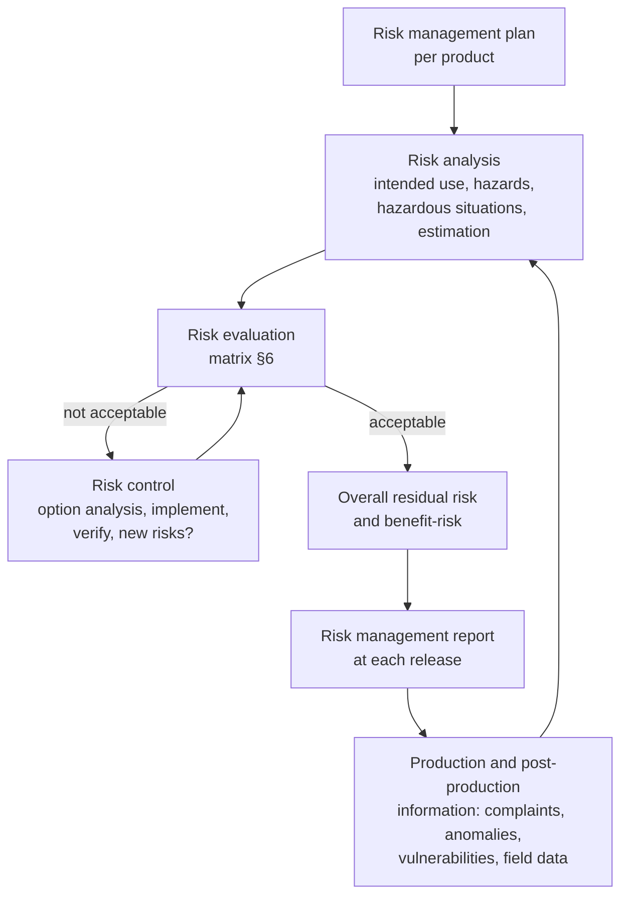

# SOP: Risk management

| | |
|---|---|
| Document | QMS-SOP-003 |
| Status | **DRAFT for approval** (written 2026-11-10 by Hermes/Claude). The scales and the acceptability matrix in §6 are a top-management decision (ISO 14971 §4.2) |
| Requirements | ISO 14971:2019 (FDA recognition 5-125); ISO/TR 24971:2020 (guidance); AAMI TIR80002-1 (software); ANSI/AAMI SW96:2023 (security risk); IEC 62304 §4.2, §7; ISO 13485 §7.1 |
| Related | QMS-SOP-002 (design control), QMS-SOP-010 (cybersecurity), QMS-SOP-005 (complaints), QMS-SOP-004 (CAPA); risk files `docs/dhf/<module>/risk-management.md` |

## 1. Purpose and scope

Defines how Libre Systems identifies hazards, estimates and evaluates risks,
controls them, verifies the controls, judges overall residual risk and keeps
the risk file current through the whole life of each product, including
security risks that can lead to harm. Applies to every Libre RWS module and
to the system.

## 2. Definitions (ISO 14971 §3)

- **Harm:** injury or damage to the health of people (patients, users,
  others). Here mostly *indirect* harm: delayed, missed or wrong diagnosis or
  treatment, or a repeated exam (extra radiation), caused by missing, late,
  wrong-patient or altered images. Privacy harm from disclosure of patient
  data is also assessed (it is harm to people even when not physical).
- **Hazard:** potential source of harm. **Hazardous situation:**
  circumstance in which people are exposed to a hazard.
- **Risk:** combination of the probability of occurrence of harm and its
  severity.
- **Risk control:** measure that reduces risk; it becomes a requirement
  (SRS row naming the hazard) and must be verified.

## 3. Responsibilities

| Role | Responsibility |
|---|---|
| Top management | Approves this SOP, the scales and the acceptability policy (§6); provides competent people; reviews the suitability of the process at management review |
| Risk owner (module lead; interim Patrick Mulcahy) | Keeps the module risk file; leads analyses; proposes controls |
| Developer | Implements controls as requirements; writes verifying tests; assesses risk impact in every PR |
| Independent reviewer | Reviews the risk file at design reviews (when available) |
| QA approver | Approves risk files and the risk management report |

People doing risk analysis need knowledge of the product, its clinical use
(imaging workflow) and of risk management; competence is recorded under
QMS-SOP-007.

## 4. Process overview

## 5. Risk management plan (per product or module)

Each risk file starts with a plan (ISO 14971 §4.4) stating: scope and life
cycle phases covered; responsibilities; requirements for review; the
acceptability criteria (normally §6 of this SOP, with any product-specific
deviation justified); verification activities for risk controls; how
production and post-production information is collected and reviewed.

## 6. Estimation and evaluation

### 6.1 Severity of harm

| Level | Name | Description (imaging-software examples) |
|---|---|---|
| S1 | Negligible | Inconvenience; no effect on care (a query is slow; an admin must re-run a command) |
| S2 | Minor | Short delay in care without injury; temporary privacy concern with no disclosure (study available a few hours late, a non-urgent exam re-sent) |
| S3 | Serious | Injury or impairment requiring intervention, or a meaningful delay of diagnosis/treatment, or a repeat exam with radiation dose; disclosure of one patient's data (prior study missing at reading leads to a missed comparison) |
| S4 | Critical | Permanent impairment or life-threatening injury; disclosure of many patients' data (wrong-patient images lead to wrong treatment; mass PHI breach) |
| S5 | Catastrophic | Death of one or more patients |

### 6.2 Probability of harm

The probability of harm P is estimated as P1 × P2: P1 = probability the
hazardous situation occurs; P2 = probability it leads to harm, taking into
account the external risk controls (the modality keeps images until stored,
the radiologist reviews image content and demographics, the viewer shows the
patient banner).

**Software failures:** IEC 62304 and TIR80002-1 do not accept statistical
failure rates for software. A software defect is assumed to be possible
(probability of the failure = 1, unless excluded by design and shown by
verification); P is then estimated from the circumstances needed for the
hazardous situation and from P2.

| Level | Name | Indicative frequency per installation-year | Meaning |
|---|---|---|---|
| P1 | Improbable | < 10⁻⁴ | Requires several independent failures; not expected in the product's life |
| P2 | Remote | 10⁻⁴ – 10⁻³ | Could happen in the product's life across all sites, unlikely at one |
| P3 | Occasional | 10⁻³ – 10⁻² | Expected to happen a few times across all sites |
| P4 | Probable | 10⁻² – 10⁻¹ | Expected at a site within a few years |
| P5 | Frequent | > 10⁻¹ | Expected at a site every year or more often |

### 6.3 Security risks

Security risks are assessed with SW96 / the cybersecurity file: the
likelihood of a threat is judged by **exploitability** (access needed,
skill, existing controls; CVSS exploitability metrics as a guide) instead of
a probability. When exploitation can lead to harm, the risk is transferred
into the safety risk table with severity per §6.1 and exploitability mapped
to P: high → P4, medium → P3, low → P2, very low (requires several
independent compromises) → P1.

### 6.4 Acceptability matrix (proposal for approval)

| Severity ↓ / Probability → | P1 Improbable | P2 Remote | P3 Occasional | P4 Probable | P5 Frequent |
|---|---|---|---|---|---|
| **S5 Catastrophic** | R | U | U | U | U |
| **S4 Critical** | R | R | U | U | U |
| **S3 Serious** | A | R | R | U | U |
| **S2 Minor** | A | A | R | R | U |
| **S1 Negligible** | A | A | A | A | R |

- **A, acceptable:** no further reduction required; still apply controls
  that are practicable (state-of-the-art baseline).
- **R, reduce as far as possible:** controls must be applied until further
  reduction is not possible or would not improve safety; then acceptable
  only with a documented rationale and a benefit-risk statement.
- **U, unacceptable:** must be reduced into R or A. If it cannot be, the
  design or intended use changes; a benefit-risk argument alone cannot
  accept a U risk.

"As far as possible" (ISO 14971 §7, Annex D of ISO/TR 24971) means reducing
risk without regard to economic considerations where a control is feasible
and does not create a larger risk.

## 7. Risk control

1. **Option analysis in this order** (ISO 14971 §7.1): inherent safety by
   design (e.g. no transcoding, architecture that cannot reach licensing);
   protective measures in the software or its environment (e.g. integrity
   checks, allow-lists, outbox, alarms); information for safety (labeling,
   warnings, training).
2. **Implement:** each control becomes an SRS requirement that names the
   hazard ("Risk control for" column) or a labeling statement in the
   intended-use document; the change follows QMS-SOP-002.
3. **Verify implementation and effectiveness:** every control requirement
   is traced to at least one test (`trace.py`), and the risk file states
   the evidence. Effectiveness is shown by tests that exercise the hazardous
   situation (e.g. bus outage, node failure, invalid configuration), not
   only the happy path.
4. **Residual risk:** re-estimate after controls; evaluate with §6.4.
5. **New risks from controls:** check that a control does not introduce new
   hazards (e.g. a licence check that refuses storage, HAZ-010).
6. **Completeness:** all identified hazardous situations are considered.

## 8. Overall residual risk and benefit-risk

At each release the risk owner evaluates the overall residual risk
(ISO 14971 §8): combined effect of all residual risks, unresolved anomalies
and open vulnerabilities, compared with the clinical benefit of the intended
use. For LibreDCM the benefit is the dependable availability of complete,
unaltered prior and current images to the physician. The result and the
method are written in the risk management report.

## 9. Risk management report

Before every release (release checklist), the report confirms that the plan
was followed, overall residual risk is acceptable, and methods to collect
production and post-production information are in place. It lists: hazards
with initial and residual scores, controls and their verification evidence,
residual risks in R with rationale, open anomalies and vulnerabilities with
their risk assessment, and the overall conclusion. It is approved by the QA
approver; at the QMS baseline and before a submission it is also reviewed by
the independent reviewer.

## 10. Production and post-production information

Inputs reviewed at least at each release and each management review:
complaints and feedback (QMS-SOP-005), anomalies found in testing or the
field (`anomalies.md`), vulnerabilities and SOUP changes (QMS-SOP-010),
CAPAs, published information about similar products (FDA MAUDE and recalls
for LLZ/PACS devices), changes to standards. A new hazard, a higher
probability or severity than estimated, or an ineffective control triggers
an update of the risk file and, if needed, a CAPA.

## 11. Triggers for review of a risk file

- Every PR that the PR template marks as affecting a hazard or risk control.
- New or changed intended use, user group or deployment topology.
- New SOUP or a SOUP major version.
- Complaint, field anomaly or vulnerability with a possible safety impact.
- Before each release and at each management review.

## 12. Records

Risk file per module (`docs/dhf/<module>/risk-management.md`), linked
cybersecurity file, trace matrix, risk management report per release
(inside the release record or as `risk-management-report-<version>.md`),
review evidence in PRs. Retained per QMS-SOP-001.
